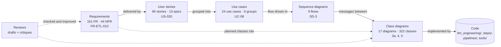

# DigitalTwin: Software Engineering Artifacts

The design of DigitalTwin as one connected set of documents: what the system must do, who uses it and how, and how it is built. Each level traces to the one above it by ID, so you can start anywhere and follow the links up to the requirement or down to the class.

| | |
|---|---|
| Baseline | `main` at `4c40ca7` (ETL stage built, P0; later stages planned) |
| Status | v1.0 of every artifact, for owner approval. Open decisions are in [the overall review](reviews/overall_review.md#5-decisions-needed-from-the-owner-before-sprint-1-ends). |
| Notation | All diagrams are Mermaid, one diagram per file, so each one can be pasted into draw.io ([see below](#working-with-drawio)) |
| Checks | `make docs-check`: links resolve, every diagram renders, every story is in one use case, every cited requirement exists (`make docs-links` skips rendering) |

## How the artifacts connect



| Level | Answers | Folder | Start with | IDs |
|---|---|---|---|---|
| 1. Requirements | *What* must the system do, how well, and in which phase? | [`requirements/`](requirements/requirements.md) | [§1.2 Product summary](requirements/requirements.md#12-product-summary), [§9 Traceability](requirements/requirements.md#9-traceability) | `FR-CFG-001`, `NFR-SEC-002` |
| 2. User stories | *Who* wants it and *why*; in which sprint? | [`user_stories/`](user_stories/user_stories.md) | [Sprint plan](user_stories/user_stories.md#sprint-plan-summary) | `US-001` … `US-096` |
| 3. Use cases | Which *goals* do actors pursue with the system, and how does each go (main and alternative flows)? | [`use_cases/`](use_cases/README.md) | [00 Overview](use_cases/00_overview.md) | `UC-01` … `UC-24` |
| 4. Sequence diagrams | *How* does one flow run, message by message, between real classes? | [`sequence_diagrams/`](sequence_diagrams/README.md) | [SD-0 End to end](sequence_diagrams/sd0_end_to_end.md) | `SD-0` … `SD-8` |
| 5. Class diagrams | *What* are the classes, their members and relations, built and planned? | [`class_diagrams/`](class_diagrams/README.md) | [0 Overview](class_diagrams/00_overview.md) | `0`, `1`, `2a` … `11` |
| History | How each artifact was drafted, critiqued and fixed | [`reviews/`](reviews/overall_review.md) | [Overall review](reviews/overall_review.md) | review finding ids |

**Reading order.** For the big picture, read the requirements summary, the use-case overview, then SD-0 and class diagram 0. For one feature, open its use case and follow the links in its header table. Every use case, sequence diagram and class diagram file starts with the same kind of header table: status, requirements, stories, and links to the related diagrams.

## Follow one feature through every level

Medium articles from RSS, which is implemented today:

| Level | Artifact | What it says |
|---|---|---|
| Requirement | [FR-MED-001](requirements/requirements.md#medium-med) | Article text comes only from official RSS feeds. |
| User story | US-023 in the [backlog](user_stories/user_stories.md#backlog) | "Collect Medium articles … from official RSS feeds only, skipping member-only stories." |
| Use case | [UC-07 Extract content from a provider](use_cases/02_run_etl.md#uc-07-extract-content-from-a-provider) | The extractor turns each source into `RawDocument`s, item by item, without breaking platform rules. |
| Sequence | [SD-2 Medium extraction](sequence_diagrams/sd2_medium_extraction.md) | `MediumExtractor` → `MediumFeedClient` → `medium.com/feed/...`, with the browser only for tag discovery. |
| Classes | [3b Providers: Medium and GitHub](class_diagrams/03b_providers_medium_and_github.md) | `MediumExtractor`, `MediumFeedClient`, `MediumListingPage`, `MediumSettings`. |
| Code | [`llm_engineering/raw_data/sources/medium/`](../llm_engineering/raw_data/sources/medium/) | What the diagrams were read from. |

The same walk works for planned work. For example, FR-ETL-010 (tombstones) → US-020 → [UC-08](use_cases/02_run_etl.md#uc-08-detect-changes-and-deletions-upstream) → [SD-3](sequence_diagrams/sd3_trigger_incremental_etl.md) → [3a](class_diagrams/03a_extraction_framework.md) (`EnumerationResult`).

## Index

### Use cases

| Group | Use cases | Main sequence diagrams |
|---|---|---|
| [00 Overview](use_cases/00_overview.md) | every actor and use case on one diagram | |
| [01 Configure and register sources](use_cases/01_configure_and_register_sources.md) | UC-01 to UC-05 | [SD-1](sequence_diagrams/sd1_etl_pipeline_run.md), [SD-7](sequence_diagrams/sd7_register_source_ui.md) |
| [02 Run the ETL](use_cases/02_run_etl.md) | UC-06 to UC-10 | [SD-1](sequence_diagrams/sd1_etl_pipeline_run.md), [SD-2](sequence_diagrams/sd2_medium_extraction.md), [SD-3](sequence_diagrams/sd3_trigger_incremental_etl.md) |
| [03 Triggers and scheduling](use_cases/03_triggers_and_scheduling.md) | UC-11 to UC-13 | [SD-3](sequence_diagrams/sd3_trigger_incremental_etl.md), [SD-7](sequence_diagrams/sd7_register_source_ui.md) |
| [04 Search index and RAG chat](use_cases/04_rag_chat_and_features.md) | UC-14 to UC-17 | [SD-4](sequence_diagrams/sd4_feature_pipeline.md), [SD-5](sequence_diagrams/sd5_rag_chat.md) |
| [05 Datasets, training and evaluation](use_cases/05_datasets_training_eval.md) | UC-18 to UC-20 | [SD-6](sequence_diagrams/sd6_datasets_training_eval.md) |
| [06 Administration, privacy and operations](use_cases/06_admin_privacy_ops.md) | UC-21 to UC-24 | [SD-8](sequence_diagrams/sd8_account_deletion.md) |

The full use case → stories → requirements → diagrams table is in [`use_cases/README.md`](use_cases/README.md#traceability-use-case--stories--requirements--diagrams).

### Sequence diagrams

| # | Flow | Status |
|---|---|---|
| [SD-0](sequence_diagrams/sd0_end_to_end.md) | End-to-end overview: from a source to an answer | Mixed |
| [SD-1](sequence_diagrams/sd1_etl_pipeline_run.md) | ETL pipeline run (`digital_data_etl`) | Implemented (P0) |
| [SD-2](sequence_diagrams/sd2_medium_extraction.md) | Medium extraction inside a crawl step | Implemented (P0) |
| [SD-3](sequence_diagrams/sd3_trigger_incremental_etl.md) | Trigger to targeted, incremental ETL run | Planned P1 |
| [SD-4](sequence_diagrams/sd4_feature_pipeline.md) | Feature pipeline from a change set | Planned P2 |
| [SD-5](sequence_diagrams/sd5_rag_chat.md) | RAG chat request | Planned P2 (P3 adapter) |
| [SD-6](sequence_diagrams/sd6_datasets_training_eval.md) | Datasets, fine-tuning, evaluation and promotion | Planned P3 |
| [SD-7](sequence_diagrams/sd7_register_source_ui.md) | User registers a source in the UI | Planned P4 |
| [SD-8](sequence_diagrams/sd8_account_deletion.md) | Account deletion | Planned P4 |

### Class diagrams

| Built (P0, with planned additions noted) | Planned |
|---|---|
| [0 Overview](class_diagrams/00_overview.md) · [1 Settings and configuration](class_diagrams/01_settings_and_configuration.md) · [2a Registry core](class_diagrams/02a_registry_core.md) · [2b Source specs](class_diagrams/02b_source_specs.md) · [3a Extraction framework](class_diagrams/03a_extraction_framework.md) · [3b Medium and GitHub](class_diagrams/03b_providers_medium_and_github.md) · [3c LinkedIn, Obsidian and Articles](class_diagrams/03c_providers_linkedin_obsidian_and_articles.md) · [4 Raw storage and versioning](class_diagrams/04_raw_storage_and_versioning.md) · [5 Orchestration](class_diagrams/05_orchestration.md) · [11 Exceptions](class_diagrams/11_exceptions.md) | [6 Triggers and scheduling](class_diagrams/06_triggers_and_scheduling.md) · [7 Feature pipeline](class_diagrams/07_feature_pipeline.md) · [8a Dataset generation](class_diagrams/08a_dataset_generation.md) · [8b Training, registry, evaluation](class_diagrams/08b_training_model_registry_and_evaluation.md) · [9 LLM clients, inference, LLMOps](class_diagrams/09_llm_clients_inference_and_llmops.md) · [10a UI, API and auth](class_diagrams/10a_ui_api_and_authentication.md) · [10b Governance and privacy](class_diagrams/10b_governance_and_privacy_operations.md) |

**Whole system on one diagram:** [`class_diagrams/system_class_diagram.mmd`](class_diagrams/system_class_diagram.mmd) holds the key classes of every subsystem (about 100, grouped by subsystem) and how they interact across subsystems. It is a raw Mermaid file: paste the whole file into draw.io. The numbered diagrams above have the full members.

The design notes (patterns to keep, cross-cutting rules, code mismatches), the class counts and the planned class → requirement map are in [`class_diagrams/README.md`](class_diagrams/README.md#12-design-notes).

## Status at a glance

| Artifact | Built (P0) | Partial | Planned |
|---|---|---|---|
| Functional requirements | 45 | 11 | 105 |
| User stories | 16 done | 12 partially done, 1 on hold | 67 to do |
| Use cases | 1 | 6 | 17 |
| Sequence diagrams | SD-1, SD-2 | SD-0 (mixed) | SD-3 to SD-8 |
| Classes | 124 | | 198 |

**Phases:**
- **P0**: the ETL as built.
- **P1**: ETL hardening and triggers, sprints S1–S4.
- **P2**: feature pipeline and RAG, S5–S8.
- **P3**: datasets, fine-tuning and evaluation, S9–S12.
- **P4**: UI, multi-user and LLMOps, S13–S16.

The phase exit criteria are in [requirements §Release / phase legend](requirements/requirements.md#digitaltwin-software-requirements-specification).

## ID conventions

| Prefix | Meaning | Defined in |
|---|---|---|
| `FR-<GROUP>-nnn` | Functional requirement. Groups: CFG, REG, ETL, MED, GH, LI, OBS, ART, STO, ORC, VER, TRG, UI, FEA, DS, FT, EVAL, INF, OPS, PRV. Inside diagrams the `FR-` is left out (`ETL-010`). | [requirements §2](requirements/requirements.md#2-functional-requirements) |
| `NFR-<GROUP>-nnn` | Non-functional requirement. Groups: PERF, REL, SCL, SEC, PRIV, MNT, OBSV, CMP, COST. | [requirements §3](requirements/requirements.md#3-non-functional-requirements) |
| `US-nnn`, `E1`–`E13` | User story, epic | [user stories](user_stories/user_stories.md) |
| `UC-nn` | Use case | [use cases](use_cases/README.md) |
| `SD-n` | Sequence diagram | [sequence diagrams](sequence_diagrams/README.md) |
| `0`–`11` (`2a`, `3b`, …) | Class diagram number | [class diagrams](class_diagrams/README.md) |
| `P0`–`P4`, `S0`–`S16` | Phase, sprint | requirements, user stories |
| `OQ-nn`, `RISK-nn`, `G1`–`G7` | Open question, risk, goal | [requirements §8](requirements/requirements.md#8-open-questions), [§7](requirements/requirements.md#7-risks), [§1.3](requirements/requirements.md#13-goals) |

IDs are stable. New items get new IDs at the end of their group. Retired ones are marked withdrawn and never reused.

## Working with draw.io

Every diagram lives in its own file, as a single ```` ```mermaid ```` block under its header table.

1. Open the file and copy everything *between* the ```` ```mermaid ```` and ```` ``` ```` lines.
2. In draw.io (desktop or app.diagrams.net), choose **Arrange › Insert › Mermaid**, paste, and click **Insert**.
3. Lay it out, restyle it, or annotate it as you like.
4. To keep that version, save it next to its source with the same name, as an **editable SVG**: **File › Export as › SVG** with *Include a copy of my diagram* checked, saved as `<name>.drawio.svg`, for example `sequence_diagrams/sd3_trigger_incremental_etl.drawio.svg`. GitHub shows it as an image, and draw.io (or the VS Code *Draw.io Integration* extension) reopens it as an editable diagram.
5. Link it from the diagram's `.md` file, for example ``.

Rules that keep this from drifting:
- **The Mermaid block is the source of truth.** A `.drawio.svg` is a view of it. If you change the design in draw.io, carry the change back into the Mermaid block (and its requirement IDs) in the same commit.
- **Large diagrams.** The system class diagram (`.mmd`) is the biggest. Paste it as a whole, then use draw.io's **Arrange › Layout** to tidy it. If one is too dense in draw.io (the class overview, the use-case overview), paste the group diagrams instead. They show the same content in smaller pieces.
- **Use cases.** Mermaid has no use-case diagram type, so these are flowcharts: `«actor»` boxes, stadium-shaped use cases and dotted `«include»` / `«extend»` arrows. After inserting one, you can swap the actor boxes for draw.io's UML stick-figure shape (*UML* library, *Actor*).

## Changing these documents

- Add a requirement in [`requirements/requirements.md`](requirements/requirements.md). Add or retarget a story in [`user_stories/user_stories.md`](user_stories/user_stories.md), including its trace row. Then put the story in exactly one use case.
- A new diagram is a new file in its folder, with the same header table and a row in that folder's `README.md` index and in this hub.
- Planned elements carry their phase and requirement IDs (`<<planned P1 REG-014>>` in class diagrams, the heading and notes in sequence diagrams), so status can be checked against the requirements.
