# 0. Overview

[← Class diagrams](README.md) · [Hub](../README.md) · Next: [1. Settings and configuration](01_settings_and_configuration.md)

| | |
|---|---|
| Status | Implemented, with planned additions |
| Subsystem | Packages and their dependencies (acyclic) |
| Requirements | none |
| Use cases | none |
| Sequence diagrams | [SD-0](../sequence_diagrams/sd0_end_to_end.md), [SD-1](../sequence_diagrams/sd1_etl_pipeline_run.md) |
| draw.io | copy the ```mermaid block below → Arrange › Insert › Mermaid |


Each box is a package. Implemented packages name their modules. Planned packages are marked `planned`. Every package also depends on `exceptions` and `utils`. Those arrows are left out. The dependency graph is acyclic, implemented and planned together. Two leaf packages exist to keep it that way: `governance` (owner scope, purge contract, exclusions), which every store and every per-user read depends on, and `run_tracking`, which owns `TriggerKind` so that triggers depend on run tracking and never the reverse.

```mermaid
classDiagram
  direction TB

  class tools {
    <<package>>
    tools.run
    tools.validate_sources
  }
  class pipelines {
    <<package>>
    pipelines.digital_data_etl
  }
  class steps_etl {
    <<package>>
    steps.etl: sync_registry, select_sources
    crawl_x, crawl, version_raw_data, summarize
  }
  class crawl_config {
    <<package>>
    crawl_config.yaml_loader
  }
  class settings {
    <<package>>
    settings.app_settings, settings.paths
  }
  class topics {
    <<package>>
    topics.models, topics.matcher
  }
  class registry {
    <<package>>
    registry.models, registry.specs
    registry.store, keys, seeder, selector
  }
  class extraction {
    <<package>>
    raw_data.sources.base + 5 providers
    raw_data.crawlers
  }
  class raw_store {
    <<package>>
    raw_data.documents, raw_data.store
  }
  class snapshot {
    <<package>>
    raw_data.snapshot
  }
  class infra_mongo {
    <<package>>
    infrastructure.mongo
  }
  class infra_web {
    <<package>>
    infrastructure.web
  }
  class infra_versioning {
    <<package>>
    infrastructure.versioning
  }
  class exceptions {
    <<package>>
    llm_engineering.exceptions
  }
  class utils {
    <<package>>
    utils.dates, hashing, globs, text
  }

  class governance {
    <<planned P1 leaf>>
    OwnerScope, PurgeScope, Purgeable, Exclusion
  }
  class run_tracking {
    <<planned P1>>
    run records, change sets, locks, TriggerKind
  }
  class triggers {
    <<planned P1>>
    scheduler, pollers, coalescer, dispatcher
  }
  class feature {
    <<planned P2>>
    cleaners, maskers, chunkers, embedders
  }
  class vector_store {
    <<planned P2>>
    VectorStore, Qdrant adapter
  }
  class llm {
    <<planned P2>>
    LLM clients, prompt registry
  }
  class llmops {
    <<planned P1 P2>>
    tracing, cost ledger, budget, alerts, backup
  }
  class inference {
    <<planned P2>>
    retriever, reranker, TwinService
  }
  class evaluation {
    <<planned P2>>
    eval sets, evaluators, promotion gate
  }
  class datasets {
    <<planned P3>>
    selector, generators, filters, versions
  }
  class training {
    <<planned P3>>
    SFT, DPO, compute backends
  }
  class model_registry {
    <<planned P3>>
    model versions, tags, lineage
  }
  class api_ui {
    <<planned P2 P4>>
    REST API, auth, registration, uploads
  }
  class privacy {
    <<planned P1 P4>>
    deletion, export, forget, taint
  }

  tools ..> pipelines : starts
  tools ..> crawl_config : validate_sources
  tools ..> extraction : health checks
  tools ..> registry : Source.from_spec
  tools ..> settings : SOURCE_HEALTH_FILE
  pipelines ..> steps_etl : composes
  steps_etl ..> crawl_config
  steps_etl ..> registry
  steps_etl ..> extraction
  steps_etl ..> raw_store
  steps_etl ..> snapshot
  steps_etl ..> infra_versioning
  steps_etl ..> settings : versioning
  crawl_config ..> registry : specs, User
  crawl_config ..> topics
  crawl_config ..> extraction : PROVIDERS
  crawl_config ..> settings : paths
  registry ..> raw_store : Origin type alias
  registry ..> infra_mongo
  registry ..> settings
  extraction ..> registry : Source, specs
  extraction ..> raw_store : RawDocument
  extraction ..> topics : TopicMatcher
  extraction ..> infra_web : Browser
  extraction ..> settings : GitHub token
  raw_store ..> infra_mongo
  raw_store ..> settings : backend
  snapshot ..> raw_store
  snapshot ..> registry
  infra_mongo ..> settings
  infra_versioning ..> settings

  registry ..> governance : planned Purgeable, Exclusion
  raw_store ..> governance : planned Purgeable
  extraction ..> governance : planned crawl exclusions
  steps_etl ..> run_tracking : planned
  run_tracking ..> infra_mongo
  triggers ..> run_tracking : locks, RunOptions, TriggerKind
  triggers ..> pipelines : runs ETL by source_ids
  triggers ..> registry : state, cursors
  triggers ..> extraction : pollers reuse clients
  feature ..> raw_store
  feature ..> run_tracking : ChangeSet
  feature ..> vector_store
  feature ..> governance
  feature ..> llmops : budget
  vector_store ..> governance : OwnerScope, Purgeable
  llm ..> llmops : budget, cost
  llm ..> model_registry : adapter artifacts
  llmops ..> infra_mongo
  llmops ..> governance : Purgeable
  datasets ..> feature : cleaned docs, chunks
  datasets ..> llm
  datasets ..> governance
  training ..> datasets
  training ..> model_registry
  training ..> evaluation : evaluate, promote
  training ..> llmops : budget
  evaluation ..> inference : evaluates a TwinService
  evaluation ..> llm : judge
  evaluation ..> model_registry : tag production
  inference ..> vector_store
  inference ..> feature : embedder
  inference ..> llm
  inference ..> model_registry : ModelResolver
  inference ..> llmops : tracing, budget
  model_registry ..> governance : Purgeable
  api_ui ..> registry
  api_ui ..> inference
  api_ui ..> triggers : on-demand crawl
  api_ui ..> privacy
  api_ui ..> llmops : rate limits, quotas
  privacy ..> governance
  privacy ..> raw_store : export
  privacy ..> registry : export, user record
  privacy ..> datasets : manifests
  privacy ..> model_registry : taint
```


