# 1. Settings and configuration

[← Class diagrams](README.md) · [Hub](../README.md) · Previous: [0. Overview](00_overview.md) · Next: [2a. Registry core](02a_registry_core.md)

| | |
|---|---|
| Status | Implemented, with planned additions |
| Subsystem | `settings/`, `crawl_config/`, `topics/` |
| Requirements | [ART](../requirements/requirements.md#articles-art) 002 · [CFG](../requirements/requirements.md#21-configuration-and-topics-cfg) 001, 002, 004, 005, 007, 008 · [DS](../requirements/requirements.md#211-dataset-generation-ds) 007 · [FEA](../requirements/requirements.md#210-feature-pipeline-fea) 003, 004, 009 · [INF](../requirements/requirements.md#214-rag-inference-service-inf) 003, 005, 008 · [OPS](../requirements/requirements.md#215-llmops-monitoring-cicd-deployment-ops) 001, 008 · [TRG](../requirements/requirements.md#28-triggers-and-scheduling-trg) 002, 003, 004, 006, 008 · [NFR-CMP](../requirements/requirements.md#38-compliance-and-ethics-cmp) 003 · [NFR-COST](../requirements/requirements.md#39-cost-cost) 001 · [NFR-PRIV](../requirements/requirements.md#35-privacy-priv) 004 · [NFR-SCL](../requirements/requirements.md#33-scalability-scl) 002 |
| Use cases | [UC-01](../use_cases/01_configure_and_register_sources.md#uc-01-declare-topics-and-sources-in-yaml), [UC-02](../use_cases/01_configure_and_register_sources.md#uc-02-check-configuration-and-provider-health) |
| Sequence diagrams | [SD-1](../sequence_diagrams/sd1_etl_pipeline_run.md) |
| draw.io | copy the ```mermaid block below → Arrange › Insert › Mermaid |


`get_settings()` is the only reader of the environment (FR-CFG-004). `YamlLoader` is the only reader of YAML (FR-CFG-001/002/005). Planned settings groups follow the same pattern: one `BaseSettings` class per env prefix, held by `Settings`. The planned `CrawlerSettings` replaces the draft's `CrawlerIdentity` class: the crawler's name, version and contact URL are configuration, and all three HTTP clients (Medium feeds, GitHub, articles) take their User-Agent from it (FR-ART-002, NFR-CMP-003). `TopicMigrator` moved to diagram [4](04_raw_storage_and_versioning.md), next to the other store migration.

Note on names: there are two classes called `GitHubSettings`. This diagram shows the environment one (`settings/app_settings.py`, token). The provider tuning one (`raw_data/sources/github/settings.py`, `request_delay_s`) is in diagram [3b](03b_providers_medium_and_github.md).

```mermaid
classDiagram
  direction TB

  class Settings {
    <<pydantic>>
    +mongo: MongoSettings
    +github: GitHubSettings
    +versioning: VersioningSettings
    +raw_store: RawStoreSettings
  }
  class MongoSettings {
    <<BaseSettings MONGO_>>
    +uri: SecretStr | None
    +scheme: mongodb | mongodb+srv
    +host: str = localhost
    +port: int | None = 27017
    +username: str | None
    +password: SecretStr | None
    +database: str = digital_twin
    +auth_source: str | None = admin
    +options: dict[str, str]
    +timeout_ms: int = 5000
    +«property» connection_string: str
    +«property» display_uri: str
    -_build(password: str | None) str
  }
  class GitHubSettings {
    <<BaseSettings GITHUB_>>
    +token: SecretStr | None
  }
  class VersioningSettings {
    <<BaseSettings DVC_>>
    +enabled: bool = True
    +snapshot_dir: Path = RAW_SNAPSHOT_DIR
    +auto_commit: bool = True
    +auto_push: bool = True
    +remote: str | None
    -_anchor(v: Path) Path$
  }
  class RawStoreSettings {
    <<BaseSettings RAW_STORE_>>
    +backend: StoreBackend = mongo
  }
  class app_settings {
    <<module>>
    +StoreBackend = Literal mongo
    +get_settings() Settings$
    -_env(prefix: str) SettingsConfigDict$
  }
  class paths {
    <<module>>
    +PROJECT_ROOT: Path
    +CONFIG_DIR, TOPICS_FILE, PROVIDERS_DIR, USERS_DIR: Path
    +ENV_FILE: Path
    +DATA_DIR, RAW_SNAPSHOT_DIR, MANIFESTS_DIR, SOURCE_HEALTH_FILE: Path
    +DVC_SETUP_FILES: list[Path]
    +from_root(path: Path) Path$
  }
  class YamlLoader {
    +topics_file: Path
    +providers_dir: Path
    +users_dir: Path
    +read(path: Path) Any$
    +«cached» topics: dict[str, Topic]
    +«cached» providers: dict[str, BaseProviderSettings]
    +«cached» users: dict[str, UserDeclaration]
    +user_dirs() list[Path]
    +load_user(user_dir: Path) UserDeclaration
    +load_specs(path: Path) list[SourceSpec]
    +get_user(user_id: str) UserDeclaration
  }
  class Topic {
    <<pydantic>>
    +description: str
    +medium_tags: list[str]
    +obsidian_tags: list[str]
  }
  class TopicsFile {
    <<pydantic>>
    +topics: dict[str, Topic]
  }
  class TopicMatcher {
    -_by_tag: dict[str, set[str]]
    -_vault_prefixes: list[tuple[str, str]]
    +TopicMatcher(topics: dict[str, Topic])
    +from_tags(tags: Iterable[str]) set[str]
    +from_vault_tags(tags: Iterable[str]) set[str]
  }
  class BaseProviderSettings {
    <<pydantic>>
    extra = forbid
  }
  class UserDeclaration {
    <<pydantic>>
    ref, see 2a
  }
  class Provider {
    <<dataclass>>
    ref, see 3a
  }

  class VectorStoreSettings {
    <<planned P2 FEA-004 NFR-SCL-002>>
    env prefix VECTOR_STORE_
    +backend: qdrant = qdrant
    +url: str
    +api_key: SecretStr | None
    +collection_alias: str
  }
  class EmbeddingSettings {
    <<planned P2 FEA-003 FEA-009>>
    env prefix EMBEDDING_
    +model_name: str
    +dimension: int
    +max_tokens: int
    +max_usd: float
  }
  class LLMSettings {
    <<planned P2 INF-003 DS-007>>
    env prefix LLM_
    +provider: str
    +model: str
    +api_key: SecretStr | None
    +local_only: bool = True
  }
  class BudgetSettings {
    <<planned P2 NFR-COST-001>>
    env prefix BUDGET_
    +monthly_usd: dict[str, float]
    +hard_stop: bool = True
  }
  class ApiSettings {
    <<planned P2 INF-005 INF-008>>
    env prefix API_
    +bearer_token: SecretStr
    +requests_per_minute: int
    +daily_spend_usd: float
  }
  class SchedulerSettings {
    <<planned P1 TRG-002 TRG-004 TRG-006>>
    env prefix SCHEDULER_
    +cadence: dict[str, str]
    +poll_interval_min: int = 15
    +debounce_s: int = 300
    +blocked_cooldown_h: int = 24
    +max_attempts: int = 3
  }
  class TracingSettings {
    <<planned P2 OPS-001 NFR-PRIV-004>>
    env prefix TRACING_
    +enabled: bool = True
    +sample_rate: float = 1.0
    +retention_days: int = 90
  }
  class CrawlerSettings {
    <<planned P1 ART-002 NFR-CMP-003>>
    env prefix CRAWLER_
    +name: str = DigitalTwinCrawler
    +version: str
    +contact_url: str
    +user_agent() str
  }

  Settings "1" *-- "1" MongoSettings
  Settings "1" *-- "1" GitHubSettings
  Settings "1" *-- "1" VersioningSettings
  Settings "1" *-- "1" RawStoreSettings
  app_settings ..> Settings : builds once, cached
  VersioningSettings ..> paths : from_root
  YamlLoader ..> paths : default locations
  YamlLoader ..> TopicsFile : validates
  TopicsFile "1" *-- "1..*" Topic
  YamlLoader ..> Provider : settings_model per provider
  YamlLoader ..> BaseProviderSettings : validates
  YamlLoader ..> UserDeclaration : builds
  TopicMatcher ..> Topic : indexes tags

  Settings "1" *-- "1" VectorStoreSettings : planned
  Settings "1" *-- "1" CrawlerSettings : planned
  Settings "1" *-- "1" EmbeddingSettings : planned
  Settings "1" *-- "1" LLMSettings : planned
  Settings "1" *-- "1" BudgetSettings : planned
  Settings "1" *-- "1" ApiSettings : planned
  Settings "1" *-- "1" SchedulerSettings : planned
  Settings "1" *-- "1" TracingSettings : planned

  note for Topic "planned CFG-007: renamed_from: list[str]"
  note for YamlLoader "module constants PROFILE_FILE = profile.yaml, USER_SOURCES_DIR = sources. planned CFG-008: once the UI exists YAML is only a bootstrap. Records get declared_via = yaml"
```


