# 2a. Registry core

[← Class diagrams](README.md) · [Hub](../README.md) · Previous: [1. Settings and configuration](01_settings_and_configuration.md) · Next: [2b. Source specs](02b_source_specs.md)

| | |
|---|---|
| Status | Implemented, with planned additions |
| Subsystem | `registry/models`, `registry/store`, seeder, selector, keys |
| Requirements | [CFG](../requirements/requirements.md#21-configuration-and-topics-cfg) 008 · [DS](../requirements/requirements.md#211-dataset-generation-ds) 006 · [GH](../requirements/requirements.md#github-gh) 005 · [PRV](../requirements/requirements.md#216-privacy-and-data-subject-operations-prv) 002, 003, 006 · [REG](../requirements/requirements.md#22-source-registry-and-multi-user-reg) 001, 003, 004, 007, 008, 009, 011, 012, 013, 014 · [STO](../requirements/requirements.md#25-raw-storage-sto) 006, 007 · [TRG](../requirements/requirements.md#28-triggers-and-scheduling-trg) 003 · [UI](../requirements/requirements.md#29-source-registration-ui-and-api-ui) 006, 009, 010, 012 · [NFR-SCL](../requirements/requirements.md#33-scalability-scl) 001 |
| Use cases | [UC-01](../use_cases/01_configure_and_register_sources.md#uc-01-declare-topics-and-sources-in-yaml), [UC-04](../use_cases/01_configure_and_register_sources.md#uc-04-register-a-source-through-the-ui-or-api), [UC-05](../use_cases/01_configure_and_register_sources.md#uc-05-manage-subscriptions-and-see-crawl-status), [UC-06](../use_cases/02_run_etl.md#uc-06-run-the-etl-pipeline), [UC-08](../use_cases/02_run_etl.md#uc-08-detect-changes-and-deletions-upstream) |
| Sequence diagrams | [SD-1](../sequence_diagrams/sd1_etl_pipeline_run.md), [SD-3](../sequence_diagrams/sd3_trigger_incremental_etl.md), [SD-7](../sequence_diagrams/sd7_register_source_ui.md), [SD-8](../sequence_diagrams/sd8_account_deletion.md) |
| draw.io | copy the ```mermaid block below → Arrange › Insert › Mermaid |


Users, sources and subscriptions live in MongoDB (`users`, `sources`, `subscriptions`). A source is stored once under its canonical key, and users link to it through subscriptions (FR-REG-001/003). `owner_id` is set only for owned specs (FR-REG-004). Planned: single ownership is enforced inside `RegistryStore.upsert_source`, as an atomic conditional update that raises `OwnershipConflictError`, not by a separate guard class that reads and then writes, so YAML sync and UI writes cannot race past it (FR-REG-012). Reconciliation reports into `SeedStats` and applies the orphan policy itself (FR-REG-008/009, FR-PRV-003). Cursors are persisted inside `SourceState` as a discriminated union on `kind`, like `SourceSpec`, and hold only source-level watermarks (FR-REG-014).

```mermaid
classDiagram
  direction TB

  class User {
    <<pydantic>>
    +id: str  pattern a-z0-9_-
    +name: str
    +handles: dict[str, str]
  }
  class Source {
    <<pydantic>>
    +id: str  canonical key, Mongo _id
    +type: str
    +provider: str
    +spec: dict[str, Any]
    +owner_id: str | None
    +topics: list[str]
    +enabled: bool = True
    +state: SourceState
    +from_spec(spec: SourceSpec, user_id: str) Source$
    +«cached» typed_spec: SourceSpec
  }
  class SourceState {
    <<pydantic>>
    +status: SourceStatus = never
    +last_run_id: str | None
    +last_crawled_at: datetime | None
    +error: str | None
    +items_ok: int
    +items_failed: int
    +items_skipped: int
  }
  class SourceStatus {
    <<enumeration>>
    never
    ok
    failed
  }
  class Subscription {
    <<pydantic>>
    +user_id: str
    +source_id: str
    +created_at: datetime
    +«property» id: str
  }
  class UserDeclaration {
    <<pydantic>>
    +user: User
    +sources: list[SourceSpec]
    -_no_duplicate_sources() UserDeclaration
  }
  class BaseSourceSpec {
    <<abstract>>
    ref, see 2b
    +key(user_id: str) str*
  }
  class RegistryStore {
    <<abstract>>
    +setup() None*
    +upsert_user(user: User) None*
    +upsert_source(source: Source) bool*
    +subscribe(user_id: str, source_id: str) bool*
    +users() list[User]*
    +sources(source_ids: Iterable[str] | None) list[Source]*
    +subscriptions(user_id: str | None) list[Subscription]*
    +record_state(source_id: str, state: SourceState) None*
  }
  class MongoRegistryStore {
    +users_col: Collection
    +sources_col: Collection
    +subscriptions_col: Collection
    +MongoRegistryStore(database: Database | None)
    +setup() None
    +upsert_user(user: User) None
    +upsert_source(source: Source) bool
    +source_upsert_op(source: Source) UpdateOne$
    +subscribe(user_id: str, source_id: str) bool
    +users() list[User]
    +sources(source_ids: Iterable[str] | None) list[Source]
    +subscriptions(user_id: str | None) list[Subscription]
    +record_state(source_id: str, state: SourceState) None
    -_run(operation) Any$
    -_with_id(raw: dict) dict$
    -_model(model, raw: dict, collection: str) BaseModel$
  }
  class registry_store_factory {
    <<module>>
    +create_registry_store(backend: str | None) RegistryStore$
  }
  class RegistrySeeder {
    +store: RegistryStore
    +seed(declarations: list[UserDeclaration]) SeedStats
  }
  class SeedStats {
    <<dataclass>>
    +users: int
    +sources_declared: int
    +sources_new: int
    +subscriptions_new: int
  }
  class SourceSelector {
    +store: RegistryStore
    +select(user_id: str | None, source_ids: list[str] | None) dict[str, list[str]]
  }
  class keys {
    <<module>>
    +TRACKING_PREFIXES: tuple[str, ...]
    +TRACKING_NAMES: set[str]
    +normalize_url(url: str) str$
    +slug(value: str) str$
    +medium_tag_key(tag: str) str$
    +medium_author_key(handle: str) str$
    +article_key(url: str) str$
    +github_user_key(username: str) str$
    +obsidian_key(user_id: str, vault_path: Path) str$
    +linkedin_key(user_id: str) str$
    +subscription_key(user_id: str, source_id: str) str$
  }

  class SourceCursor {
    <<planned abstract P1 REG-014 REG-011>>
    +kind: str  discriminator
    +updated_at: datetime
  }
  class DeclaredVia {
    <<planned enum P4 CFG-008>>
    yaml
    ui
    api
  }
  class DeclarationMerger {
    <<planned P1 REG-013>>
    +merge(source: Source, subscriptions: list[Subscription]) Source
  }
  class RegistryReconciler {
    <<planned P1 REG-008 REG-009 PRV-003>>
    +store: RegistryStore
    +raw: RawDataStore
    +policy: OrphanSourcePolicy
    +reconcile(declarations: list[UserDeclaration], stats: SeedStats) None
    +unsubscribe(user_id: str, source_id: str) None
    -_apply_orphan_policy(source: Source) int
  }
  class OrphanSourcePolicy {
    <<planned enum P1 PRV-003>>
    retain
    purge
  }
  class SelectionResult {
    <<planned P1 REG-007>>
    +by_provider: dict[str, list[str]]
    +skipped_disabled: list[str]
    +skipped_no_consent: list[str]
  }
  class RawDataStore {
    <<abstract>>
    ref, see 4
  }
  class Purgeable {
    <<planned abstract P1 STO-006>>
    ref, see 10b
  }

  RegistryStore <|-- MongoRegistryStore
  registry_store_factory ..> MongoRegistryStore : creates
  Source "1" *-- "1" SourceState : state
  SourceState --> SourceStatus
  Subscription "0..*" --> "1" User : user_id
  Subscription "0..*" --> "1" Source : source_id
  Source "0..*" --> "0..1" User : owner_id
  UserDeclaration "1" *-- "1" User
  UserDeclaration "1" *-- "0..*" BaseSourceSpec : sources
  Source ..> BaseSourceSpec : from_spec, typed_spec
  RegistrySeeder --> RegistryStore
  RegistrySeeder ..> UserDeclaration : reads
  RegistrySeeder ..> Source : creates
  RegistrySeeder ..> SeedStats : returns
  SourceSelector --> RegistryStore
  MongoRegistryStore ..> keys : subscription_key
  Subscription ..> keys : subscription_key
  RegistryStore ..> Source : persists
  RegistryStore ..> User : persists
  RegistryStore ..> Subscription : persists

  SourceState "1" o-- "0..1" SourceCursor : planned cursor
  RegistrySeeder ..> DeclarationMerger : planned
  RegistrySeeder ..> RegistryReconciler : planned, after upserts
  RegistryReconciler --> RegistryStore
  RegistryReconciler --> RawDataStore : orphan purge
  RegistryReconciler ..> SeedStats : fills removed counts
  RegistryReconciler --> OrphanSourcePolicy
  Purgeable <|-- RegistryStore : planned
  SourceSelector ..> SelectionResult : planned return type
  Source ..> DeclaredVia : planned

  note for SourceState "planned REG-014: last_success_at, last_success_run_id, consecutive_failures, cursor: SourceCursor, retry_not_before. record_state merges instead of overwriting; a failed run keeps last_success_at and cursor"
  note for Source "planned: declared_via (CFG-008), schema_version (STO-007), license_allows_training (DS-006)"
  note for Subscription "planned REG-013 CFG-008: topics, enabled and declared_via per subscriber"
  note for RegistryStore "planned REG-012: upsert_source never changes an existing owner_id, conditional update, raises OwnershipConflictError. planned: unsubscribe, delete_subscription, delete_user (REG-008 REG-009 PRV-002), purge(scope) as Purgeable, add_exclusion and exclusions(user_id) (UI-006 PRV-006), record_consent (UI-010)"
  note for MongoRegistryStore "module constants USERS, SOURCES, SUBSCRIPTIONS (collection names) and DECLARATION_FIELDS = type, provider, spec, owner_id, topics, enabled. owner_id in that tuple is the REG-012 gap"
  note for User "planned UI-009 UI-010 UI-012: email, role, disabled, consent: Consent | None, quota overrides"
  note for SeedStats "planned REG-009: subscriptions_removed, users_removed, sources_disabled"
  note for SourceSelector "planned REG-007 UI-010: returns SelectionResult. A source is selected only if a subscriber has a current Consent; an owned source needs its owner's consent"
```


