# 2b. Source specs

[← Class diagrams](README.md) · [Hub](../README.md) · Previous: [2a. Registry core](02a_registry_core.md) · Next: [3a. Extraction framework](03a_extraction_framework.md)

| | |
|---|---|
| Status | Implemented, with planned additions |
| Subsystem | `registry/specs` (the discriminated union) |
| Requirements | [ART](../requirements/requirements.md#articles-art) 005 · [CFG](../requirements/requirements.md#21-configuration-and-topics-cfg) 001, 002 · [DS](../requirements/requirements.md#211-dataset-generation-ds) 006 · [GH](../requirements/requirements.md#github-gh) 006, 007 · [MED](../requirements/requirements.md#medium-med) 007 · [OBS](../requirements/requirements.md#obsidian-obs) 004 · [NFR-CMP](../requirements/requirements.md#38-compliance-and-ethics-cmp) 005 |
| Use cases | [UC-01](../use_cases/01_configure_and_register_sources.md#uc-01-declare-topics-and-sources-in-yaml), [UC-04](../use_cases/01_configure_and_register_sources.md#uc-04-register-a-source-through-the-ui-or-api) |
| Sequence diagrams | none |
| draw.io | copy the ```mermaid block below → Arrange › Insert › Advanced › Mermaid |


The `type` field picks the spec model (Pydantic discriminated union, FR-CFG-002). Each spec knows its `provider`, whether it is `owned`, and how to build its canonical `key()`. Topic keys are checked against `topics.yaml` through the validation context (FR-CFG-001).

```mermaid
classDiagram
  direction TB

  class BaseSourceSpec {
    <<abstract>>
    +provider: str$
    +owned: bool$
    +enabled: bool = True
    +key(user_id: str) str*
    +declared_topics() list[str]
    +referenced_topics() set[str]
    -_check_topics(info: ValidationInfo) BaseSourceSpec
  }
  class GitHubSpec {
    +provider: str = github$
    +owned: bool = True$
    +type: Literal github
    +username: str
    +repos: list[str]
    +exclude_repos: list[str]
    +include_forks: bool = False
    +include: list[str] = README*, *.md, *.py, *.ipynb
    +exclude: list[str]
    +skip_hidden: bool = True
    +max_file_kb: int = 1024
    +min_chars: int = 40
    +topic_rules: list[RepoTopicRule]
    +key(user_id: str) str
    +referenced_topics() set[str]
  }
  class RepoTopicRule {
    <<pydantic>>
    +repo: str  glob
    +topic: str
  }
  class ObsidianSpec {
    +provider: str = obsidian$
    +owned: bool = True$
    +type: Literal obsidian
    +vault_path: Path
    +include: list[str] = *.md
    +exclude: list[str]
    +skip_hidden: bool = True
    +include_hidden: list[str]
    +min_chars: int = 40
    +pdf_include: list[str]
    +pdf_origin: Origin = external
    +pdf_max_mb: float = 100
    +topic_rules: list[TopicRule]
    -_anchor(v: Path) Path$
    +key(user_id: str) str
    +referenced_topics() set[str]
  }
  class TopicRule {
    <<pydantic>>
    +glob: str
    +topic: str
  }
  class LinkedInExportSpec {
    +provider: str = linkedin$
    +owned: bool = True$
    +type: Literal linkedin_export
    +export_dir: Path
    +include: list[posts | articles | comments]
    +min_chars: int = 40
    -_anchor(v: Path) Path$
    +key(user_id: str) str
  }
  class MediumTagSpec {
    +provider: str = medium$
    +owned: bool = False$
    +type: Literal medium_tag
    +tag: str
    +topics: list[str]  min 1
    +key(user_id: str) str
    +declared_topics() list[str]
    +«property» listing_url: str
  }
  class MediumAuthorSpec {
    +provider: str = medium$
    +owned: bool = False$
    +type: Literal medium_author
    +handle: str
    +topics: list[str]  min 1
    -_at_prefix(v: str) str$
    +key(user_id: str) str
    +declared_topics() list[str]
    +«property» listing_url: str
  }
  class ArticleSpec {
    +provider: str = articles$
    +owned: bool = False$
    +type: Literal article
    +url: HttpUrl
    +topics: list[str]
    +origin: Origin = external
    +key(user_id: str) str
    +declared_topics() list[str]
  }
  class SourceSpec {
    <<discriminated union>>
    discriminator = type
    GitHubSpec | ObsidianSpec | LinkedInExportSpec
    MediumTagSpec | MediumAuthorSpec | ArticleSpec
  }
  class specs_registry {
    <<module>>
    +SourceSpec: Annotated union
    +source_spec_adapter: TypeAdapter[SourceSpec]
  }
  class Origin {
    <<enumeration>>
    self
    external
  }
  class keys {
    <<module>>
    ref, see 2a
  }

  BaseSourceSpec <|-- GitHubSpec
  BaseSourceSpec <|-- ObsidianSpec
  BaseSourceSpec <|-- LinkedInExportSpec
  BaseSourceSpec <|-- MediumTagSpec
  BaseSourceSpec <|-- MediumAuthorSpec
  BaseSourceSpec <|-- ArticleSpec
  GitHubSpec "1" *-- "0..*" RepoTopicRule
  ObsidianSpec "1" *-- "0..*" TopicRule
  ObsidianSpec --> Origin : pdf_origin
  ArticleSpec --> Origin : origin
  SourceSpec ..> GitHubSpec : github
  SourceSpec ..> ObsidianSpec : obsidian
  SourceSpec ..> LinkedInExportSpec : linkedin_export
  SourceSpec ..> MediumTagSpec : medium_tag
  SourceSpec ..> MediumAuthorSpec : medium_author
  SourceSpec ..> ArticleSpec : article
  specs_registry ..> SourceSpec : defines, validates
  BaseSourceSpec ..> keys : key()

  note for BaseSourceSpec "planned: owned becomes an instance decision is_owned() for MED-007 and ART-005. planned license_allows_training (DS-006, NFR-CMP-005)"
  note for ArticleSpec "planned ART-005: origin = self gives an owner-scoped key and owner_id"
  note for MediumAuthorSpec "planned MED-007: own: bool"
  note for GitHubSpec "planned: include_private (GH-007), vendored_paths (GH-006)"
  note for ObsidianSpec "planned OBS-004: private_flags, default twin false or private true"
```


