# 3a. Extraction framework

[← Class diagrams](README.md) · [Hub](../README.md) · Previous: [2b. Source specs](02b_source_specs.md) · Next: [3b. Providers: Medium and GitHub](03b_providers_medium_and_github.md)

| | |
|---|---|
| Status | Implemented, with planned additions |
| Subsystem | `raw_data/sources/base`, `raw_data/sources/registry.py` |
| Requirements | [ART](../requirements/requirements.md#articles-art) 002, 003 · [ETL](../requirements/requirements.md#23-extraction-framework-etl) 001, 002, 010, 012 · [GH](../requirements/requirements.md#github-gh) 004 · [MED](../requirements/requirements.md#medium-med) 005, 008 · [OBS](../requirements/requirements.md#obsidian-obs) 004 · [PRV](../requirements/requirements.md#216-privacy-and-data-subject-operations-prv) 006 · [REG](../requirements/requirements.md#22-source-registry-and-multi-user-reg) 011, 014 · [UI](../requirements/requirements.md#29-source-registration-ui-and-api-ui) 006 · [NFR-CMP](../requirements/requirements.md#38-compliance-and-ethics-cmp) 001, 003 · [NFR-REL](../requirements/requirements.md#32-reliability-and-idempotency-rel) 005 |
| Use cases | [UC-02](../use_cases/01_configure_and_register_sources.md#uc-02-check-configuration-and-provider-health), [UC-06](../use_cases/02_run_etl.md#uc-06-run-the-etl-pipeline), [UC-07](../use_cases/02_run_etl.md#uc-07-extract-content-from-a-provider), [UC-08](../use_cases/02_run_etl.md#uc-08-detect-changes-and-deletions-upstream) |
| Sequence diagrams | [SD-1](../sequence_diagrams/sd1_etl_pipeline_run.md) |
| draw.io | copy the ```mermaid block below → Arrange › Insert › Advanced › Mermaid |


`BaseExtractor[S]` is a template method: `extract()` opens `session()`, calls `extract_source()` for each source, records per-source failures and stops the provider on `PROVIDER_WIDE_ERRORS` (`AccessBlockedError`, `AuthenticationError`, `RateLimitError`) (FR-ETL-001/002). `S` is bound to `BaseProviderSettings`. The provider registry maps a name to its settings model and extractor class. Planned: each extractor reports an `EnumerationResult` per source, and `crawl_provider` tombstones only what a complete enumeration no longer lists (FR-ETL-010). Item fingerprints for change detection come from the raw store through the context, so cursors stay small (FR-REG-011).

```mermaid
classDiagram
  direction TB

  class BaseExtractor~S~ {
    <<abstract>>
    +provider: str$
    +settings: S
    +sources: list[Source]
    +context: CrawlContext
    +log: Logger
    +report: CrawlReport
    -_current: Source | None
    +BaseExtractor(settings: S, sources: list[Source], context: CrawlContext)
    +extract() Iterator[RawDocument]
    +session() AbstractContextManager
    +extract_source(source: Source) Iterator[RawDocument]*
    +health_check(*, offline: bool = False) SourceHealth*
    +«property» current: Source
    +record_failed(item: str, reason: str) None
    +record_skipped(item: str, reason: str) None
    +make_document(*, source, id, kind: SourceKind, origin: Origin, content, author, query, rank, topics, owned: bool = True, fields) RawDocument
    +health(ok: bool, summary: str, details) SourceHealth
    -_abort(exc: SourceError, failed: list[Source]) None
    -_fail_sources_without_successes() None
  }
  class BaseProviderSettings {
    <<pydantic>>
    extra = forbid
  }
  class CrawlContext {
    <<dataclass>>
    +run_id: str
    +topics: dict[str, Topic]
    +users: dict[str, User]
    +existing_topics: dict[str, set[str]]
    +matcher: TopicMatcher  set in post_init
    +topic_counts() Counter[str]
    +owner_name(owner_id: str | None) str
  }
  class CrawlReport {
    <<dataclass>>
    +provider: str
    +source_ids: list[str]
    +outcomes: list[ItemOutcome]
    +source_errors: dict[str, str]
    +aborted: str | None
    +ok(source_id, item, title, topics) None
    +failed(source_id, item, reason) None
    +skipped(source_id, item, reason) None
    +source_failed(source_id, reason) None
    +counts(source_id: str | None) dict[str, int]
  }
  class ItemOutcome {
    <<dataclass>>
    +source_id: str
    +item: str
    +status: ItemStatus
    +title: str | None
    +topics: list[str]
    +reason: str | None
  }
  class ItemStatus {
    <<enumeration>>
    ok
    failed
    skipped
  }
  class SourceHealth {
    <<pydantic>>
    +source: str
    +ok: bool
    +summary: str
    +details: dict[str, Any]
  }
  class Provider {
    <<dataclass>>
    frozen
    +name: str
    +settings_model: type[BaseProviderSettings]
    +extractor_class: type[BaseExtractor]
  }
  class provider_registry {
    <<module>>
    +PROVIDERS: dict[str, Provider]
    +get_provider(name: str) Provider$
    +create_extractor(provider, settings, sources, context) BaseExtractor$
  }
  class extractor_module {
    <<module>>
    +PROVIDER_WIDE_ERRORS: AccessBlockedError, AuthenticationError, RateLimitError
  }
  class MediumExtractor {
    +provider = medium$
  }
  class GitHubExtractor {
    +provider = github$
  }
  class LinkedInExportExtractor {
    +provider = linkedin$
  }
  class ObsidianExtractor {
    +provider = obsidian$
  }
  class ArticlesExtractor {
    +provider = articles$
  }
  class MediumSettings
  class ProviderGitHubSettings["GitHubSettings (provider)"]
  class LinkedInSettings
  class ObsidianSettings
  class ArticlesSettings
  class RawDocument {
    <<pydantic>>
    ref, see 4
  }
  class Source {
    <<pydantic>>
    ref, see 2a
  }
  class TopicMatcher {
    ref, see 1
  }

  class SourceCursor {
    <<planned abstract P1 REG-014>>
    ref, see 2a
  }
  class EnumerationResult {
    <<planned P1 ETL-010>>
    +source_id: str
    +complete: bool
    +seen_ids: set[str]
    +missing(stored_ids: set[str]) set[str]
  }
  class CrawlerSettings {
    <<planned P1 ART-002>>
    ref, see 1
  }
  class RetryPolicy {
    <<planned P1 NFR-REL-005 MED-005>>
    +max_retries: int
    +base_delay_s: float
    +timeout_s: float = 60
    +retry_after_s(response) float | None
    +delays() Iterator[float]
  }
  class RobotsPolicy {
    <<planned P1 ART-003>>
    +crawler: CrawlerSettings
    -_cache: dict[str, RobotFileParser]
    +allowed(url: str) bool
  }

  BaseExtractor <|-- MediumExtractor : S = MediumSettings
  BaseExtractor <|-- GitHubExtractor : S = GitHubSettings
  BaseExtractor <|-- LinkedInExportExtractor : S = LinkedInSettings
  BaseExtractor <|-- ObsidianExtractor : S = ObsidianSettings
  BaseExtractor <|-- ArticlesExtractor : S = ArticlesSettings
  BaseProviderSettings <|-- MediumSettings
  BaseProviderSettings <|-- ProviderGitHubSettings
  BaseProviderSettings <|-- LinkedInSettings
  BaseProviderSettings <|-- ObsidianSettings
  BaseProviderSettings <|-- ArticlesSettings
  BaseExtractor "1" --> "1" BaseProviderSettings : settings
  BaseExtractor "1" o-- "0..*" Source : sources
  BaseExtractor "1" --> "1" CrawlContext : context
  BaseExtractor "1" *-- "1" CrawlReport : report
  BaseExtractor ..> RawDocument : yields via make_document
  BaseExtractor ..> SourceHealth : health_check
  BaseExtractor ..> extractor_module : PROVIDER_WIDE_ERRORS
  CrawlReport "1" *-- "0..*" ItemOutcome
  ItemOutcome --> ItemStatus
  CrawlContext "1" *-- "1" TopicMatcher : matcher
  provider_registry "1" *-- "5" Provider
  Provider ..> BaseExtractor : extractor_class
  Provider ..> BaseProviderSettings : settings_model
  provider_registry ..> BaseExtractor : creates

  BaseExtractor ..> EnumerationResult : planned
  BaseExtractor ..> SourceCursor : planned
  RobotsPolicy --> CrawlerSettings : user agent
  CrawlReport "1" *-- "0..*" EnumerationResult : planned

  note for BaseExtractor "planned ETL-012: extract() also contains non-SourceError exceptions per source, logged with traceback. planned REG-011 ETL-010: cursor_for(source) and record_enumeration(result) hooks; unchanged items are reported as skipped: unchanged"
  note for CrawlContext "planned: interactive: bool from RunOptions (MED-008), cursors: dict[str, SourceCursor] (REG-014), fingerprints: dict[str, str] from RawDataStore.fingerprints (REG-011), exclusions: list[Exclusion] with crawl scope (UI-006 PRV-006)"
  note for CrawlReport "module constant STATUSES = ok, failed, skipped. planned ETL-010: one EnumerationResult per source. GH-004: a truncated tree gives complete = False"
  note for RetryPolicy "replaces the private _parse_retry_after of github/client.py and the fixed backoff of MediumFeedClient; used by all three HTTP clients (NFR-REL-005)"
```


