# 3b. Providers: Medium and GitHub

[← Class diagrams](README.md) · [Hub](../README.md) · Previous: [3a. Extraction framework](03a_extraction_framework.md) · Next: [3c. Providers: LinkedIn, Obsidian and Articles](03c_providers_linkedin_obsidian_and_articles.md)

| | |
|---|---|
| Status | Implemented, with planned additions |
| Subsystem | `raw_data/sources/{medium,github}`, `infrastructure/web` |
| Requirements | [CFG](../requirements/requirements.md#21-configuration-and-topics-cfg) 005 · [GH](../requirements/requirements.md#github-gh) 001, 004, 005, 006, 007 · [MED](../requirements/requirements.md#medium-med) 001, 003, 005, 008 · [REG](../requirements/requirements.md#22-source-registry-and-multi-user-reg) 011, 014 · [TRG](../requirements/requirements.md#28-triggers-and-scheduling-trg) 003 |
| Use cases | [UC-07](../use_cases/02_run_etl.md#uc-07-extract-content-from-a-provider) |
| Sequence diagrams | [SD-2](../sequence_diagrams/sd2_medium_extraction.md), [SD-3](../sequence_diagrams/sd3_trigger_incremental_etl.md) |
| draw.io | copy the ```mermaid block below → Arrange › Insert › Advanced › Mermaid |


Medium article text comes only from official RSS feeds (FR-MED-001). The browser is used only to discover `medium_tag` links and falls back to the tag feed when blocked (FR-MED-003). GitHub uses the REST API for repos and trees and the raw host for file bodies (FR-GH-001).

```mermaid
classDiagram
  direction TB

  class BaseExtractor~S~ {
    <<abstract>>
    ref, see 3a
  }
  class MediumExtractor {
    +provider: str = medium$
    +counts: Counter[str]
    +known: dict[str, set[str]]
    +feeds: MediumFeedClient
    +listing: MediumListingPage | None
    +listing_blocked: bool
    +session() AbstractContextManager  «contextmanager»
    -_browser() Browser
    +extract_source(source: Source) Iterator[RawDocument]
    -_author_articles(source, spec: MediumAuthorSpec) Iterator[RawDocument]
    -_tag_articles(source, spec: MediumTagSpec) Iterator[RawDocument]
    -_discover(spec: MediumTagSpec) list[str]
    -_find_in_feed(url: str) FeedEntry | None
    -_accept(source, spec, entry: FeedEntry, rank: int) RawDocument | None
    +article_topics(spec, tags: list[str]) set[str]
    +health_check(*, offline: bool = False) SourceHealth
  }
  class MediumSettings {
    +limit_per_topic: int = 100
    +skip_member_only: bool = True
    +feed_delay_s: float = 3.0
    +feed_max_retries: int = 3
    +headless: bool = True
    +browser_binary: str | None
    +user_data_dir: Path | None
    +profile_directory: str | None
    +page_load_timeout_s: float = 30
    +max_scrolls: int = 80
    +action_delay_min_s: float = 2.0
    +action_delay_max_s: float = 5.0
    -_delays_ordered() MediumSettings
  }
  class MediumFeedClient {
    +source: str
    +delay_s: float = 3.0
    +max_retries: int = 3
    -_http: httpx.Client
    -_cache: dict[str, list[FeedEntry]]
    -_last_request: float
    +MediumFeedClient(*, source: str, delay_s: float = 3.0, max_retries: int = 3)
    +author_feed(handle: str) list[FeedEntry]
    +tag_feed(tag: str) list[FeedEntry]
    +entries(feed_url: str) list[FeedEntry]
    -_get(url: str) str
    +enter() MediumFeedClient
    +exit() None
  }
  class FeedEntry {
    <<dataclass>>
    +article_id: str
    +url: str
    +title: str | None
    +author: str | None
    +published_at: datetime | None
    +tags: list[str]
    +content: str
    +full_text: bool
    +from_feedparser(entry) FeedEntry$
  }
  class MediumListingPage {
    +browser: Browser
    +max_scrolls: int
    +MediumListingPage(browser: Browser, *, max_scrolls: int)
    +collect(url: str, limit: int) list[str]
  }
  class medium_feed_client {
    <<module>>
    +MEDIUM: str = https://medium.com
    +USER_AGENT: str = Mozilla/5.0 ... DigitalTwinCrawler/0.1
    +feed_url_for_article(url: str) str | None$
  }
  class medium_listing_page {
    <<module>>
    +ARTICLE_PATH: Pattern
    +NON_ARTICLE_PREFIXES: tuple[str, ...]
    +article_id(url: str) str | None$
    +article_links(html: str) list[str]$
  }
  class Browser {
    +source: str
    +headless: bool
    +page_load_timeout_s: float
    +challenge_wait_s: float
    +binary_path: str | None
    +user_data_dir: Path | None
    +profile_directory: str | None
    +delay_s: tuple[float, float]
    -_driver: webdriver.Chrome | None
    +Browser(*, source, headless = True, page_load_timeout_s = 30, challenge_wait_s = None, binary_path, user_data_dir, profile_directory, delay_s)
    +enter() Browser
    +exit() None
    +«property» driver: webdriver.Chrome
    +«property» page_source: str
    +pause() None
    +open(url: str) str
    +scroll_down() bool
    +is_challenge(html: str) bool$
    -_wait_for_challenge(url: str) str
    -_profile_hint() str
  }
  class GitHubExtractor {
    +provider: str = github$
    +client: GitHubClient
    -_client() GitHubClient$
    +session() AbstractContextManager  «contextmanager»
    +extract_source(source: Source) Iterator[RawDocument]
    -_repo_documents(source, spec: GitHubSpec, repo: dict) Iterator[RawDocument]
    -_file_text(repo: dict, path: str) str | None
    -_repo_topics(spec: GitHubSpec, repo: dict) set[str]
    +health_check(*, offline: bool = False) SourceHealth
  }
  class ProviderGitHubSettings["GitHubSettings (provider)"] {
    +request_delay_s: float = 0.5
  }
  class AppGitHubSettings["GitHubSettings (app_settings)"] {
    <<BaseSettings GITHUB_>>
    +token: SecretStr | None
  }
  class GitHubClient {
    +source: str
    -_http: httpx.Client
    +GitHubClient(*, source: str, token: str | None)
    +user_repos(username: str) list[dict]
    +repo_tree(repo: dict) dict
    +raw_file(repo: dict, path: str) str
    +rate_limit_remaining() int
    -_get(url: str, params: dict | None) httpx.Response
    +enter() GitHubClient
    +exit() None
  }
  class github_files {
    <<module>>
    +DOC_SUFFIXES: set[str]
    +select_repos(repos: list[dict], cfg: GitHubSpec) list[dict]$
    +is_wanted(path: str, size: int, cfg: GitHubSpec) bool$
    +select_files(tree: dict, cfg: GitHubSpec) list[str]$
    +file_type(path: str) str$
  }
  class github_client_module {
    <<module>>
    +API: str = https://api.github.com
    +RAW: str = https://raw.githubusercontent.com
    -_parse_retry_after(resp: httpx.Response) float | None$
  }
  class github_notebook {
    <<module>>
    +notebook_to_markdown(raw: str) str$
  }
  class MediumTagSpec {
    ref, see 2b
  }
  class MediumAuthorSpec {
    ref, see 2b
  }
  class GitHubSpec {
    ref, see 2b
  }

  class HttpCursor {
    <<planned P1 REG-011 REG-014 TRG-003>>
    +kind: http
    +etag: str | None
    +last_modified: str | None
    +last_guid: str | None
  }
  class GitHubCursor {
    <<planned P1 GH-005 REG-011>>
    +kind: github
    +pushed_at: dict[str, datetime]  per repo
  }
  class SourceCursor {
    <<planned abstract P1 REG-014>>
    ref, see 2a
  }
  class VendoredCodeClassifier {
    <<planned P2 GH-006>>
    +vendored_paths: list[str]
    +is_vendored(path: str, text: str) bool
  }
  class RetryPolicy {
    <<planned P1 MED-005>>
    ref, see 3a
  }

  BaseExtractor <|-- MediumExtractor
  BaseExtractor <|-- GitHubExtractor
  MediumExtractor --> MediumSettings : settings
  MediumExtractor "1" *-- "1" MediumFeedClient : feeds, per session
  MediumExtractor "1" *-- "0..1" MediumListingPage : listing, tag sources only
  MediumExtractor ..> Browser : creates in session
  MediumExtractor ..> medium_feed_client : feed_url_for_article
  MediumExtractor ..> medium_listing_page : article_id
  MediumFeedClient ..> medium_feed_client : USER_AGENT
  MediumExtractor ..> MediumTagSpec
  MediumExtractor ..> MediumAuthorSpec
  MediumFeedClient ..> FeedEntry : parses
  MediumListingPage --> Browser
  MediumListingPage ..> medium_listing_page : article_links
  GitHubExtractor --> ProviderGitHubSettings : settings
  GitHubExtractor "1" *-- "1" GitHubClient : client, per session
  GitHubExtractor ..> AppGitHubSettings : token via get_settings
  GitHubExtractor ..> github_files
  GitHubExtractor ..> github_notebook : notebook_to_markdown
  GitHubExtractor ..> GitHubSpec
  GitHubClient ..> github_client_module : API, RAW, retry after

  SourceCursor <|-- HttpCursor
  SourceCursor <|-- GitHubCursor
  MediumExtractor ..> HttpCursor : planned
  GitHubExtractor ..> GitHubCursor : planned
  GitHubExtractor ..> VendoredCodeClassifier : planned
  MediumFeedClient ..> RetryPolicy : planned
  GitHubClient ..> RetryPolicy : planned

  note for MediumSettings "skip_member_only is declared but never read (CFG-005). planned MED-008: interactive flag, browser only when interactive"
  note for MediumFeedClient "planned MED-005: honour Retry-After, 5xx exhaustion raises SourceUnavailableError. _find_in_feed must re-raise RateLimitError"
  note for GitHubClient "planned: truncated tree gives EnumerationResult complete = False and a report entry (GH-004), blob sha into metadata.sha and compared with CrawlContext.fingerprints (GH-005), /user/repos with opt-in (GH-007), UA from CrawlerSettings"
  note for Browser "module constants CHALLENGE_MARKERS, DEFAULT_PROFILE_DIRS. challenge_wait_s defaults to 15 s headless, 30 s headed"
```


