# 3c. Providers: LinkedIn, Obsidian and Articles

[← Class diagrams](README.md) · [Hub](../README.md) · Previous: [3b. Providers: Medium and GitHub](03b_providers_medium_and_github.md) · Next: [4. Raw storage and versioning](04_raw_storage_and_versioning.md)

| | |
|---|---|
| Status | Implemented, with planned additions |
| Subsystem | `raw_data/sources/{linkedin,obsidian,articles}`, `raw_data/crawlers` |
| Requirements | [ART](../requirements/requirements.md#articles-art) 001, 002, 003, 004 · [ETL](../requirements/requirements.md#23-extraction-framework-etl) 005 · [GH](../requirements/requirements.md#github-gh) 005 · [LI](../requirements/requirements.md#linkedin-li) 001 · [OBS](../requirements/requirements.md#obsidian-obs) 002, 004, 006 · [REG](../requirements/requirements.md#22-source-registry-and-multi-user-reg) 011, 014 · [TRG](../requirements/requirements.md#28-triggers-and-scheduling-trg) 003 |
| Use cases | [UC-07](../use_cases/02_run_etl.md#uc-07-extract-content-from-a-provider), [UC-09](../use_cases/02_run_etl.md#uc-09-upload-a-linkedin-export-or-obsidian-vault) |
| Sequence diagrams | none |
| draw.io | copy the ```mermaid block below → Arrange › Insert › Advanced › Mermaid |


LinkedIn is read only from the official export (FR-LI-001). Obsidian notes are the owner's writing, and vault PDFs are `external` by default with no `owner_id` (FR-ETL-005, FR-OBS-002). Articles are fetched by plain HTTP and converted to markdown (FR-ART-001).

```mermaid
classDiagram
  direction TB

  class BaseExtractor~S~ {
    <<abstract>>
    ref, see 3a
  }
  class LinkedInExportExtractor {
    +provider: str = linkedin$
    +export(source: Source) LinkedInExport$
    +extract_source(source: Source) Iterator[RawDocument]
    -_from_csv(source, export: LinkedInExport, filename: str, parse: Callable) Iterator[RawDocument]
    -_document(source, item: LinkedInItem) RawDocument | None
    +health_check(*, offline: bool = False) SourceHealth
  }
  class LinkedInSettings {
    no fields yet
  }
  class LinkedInExport {
    +root: Path
    +source: str
    +LinkedInExport(root: Path, *, source: str)
    +exists() bool
    +find(name: str) Path | None
    +article_files() list[Path]
    +read_csv(path: Path) Iterator[dict[str, str]]
    +read_text(path: Path) str
  }
  class LinkedInItem {
    <<dataclass>>
    +kind: SourceKind
    +native_id: str
    +text: str
    +title: str | None
    +url: str | None
    +created_at: datetime | None
    +metadata: dict[str, Any]
    +«property» hashtags: list[str]
  }
  class linkedin_parsers {
    <<module>>
    +HASHTAG, DATE_PREFIX: Pattern
    +parse_post(row: dict[str, str]) LinkedInItem$
    +parse_comment(row: dict[str, str]) LinkedInItem$
    +parse_article(html: str, path: Path) LinkedInItem$
  }
  class ObsidianExtractor {
    +provider: str = obsidian$
    +vault(source: Source) ObsidianVault$
    +extract_source(source: Source) Iterator[RawDocument]
    -_note_document(source, spec: ObsidianSpec, note: Note) RawDocument | None
    -_pdf_document(source, spec: ObsidianSpec, root: Path, rel: Path) RawDocument | None
    -_topics(spec: ObsidianSpec, rel: str, tags: list[str]) set[str]
    +health_check(*, offline: bool = False) SourceHealth
  }
  class ObsidianSettings {
    no fields yet
  }
  class ObsidianVault {
    +root: Path
    +include: list[str]
    +exclude: list[str]
    +skip_hidden: bool = True
    +include_hidden: list[str]
    +source: str
    +ObsidianVault(root: Path, *, include, exclude, skip_hidden = True, include_hidden = None, source = obsidian)
    +exists() bool
    +wanted(rel: str, include: list[str]) bool
    +notes() Iterator[Note]
    +pdf_paths(patterns: list[str]) Iterator[Path]
  }
  class ObsidianNote["Note"] {
    <<dataclass>>
    +path: Path
    +body: str
    +metadata: dict
    +tags: list[str]
    +modified_at: datetime | None
    +«property» rel: str
  }
  class CodeAwareObsidianLoader {
    -_parse_document_tags(content: str) set[str]
  }
  class ObsidianLoader {
    <<external>>
    langchain_community
  }
  class PdfText {
    <<dataclass>>
    +text: str
    +pages: int
    +title: str | None
    +author: str | None
  }
  class obsidian_markdown {
    <<module>>
    +EMBED, WIKILINK, CODE_FENCE: Pattern
    +clean_obsidian_markdown(text: str) str$
    +strip_code_fences(text: str) str$
  }
  class obsidian_pdf_reader {
    <<module>>
    +PAGE_BREAK: str
    +read_pdf(path: Path, *, source: str) PdfText$
  }
  class ArticlesExtractor {
    +provider: str = articles$
    +«property» crawler: CustomArticleCrawler
    +extract_source(source: Source) Iterator[RawDocument]
    +health_check(*, offline: bool = False) SourceHealth
  }
  class ArticlesSettings {
    +request_delay_s: float = 1.0
    +min_chars: int = 200
  }
  class CustomArticleCrawler {
    +source: str
    +min_chars: int = 200
    -_transformer: Html2TextTransformer
    +CustomArticleCrawler(*, source: str, min_chars: int = 200)
    +crawl(url: str) CrawledArticle
    -_fetch(url: str) Document
    +to_article(html_doc: Document) CrawledArticle
  }
  class CrawledArticle {
    <<dataclass>>
    +url: str
    +title: str | None
    +content: str
    +metadata: dict[str, Any]
  }
  class LinkedInExportSpec {
    ref, see 2b
  }
  class ObsidianSpec {
    ref, see 2b
  }
  class ArticleSpec {
    ref, see 2b
  }

  class SourceCursor {
    <<planned abstract P1 REG-014>>
    ref, see 2a
  }
  class VaultCursor {
    <<planned P1 REG-011>>
    +kind: vault
    +mtime_watermark: datetime
  }
  class HttpCursor {
    <<planned P1 REG-011>>
    ref, see 3b
  }
  class RobotsPolicy {
    <<planned P1 ART-003>>
    ref, see 3a
  }
  class CrawlerSettings {
    <<planned P1 ART-002>>
    ref, see 1
  }

  BaseExtractor <|-- LinkedInExportExtractor
  BaseExtractor <|-- ObsidianExtractor
  BaseExtractor <|-- ArticlesExtractor
  LinkedInExportExtractor --> LinkedInSettings : settings
  LinkedInExportExtractor ..> LinkedInExport : creates per source
  LinkedInExportExtractor ..> linkedin_parsers
  LinkedInExportExtractor ..> LinkedInExportSpec
  linkedin_parsers ..> LinkedInItem : creates
  ObsidianExtractor --> ObsidianSettings : settings
  ObsidianExtractor ..> ObsidianVault : creates per source
  ObsidianExtractor ..> obsidian_markdown : clean_obsidian_markdown
  ObsidianExtractor ..> obsidian_pdf_reader : read_pdf
  ObsidianExtractor ..> ObsidianSpec
  ObsidianVault ..> CodeAwareObsidianLoader : loads notes
  ObsidianVault ..> ObsidianNote : yields
  ObsidianLoader <|-- CodeAwareObsidianLoader
  obsidian_pdf_reader ..> PdfText : returns
  CodeAwareObsidianLoader ..> obsidian_markdown : strip_code_fences
  ArticlesExtractor --> ArticlesSettings : settings
  ArticlesExtractor ..> CustomArticleCrawler : creates
  ArticlesExtractor ..> ArticleSpec
  CustomArticleCrawler ..> CrawledArticle : returns

  SourceCursor <|-- VaultCursor
  SourceCursor <|-- HttpCursor
  ObsidianExtractor ..> VaultCursor : planned
  ArticlesExtractor ..> HttpCursor : planned
  CustomArticleCrawler ..> RobotsPolicy : planned
  CustomArticleCrawler ..> CrawlerSettings : planned UA

  note for ObsidianVault "module constant FILE_KEYS. planned OBS-006: load notes one file at a time so one bad note fails only itself. planned OBS-004: is_private(note) from ObsidianSpec.private_flags; a private note is skipped, and its stored copy is tombstoned because the complete enumeration no longer lists it"
  note for CustomArticleCrawler "module constants USER_AGENT (a copied desktop Chrome string today) and CRAWLER_NAME. planned ART-002: UA from CrawlerSettings. planned ART-004: to_article reads the meta author byline, so CrawledArticle gains author"
  note for LinkedInExport "module constants SHARES_CSV = Shares.csv, COMMENTS_CSV = Comments.csv, defined in export_files.py"
```


