# 4. Raw storage and versioning

[← Class diagrams](README.md) · [Hub](../README.md) · Previous: [3c. Providers: LinkedIn, Obsidian and Articles](03c_providers_linkedin_obsidian_and_articles.md) · Next: [5. Orchestration](05_orchestration.md)

| | |
|---|---|
| Status | Implemented, with planned additions |
| Subsystem | `raw_data/{documents,store,snapshot}`, `infrastructure/{mongo,versioning}`, planned migrations |
| Requirements | [CFG](../requirements/requirements.md#21-configuration-and-topics-cfg) 007 · [ETL](../requirements/requirements.md#23-extraction-framework-etl) 006, 010, 013 · [GH](../requirements/requirements.md#github-gh) 005 · [OPS](../requirements/requirements.md#215-llmops-monitoring-cicd-deployment-ops) 009 · [ORC](../requirements/requirements.md#26-orchestration-and-cli-orc) 007 · [PRV](../requirements/requirements.md#216-privacy-and-data-subject-operations-prv) 002 · [REG](../requirements/requirements.md#22-source-registry-and-multi-user-reg) 011 · [STO](../requirements/requirements.md#25-raw-storage-sto) 002, 005, 006, 007 · [VER](../requirements/requirements.md#27-data-versioning-ver) 001, 002, 006, 007, 008 |
| Use cases | [UC-06](../use_cases/02_run_etl.md#uc-06-run-the-etl-pipeline), [UC-08](../use_cases/02_run_etl.md#uc-08-detect-changes-and-deletions-upstream), [UC-10](../use_cases/02_run_etl.md#uc-10-restore-a-raw-data-snapshot), [UC-23](../use_cases/06_admin_privacy_ops.md#uc-23-delete-my-account) |
| Sequence diagrams | [SD-1](../sequence_diagrams/sd1_etl_pipeline_run.md), [SD-3](../sequence_diagrams/sd3_trigger_incremental_etl.md), [SD-4](../sequence_diagrams/sd4_feature_pipeline.md), [SD-8](../sequence_diagrams/sd8_account_deletion.md) |
| draw.io | copy the ```mermaid block below → Arrange › Insert › Advanced › Mermaid |


`RawDataStore` is the repository for `RawDocument`. Upserts are idempotent by `_id`. Topics and `source_ids` are merged, and provenance is appended and capped at 50 (FR-STO-002, FR-ETL-006). After each run, the exporter writes deterministic JSONL that DVC versions (FR-VER-001/002). Planned: `RawDataStore` becomes `Purgeable` (diagram [10b](10b_governance_and_privacy_operations.md)), tombstones only what a complete enumeration no longer lists, and exposes per-source fingerprints for change detection. `TopicMigrator` (moved from diagram [1](01_settings_and_configuration.md)) and `SchemaMigrator` are the two store migrations.

```mermaid
classDiagram
  direction TB

  class RawDocument {
    <<pydantic>>
    +id: str
    +provider: str
    +source: SourceKind
    +owner_id: str | None
    +source_ids: list[str]
    +origin: Origin
    +title: str | None
    +content: str
    +url: str | None
    +author: str
    +created_at: datetime | None
    +updated_at: datetime | None
    +content_hash: str
    +topics: list[str]
    +provenance: list[Provenance]
    +metadata: dict[str, Any]
  }
  class Provenance {
    <<pydantic>>
    +source_id: str
    +query: str
    +rank: int | None
    +run_id: str
    +collected_at: datetime
  }
  class SourceKind {
    <<enumeration>>
    medium
    linkedin_post
    linkedin_article
    linkedin_comment
    obsidian
    github
    article
  }
  class Origin {
    <<enumeration>>
    self
    external
  }
  class RawDataStore {
    <<abstract>>
    +setup() None*
    +upsert_many(docs: Iterable[RawDocument]) UpsertStats*
    +find(provider: str | None, owner_id: str | None) Iterator[RawDocument]*
    +topics_by_id(provider: str) dict[str, set[str]]*
    +counts_by_topic(provider: str) Counter[str]*
    +count(provider: str | None) int*
  }
  class MongoRawDataStore {
    +collection: Collection
    +MongoRawDataStore(database: Database | None)
    +setup() None
    +upsert_many(docs: Iterable[RawDocument]) UpsertStats
    -_upsert_op(doc: RawDocument) UpdateOne$
    +find(provider: str | None, owner_id: str | None) Iterator[RawDocument]
    +topics_by_id(provider: str) dict[str, set[str]]
    +counts_by_topic(provider: str) Counter[str]
    +count(provider: str | None) int
    -_filter(provider: str | None) dict$
    -_to_document(raw: dict) RawDocument$
  }
  class UpsertStats {
    <<dataclass>>
    +inserted: int = 0
    +matched: int = 0
    +iadd(other: UpsertStats) UpsertStats
  }
  class raw_store_factory {
    <<module>>
    +create_raw_data_store(backend: str | None) RawDataStore$
  }
  class mongo_client {
    <<module>>
    +get_client() MongoClient$
    +get_database() Database$
  }
  class RawDataSnapshotExporter {
    +store: RawDataStore
    +registry: RegistryStore
    +out_dir: Path
    +export(providers: list[str]) dict[str, int]
    -_write(path: Path, records: Iterable[BaseModel], exclude: set[str] | None) int$
  }
  class DvcRepo {
    +root: Path = PROJECT_ROOT
    -_dvc(args: str) str
    +add(path: Path) Path
    +push(remote: str | None) None
    +tracked_hash(pointer: Path) str
  }
  class GitRepo {
    +root: Path = PROJECT_ROOT
    -_git(args: str, ok_codes: tuple[int, ...]) CompletedProcess
    +commit_paths(paths: list[Path], message: str) str | None
  }
  class versioning_command {
    <<module>>
    +run_command(args: list[str], cwd: Path, *, ok_codes: tuple[int, ...]) CompletedProcess$
  }
  class RegistryStore {
    <<abstract>>
    ref, see 2a
  }

  class TopicMigrator {
    <<planned P2 CFG-007>>
    +stale_topics(topics: dict[str, Topic], store: RawDataStore) dict[str, int]
    +apply_renames(topics: dict[str, Topic], store: RawDataStore) int
  }
  class Topic {
    <<pydantic>>
    ref, see 1
  }
  class Purgeable {
    <<planned abstract P1 STO-006>>
    ref, see 10b
  }
  class SchemaMigration {
    <<planned abstract P1 STO-007>>
    +from_version: int
    +to_version: int
    +apply(raw: dict) dict*
  }
  class SchemaMigrator {
    <<planned P1 STO-007>>
    +CURRENT_VERSION: int$
    +migrations: list[SchemaMigration]
    +upgrade(raw: dict) dict
    +run(store: RawDataStore) int
  }
  class SnapshotPublisher {
    <<planned P1 VER-006>>
    +dvc: DvcRepo
    +git: GitRepo
    +branch: str = data
    +publish(snapshot_dir: Path, message: str) SnapshotRef
  }
  class SnapshotRef {
    <<planned P1 VER-006 ORC-007>>
    +data_md5: str
    +git_commit: str | None
    +ref_name: str
  }
  class SnapshotRestorer {
    <<planned P1 VER-007>>
    +restore(rev: str, store: RawDataStore, registry: RegistryStore) dict[str, int]
  }
  class SnapshotLayout {
    <<planned P4 VER-008>>
    +path_for(doc: RawDocument) Path
  }

  RawDocument "1" *-- "0..50" Provenance : provenance
  RawDocument --> SourceKind : source
  RawDocument --> Origin
  RawDataStore <|-- MongoRawDataStore
  RawDataStore ..> RawDocument : persists
  RawDataStore ..> UpsertStats : returns
  raw_store_factory ..> MongoRawDataStore : creates
  MongoRawDataStore ..> mongo_client : get_database
  RawDataSnapshotExporter --> RawDataStore
  RawDataSnapshotExporter --> RegistryStore
  DvcRepo ..> versioning_command
  GitRepo ..> versioning_command

  TopicMigrator ..> RawDataStore
  TopicMigrator ..> Topic : renamed_from
  Purgeable <|-- RawDataStore : planned
  SchemaMigrator "1" o-- "0..*" SchemaMigration
  SchemaMigrator ..> RawDataStore
  SnapshotPublisher --> DvcRepo
  SnapshotPublisher --> GitRepo
  SnapshotPublisher ..> SnapshotRef : returns
  SnapshotRestorer ..> RawDataStore
  SnapshotRestorer ..> RegistryStore
  RawDataSnapshotExporter ..> SnapshotLayout : planned

  note for RawDocument "planned: deleted_at (ETL-010 STO-006), changed_at and previous_content_hash (STO-005), schema_version (STO-007), metadata.sha for GitHub (GH-005), topics_by_source: dict[str, list[str]] so that ETL-013 can replace one source's derived topics"
  note for RawDataStore "planned STO-006: tombstone(ids), untombstone on upsert, purge(scope) as Purgeable, find(include_deleted=False). planned REG-011: fingerprints(source_id) dict[str, str]. planned ETL-013: replace_derived_topics(source_id, doc_id, topics); counts exclude tombstoned documents"
  note for MongoRawDataStore "module constants COLLECTION = raw_documents, PROVENANCE_KEPT = 50"
  note for RawDataSnapshotExporter "module constants SNAPSHOT_EXCLUDE = provenance, REGISTRY_DIR = registry. Sources are written without state"
  note for UpsertStats "planned STO-005: changed, unchanged, inserted_ids, changed_ids for the ChangeSet"
```


