# 5. Orchestration

[← Class diagrams](README.md) · [Hub](../README.md) · Previous: [4. Raw storage and versioning](04_raw_storage_and_versioning.md) · Next: [6. Triggers and scheduling (planned)](06_triggers_and_scheduling.md)

| | |
|---|---|
| Status | Implemented, with planned additions |
| Subsystem | `pipelines/`, `steps/etl/`, `tools/`, planned run records, change sets, locks, trigger kinds |
| Requirements | [ETL](../requirements/requirements.md#23-extraction-framework-etl) 003, 010, 012 · [MED](../requirements/requirements.md#medium-med) 008 · [OPS](../requirements/requirements.md#215-llmops-monitoring-cicd-deployment-ops) 006 · [ORC](../requirements/requirements.md#26-orchestration-and-cli-orc) 001, 003, 004, 006, 007, 008 · [REG](../requirements/requirements.md#22-source-registry-and-multi-user-reg) 011 · [STO](../requirements/requirements.md#25-raw-storage-sto) 005 · [TRG](../requirements/requirements.md#28-triggers-and-scheduling-trg) 002, 005, 008 · [VER](../requirements/requirements.md#27-data-versioning-ver) 006, 007 · [NFR-COST](../requirements/requirements.md#39-cost-cost) 002 |
| Use cases | [UC-02](../use_cases/01_configure_and_register_sources.md#uc-02-check-configuration-and-provider-health), [UC-06](../use_cases/02_run_etl.md#uc-06-run-the-etl-pipeline), [UC-08](../use_cases/02_run_etl.md#uc-08-detect-changes-and-deletions-upstream), [UC-10](../use_cases/02_run_etl.md#uc-10-restore-a-raw-data-snapshot), [UC-11](../use_cases/03_triggers_and_scheduling.md#uc-11-run-sources-on-a-schedule), [UC-24](../use_cases/06_admin_privacy_ops.md#uc-24-operate-and-monitor-the-system) |
| Sequence diagrams | [SD-1](../sequence_diagrams/sd1_etl_pipeline_run.md), [SD-3](../sequence_diagrams/sd3_trigger_incremental_etl.md), [SD-4](../sequence_diagrams/sd4_feature_pipeline.md) |
| draw.io | copy the ```mermaid block below → Arrange › Insert › Mermaid |


The ZenML pipeline `digital_data_etl` composes the steps (FR-ORC-001). Each crawl step is a thin wrapper around `run_crawl_step(provider, selection)`, which calls `crawl_provider` (a plain function, usable outside ZenML) and returns a summary dict plus an HTML report artifact (FR-ORC-003, FR-ETL-003). `crawl_provider` is the composition root of a crawl: it builds `YamlLoader`, both stores through their factories, and the `CrawlContext`, then creates the extractor.

Planned run tracking lives here, not in the trigger package: `TriggerKind`, `RunOptions`, `RunRecord`, `ChangeSet` and the locks are written by the ETL itself, and triggers only read them. That keeps the package graph acyclic (section [0](00_overview.md)).

```mermaid
classDiagram
  direction TB

  class digital_data_etl {
    <<pipeline>>
    enable_cache = False
    +digital_data_etl(user_id: str | None, source_ids: list[str] | None) None
  }
  class sync_registry {
    <<step>>
    +sync_registry() dict[str, int]  registry_sync
  }
  class select_sources {
    <<step>>
    +select_sources(registry_sync: dict[str, int], user_id: str | None, source_ids: list[str] | None) dict[str, list[str]]  selection
  }
  class crawl_medium {
    <<step>>
    +crawl_medium(selection) tuple[medium_summary, medium_report]
  }
  class crawl_github {
    <<step>>
    +crawl_github(selection) tuple[github_summary, github_report]
  }
  class crawl_linkedin {
    <<step>>
    +crawl_linkedin(selection) tuple[linkedin_summary, linkedin_report]
  }
  class crawl_obsidian {
    <<step>>
    +crawl_obsidian(selection) tuple[obsidian_summary, obsidian_report]
  }
  class crawl_articles {
    <<step>>
    +crawl_articles(selection) tuple[articles_summary, articles_report]
  }
  class version_raw_data {
    <<step>>
    +version_raw_data(crawl_summaries: list[dict[str, Any]]) dict[str, Any]  versioning_summary
  }
  class summarize_crawl {
    <<step>>
    +summarize_crawl(crawl_summaries: list[dict[str, Any]], versioning: dict[str, Any]) None
    +format_summary(summary: dict[str, Any]) str$
  }
  class crawl_module {
    <<module>>
    +BATCH_SIZE: int = 50$
    +crawl_provider(provider: str, source_ids: list[str], run_id: str) tuple[dict[str, Any], CrawlReport]$
    +record_states(registry: RegistryStore, report: CrawlReport, run_id: str) None$
  }
  class zenml_helpers {
    <<module>>
    +current_run_id() str$
    +log_summary(summary: dict[str, Any]) None$
    +run_crawl_step(provider: str, selection: dict[str, list[str]]) tuple[dict[str, Any], HTMLString]$
  }
  class html_report {
    <<module>>
    +STATUS_ORDER, STATUS_COLOR: dict$
    +render_crawl_report(report: CrawlReport) str$
  }
  class tools_run {
    <<cli>>
    tools.run --etl --user --source
    +main() int
  }
  class tools_validate_sources {
    <<cli>>
    tools.validate_sources --offline --user
    +main() int
  }
  class YamlLoader {
    ref, see 1
  }
  class RegistrySeeder {
    ref, see 2a
  }
  class SourceSelector {
    ref, see 2a
  }
  class Source {
    <<pydantic>>
    ref, see 2a
  }
  class registry_store_factory {
    <<module>>
    ref, see 2a
  }
  class CrawlContext {
    <<dataclass>>
    ref, see 3a
  }
  class CrawlReport {
    <<dataclass>>
    ref, see 3a
  }
  class provider_registry {
    <<module>>
    ref, see 3a
  }
  class raw_store_factory {
    <<module>>
    ref, see 4
  }
  class UpsertStats {
    <<dataclass>>
    ref, see 4
  }
  class RawDataSnapshotExporter {
    ref, see 4
  }
  class DvcRepo {
    ref, see 4
  }
  class GitRepo {
    ref, see 4
  }

  class TriggerKind {
    <<planned enum P1 TRG-008 ORC-007>>
    schedule
    poll
    watch
    webhook
    manual
    change_set
  }
  class RunOptions {
    <<planned P1 MED-008 TRG-002>>
    +interactive: bool = False
    +trigger: TriggerKind = manual
    +trigger_event_ids: list[str]
  }
  class RunRecord {
    <<planned P1 ORC-007 NFR-COST-002>>
    +run_id: str
    +trigger: TriggerKind
    +selection: dict[str, list[str]]
    +code_commit: str
    +config_hash: str
    +summaries: list[CrawlSummary]
    +change_set_id: str | None
    +snapshot: SnapshotRef | None
    +cost_usd: float
    +started_at: datetime
    +finished_at: datetime | None
  }
  class CrawlSummary {
    <<planned P1 ORC-003 ORC-007>>
    +provider: str
    +status: ok | partial | failed | skipped
    +sources_failed: list[str]
    +items_ok, items_failed, items_skipped: int
    +inserted, matched, changed, tombstoned: int
    +stored_total: int
    +topics: dict[str, int]
  }
  class ChangeSet {
    <<planned P2 ORC-008 STO-005>>
    +id: str
    +run_id: str
    +inserted: list[str]
    +changed: list[str]
    +tombstoned: list[str]
    +is_empty() bool
  }
  class RunRecordStore {
    <<planned abstract P1 ORC-007 ORC-008>>
    Mongo impl: collections runs, change_sets
    +save(record: RunRecord) None*
    +get(run_id: str) RunRecord*
    +save_change_set(change_set: ChangeSet) None*
    +get_change_set(change_set_id: str) ChangeSet*
  }
  class LockManager {
    <<planned abstract P1 ORC-006>>
    Mongo impl: collection locks, TTL index
    +acquire(key: str, owner_run_id: str, ttl_s: int) Lease | None*
    +renew(lease: Lease) Lease*
    +release(lease: Lease) None*
  }
  class Lease {
    <<planned P1 ORC-006>>
    +key: str
    +owner_run_id: str
    +expires_at: datetime
  }
  class record_run {
    <<planned step P1 ORC-007 OPS-006>>
    +record_run(crawl_summaries, versioning) RunRecord
  }
  class publish_change_set {
    <<planned step P2 ORC-008>>
    +publish_change_set(crawl_summaries) ChangeSet
  }
  class tools_restore_snapshot {
    <<planned cli P1 VER-007>>
    tools.restore_snapshot --rev
    +main() int
  }
  class Alerter {
    <<planned abstract P1>>
    ref, see 9
  }
  class SnapshotPublisher {
    <<planned P1 VER-006>>
    ref, see 4
  }
  class SnapshotRestorer {
    <<planned P1 VER-007>>
    ref, see 4
  }
  class SnapshotRef {
    <<planned P1 VER-006>>
    ref, see 4
  }

  digital_data_etl *-- sync_registry
  digital_data_etl *-- select_sources
  digital_data_etl *-- crawl_medium
  digital_data_etl *-- crawl_github
  digital_data_etl *-- crawl_linkedin
  digital_data_etl *-- crawl_obsidian
  digital_data_etl *-- crawl_articles
  digital_data_etl *-- version_raw_data
  digital_data_etl *-- summarize_crawl
  tools_run ..> digital_data_etl : with_options run_name
  tools_validate_sources ..> YamlLoader
  tools_validate_sources ..> Source : from_spec, dedup by key
  tools_validate_sources ..> CrawlContext : run_id validate
  tools_validate_sources ..> provider_registry : create_extractor, health_check
  sync_registry ..> YamlLoader
  sync_registry ..> RegistrySeeder
  sync_registry ..> registry_store_factory
  select_sources ..> SourceSelector
  select_sources ..> registry_store_factory
  crawl_medium ..> zenml_helpers : run_crawl_step
  crawl_github ..> zenml_helpers
  crawl_linkedin ..> zenml_helpers
  crawl_obsidian ..> zenml_helpers
  crawl_articles ..> zenml_helpers
  zenml_helpers ..> crawl_module : crawl_provider
  zenml_helpers ..> html_report : render_crawl_report
  crawl_module ..> YamlLoader : topics, providers
  crawl_module ..> registry_store_factory : sources, users, record_state
  crawl_module ..> raw_store_factory : upsert_many in batches
  crawl_module ..> CrawlContext : builds
  crawl_module ..> provider_registry : create_extractor
  crawl_module ..> CrawlReport
  crawl_module ..> UpsertStats : totals
  html_report ..> CrawlReport
  version_raw_data ..> RawDataSnapshotExporter
  version_raw_data ..> DvcRepo : add, tracked_hash, push
  version_raw_data ..> GitRepo : commit_paths
  version_raw_data ..> provider_registry : PROVIDERS
  version_raw_data ..> zenml_helpers : current_run_id, log_summary

  digital_data_etl *-- record_run : planned
  digital_data_etl *-- publish_change_set : planned
  digital_data_etl ..> RunOptions : planned parameter
  RunOptions --> TriggerKind
  RunRecord --> TriggerKind
  RunRecord "1" *-- "1..*" CrawlSummary
  RunRecord ..> ChangeSet : change_set_id
  RunRecord "1" *-- "0..1" SnapshotRef : snapshot
  RunRecordStore ..> RunRecord : persists
  RunRecordStore ..> ChangeSet : persists
  LockManager ..> Lease
  record_run ..> RunRecordStore
  record_run ..> Alerter : provider failed, N consecutive failures
  publish_change_set ..> RunRecordStore
  crawl_module ..> LockManager : planned, per source and browser profile
  version_raw_data ..> LockManager : planned, snapshot lock
  version_raw_data ..> SnapshotPublisher : planned, replaces inline add, commit, push
  tools_restore_snapshot ..> SnapshotRestorer

  note for crawl_module "planned ETL-012 ORC-004: a non-SourceError in one source is contained, so later steps still run. planned ETL-010: after extract, tombstone EnumerationResult.missing() for complete enumerations only. planned REG-011: loads RawDataStore.fingerprints into CrawlContext"
  note for summarize_crawl "Raises PipelineError at the end if a provider failed or versioning failed"
```


