# 6. Triggers and scheduling (planned)

[← Class diagrams](README.md) · [Hub](../README.md) · Previous: [5. Orchestration](05_orchestration.md) · Next: [7. Feature pipeline (planned)](07_feature_pipeline.md)

| | |
|---|---|
| Status | Planned |
| Subsystem | planned |
| Requirements | [GH](../requirements/requirements.md#github-gh) 005 · [MED](../requirements/requirements.md#medium-med) 008 · [ORC](../requirements/requirements.md#26-orchestration-and-cli-orc) 006, 008 · [REG](../requirements/requirements.md#22-source-registry-and-multi-user-reg) 011, 014 · [TRG](../requirements/requirements.md#28-triggers-and-scheduling-trg) 002, 003, 004, 005, 006, 007, 008 |
| Use cases | [UC-11](../use_cases/03_triggers_and_scheduling.md#uc-11-run-sources-on-a-schedule), [UC-12](../use_cases/03_triggers_and_scheduling.md#uc-12-trigger-ingestion-from-new-content), [UC-13](../use_cases/03_triggers_and_scheduling.md#uc-13-crawl-my-sources-on-demand) |
| Sequence diagrams | [SD-0](../sequence_diagrams/sd0_end_to_end.md), [SD-3](../sequence_diagrams/sd3_trigger_incremental_etl.md), [SD-4](../sequence_diagrams/sd4_feature_pipeline.md), [SD-7](../sequence_diagrams/sd7_register_source_ui.md) |
| draw.io | copy the ```mermaid block below → Arrange › Insert › Mermaid |


Triggers decide *when* to run and *which* `source_ids`. Every path ends in `TriggerDispatcher`, which calls `digital_data_etl(source_ids=..., options=RunOptions(interactive=False, trigger=...))` (FR-MED-008), and only after `BackoffGate` and the locks allow it. `BackoffGate` is the single place that decides whether a source may run now (`retry_not_before`, blocked cool-down) and when a failed triggered run is retried (`max_attempts`). Webhook replay protection is durable: delivery ids are looked up in the `trigger_events` collection, not kept in memory.

```mermaid
classDiagram
  direction TB

  class TriggerEvent {
    <<planned P1 TRG-008>>
    +id: str
    +source_id: str
    +kind: TriggerKind
    +delivery_id: str | None
    +received_at: datetime
    +coalesced_into_run: str | None
    +attempt: int
    +status: pending | deferred | dispatched | succeeded | failed
  }
  class TriggerEventStore {
    <<planned abstract P1 TRG-008 TRG-007>>
    Mongo impl: collection trigger_events
    +append(event: TriggerEvent) None*
    +update(event: TriggerEvent) None*
    +pending() list[TriggerEvent]*
    +seen(delivery_id: str) bool*
  }
  class TriggerSource {
    <<planned abstract P1 TRG-003>>
    +poll(now: datetime) list[TriggerEvent]*
  }
  class GitHubPushPoller {
    <<planned P1 TRG-003 GH-005>>
    +client: GitHubClient
    +poll(now: datetime) list[TriggerEvent]
  }
  class MediumFeedPoller {
    <<planned P1 TRG-003>>
    +feeds: MediumFeedClient
    +poll(now: datetime) list[TriggerEvent]
  }
  class VaultWatcher {
    <<planned P1 TRG-003>>
    +debounce_s: int
    +poll(now: datetime) list[TriggerEvent]
  }
  class Scheduler {
    <<planned P1 TRG-002>>
    +entries: list[ScheduleEntry]
    +due(now: datetime) list[TriggerEvent]
  }
  class ScheduleEntry {
    <<planned P1 TRG-002>>
    +provider: str
    +cron: str
    +source_ids: list[str] | None
  }
  class Coalescer {
    <<planned P1 TRG-004>>
    +window_s: int
    +add(event: TriggerEvent) None
    +flush(now: datetime) list[TriggerBatch]
  }
  class TriggerBatch {
    <<planned P1 TRG-004>>
    +source_ids: list[str]
    +events: list[TriggerEvent]
  }
  class BackoffGate {
    <<planned P1 TRG-006 TRG-008 REG-014>>
    +registry: RegistryStore
    +blocked_cooldown_h: int = 24
    +max_attempts: int = 3
    +allowed(source_id: str, now: datetime) bool
    +next_attempt_at(event: TriggerEvent) datetime | None
  }
  class TriggerDispatcher {
    <<planned P1 TRG-002 TRG-003 ORC-006>>
    +gate: BackoffGate
    +locks: LockManager
    +events: TriggerEventStore
    +dispatch(batch: TriggerBatch) str | None
  }
  class FeatureRunTrigger {
    <<planned P2 TRG-005>>
    +on_change_set(change_set: ChangeSet) str | None
  }
  class GitHubWebhookVerifier {
    <<planned P4 TRG-007>>
    +secret: SecretStr
    +events: TriggerEventStore
    +verify(headers: dict[str, str], body: bytes) TriggerEvent
  }
  class TriggerKind {
    <<planned enum P1>>
    ref, see 5
  }
  class RunOptions {
    <<planned P1 MED-008>>
    ref, see 5
  }
  class ChangeSet {
    <<planned P2 ORC-008>>
    ref, see 5
  }
  class LockManager {
    <<planned abstract P1 ORC-006>>
    ref, see 5
  }
  class digital_data_etl {
    <<pipeline>>
    ref, see 5
  }
  class feature_engineering {
    <<planned pipeline P2>>
    ref, see 7
  }
  class RegistryStore {
    <<abstract>>
    ref, see 2a
  }
  class SourceState {
    <<pydantic>>
    ref, see 2a
  }
  class GitHubClient {
    ref, see 3b
  }
  class MediumFeedClient {
    ref, see 3b
  }
  class GitHubCursor {
    <<planned P1 GH-005>>
    ref, see 3b
  }
  class HttpCursor {
    <<planned P1 REG-011>>
    ref, see 3b
  }

  TriggerEvent --> TriggerKind
  TriggerEventStore ..> TriggerEvent : persists
  TriggerSource <|-- GitHubPushPoller
  TriggerSource <|-- MediumFeedPoller
  TriggerSource <|-- VaultWatcher
  GitHubPushPoller --> GitHubClient
  GitHubPushPoller ..> GitHubCursor : compares pushed_at
  MediumFeedPoller --> MediumFeedClient
  MediumFeedPoller ..> HttpCursor : compares last_guid
  Scheduler "1" *-- "0..*" ScheduleEntry
  TriggerSource ..> TriggerEvent : emits
  Scheduler ..> TriggerEvent : emits
  Coalescer ..> TriggerBatch : produces
  TriggerBatch "1" o-- "1..*" TriggerEvent
  TriggerDispatcher --> BackoffGate
  TriggerDispatcher --> LockManager
  TriggerDispatcher --> TriggerEventStore
  TriggerDispatcher ..> digital_data_etl : source_ids, RunOptions
  TriggerDispatcher ..> RunOptions : interactive False
  BackoffGate --> RegistryStore
  BackoffGate ..> SourceState : retry_not_before, consecutive_failures
  FeatureRunTrigger ..> ChangeSet
  FeatureRunTrigger ..> feature_engineering : document ids only
  GitHubWebhookVerifier --> TriggerEventStore : replay check by delivery_id
  GitHubWebhookVerifier ..> TriggerEvent : emits on valid delivery
```


