# 7. Feature pipeline (planned)

[← Class diagrams](README.md) · [Hub](../README.md) · Previous: [6. Triggers and scheduling (planned)](06_triggers_and_scheduling.md) · Next: [8a. Dataset generation (planned)](08a_dataset_generation.md)

| | |
|---|---|
| Status | Planned |
| Subsystem | planned (clean, mask, chunk, embed, vector store, lineage) |
| Requirements | [DS](../requirements/requirements.md#211-dataset-generation-ds) 004, 008 · [ETL](../requirements/requirements.md#23-extraction-framework-etl) 011 · [FEA](../requirements/requirements.md#210-feature-pipeline-fea) 001, 002, 003, 004, 005, 006, 007, 008, 009, 010 · [FT](../requirements/requirements.md#212-fine-tuning-ft) 004 · [INF](../requirements/requirements.md#214-rag-inference-service-inf) 002 · [OPS](../requirements/requirements.md#215-llmops-monitoring-cicd-deployment-ops) 008 · [ORC](../requirements/requirements.md#26-orchestration-and-cli-orc) 005, 008 · [PRV](../requirements/requirements.md#216-privacy-and-data-subject-operations-prv) 004 · [REG](../requirements/requirements.md#22-source-registry-and-multi-user-reg) 010 · [VER](../requirements/requirements.md#27-data-versioning-ver) 004 · [NFR-PERF](../requirements/requirements.md#31-performance-perf) 005 · [NFR-SCL](../requirements/requirements.md#33-scalability-scl) 002 |
| Use cases | [UC-14](../use_cases/04_rag_chat_and_features.md#uc-14-build-and-update-the-search-index), [UC-15](../use_cases/04_rag_chat_and_features.md#uc-15-exclude-or-forget-content), [UC-16](../use_cases/04_rag_chat_and_features.md#uc-16-chat-with-the-twin) |
| Sequence diagrams | [SD-4](../sequence_diagrams/sd4_feature_pipeline.md), [SD-5](../sequence_diagrams/sd5_rag_chat.md), [SD-6](../sequence_diagrams/sd6_datasets_training_eval.md), [SD-8](../sequence_diagrams/sd8_account_deletion.md) |
| draw.io | copy the ```mermaid block below → Arrange › Insert › Mermaid |


The feature pipeline takes a change set (or a filter for a full rebuild) and turns raw documents into cleaned documents, chunks and vectors (FR-FEA-001..010). It follows the existing patterns: an ABC plus a Mongo or Qdrant implementation plus a factory, and one strategy class per source kind, looked up in a module-level dict (like `PROVIDERS`). `Masker` covers both secret masking before indexing (P2) and PII masking before training (P3), with one regex implementation configured with different pattern sets. Every per-user read goes through `OwnerScope` (diagram [10b](10b_governance_and_privacy_operations.md)), composed into `VectorFilter`. `Lineage` records the raw snapshot and commits each artifact was built from (FR-VER-004) and is reused by datasets, models and eval reports.

```mermaid
classDiagram
  direction TB

  class feature_engineering {
    <<planned pipeline P2 FEA-001 ORC-005>>
    +feature_engineering(change_set_id: str | None, user_id: str | None, provider: str | None) None
    «step» load_documents
    «step» clean_and_mask
    «step» chunk_and_embed
    «step» sync_vector_index
  }
  class Lineage {
    <<planned P2 VER-004 ORC-005>>
    +data_md5: str
    +snapshot_commit: str | None
    +code_commit: str
    +inputs: dict[str, str]
  }
  class CleanedDocument {
    <<planned P2 FEA-001 FEA-006>>
    +id: str  equal to raw id
    +owner_id: str | None
    +origin: Origin
    +kind: SourceKind
    +topics: list[str]
    +title: str | None
    +url: str | None
    +content: str
    +raw_content_hash: str
    +cleaner_version: str
    +lineage: Lineage
    +style_eligible: bool | None
    +quarantine_reason: str | None
    +deleted_at: datetime | None
  }
  class Cleaner {
    <<planned abstract P2 FEA-001>>
    +version: str$
    +kinds: set[SourceKind]$
    +clean(doc: RawDocument) str*
  }
  class MarkdownCleaner {
    <<planned P2 FEA-001>>
    notes, articles, medium
  }
  class CodeCleaner {
    <<planned P2 FEA-001>>
    github code and notebooks
  }
  class PostCleaner {
    <<planned P2 FEA-001>>
    linkedin posts and comments
  }
  class feature_strategies {
    <<planned module P2 FEA-001 FEA-002>>
    +CLEANERS: dict[SourceKind, Cleaner]
    +CHUNKERS: dict[SourceKind, Chunker]
    +cleaner_for(kind: SourceKind) Cleaner$
    +chunker_for(kind: SourceKind) Chunker$
  }
  class QualityGate {
    <<planned P2 FEA-007>>
    +min_chars: int
    +min_alpha_ratio: float = 0.3
    +max_blob_run: int = 1000
    +check(doc: CleanedDocument) str | None
  }
  class Masker {
    <<planned abstract P2 FEA-008 PRV-004>>
    +mask(text: str) str*
  }
  class RegexMasker {
    <<planned P2 FEA-008>>
    +patterns: dict[str, Pattern]
    secrets before indexing, PII before training
  }
  class NerRedactor {
    <<planned P3 PRV-004>>
    +model_name: str
    third-party names to typed placeholders
  }
  class DuplicateDetector {
    <<planned P2 ETL-011>>
    +threshold: float = 0.9
    +num_perm: int
    +groups(docs: Iterable[CleanedDocument]) list[DuplicateGroup]
  }
  class DuplicateGroup {
    <<planned P2 ETL-011 DS-004>>
    +representative_id: str
    +member_ids: list[str]
    +exact: bool
  }
  class CleanedDocumentStore {
    <<planned abstract P2 FEA-006>>
    Mongo impl: collection cleaned_documents
    +upsert(docs: Iterable[CleanedDocument]) UpsertStats*
    +find(ids: list[str] | None, scope: OwnerScope | None) Iterator[CleanedDocument]*
    +mark_deleted(ids: list[str]) int*
    +set_style_eligible(decisions: dict[str, bool]) int*
  }
  class Chunk {
    <<planned P2 FEA-002 FEA-004>>
    +point_id: str  hash of document_id, chunk_index, cleaner_version
    +document_id: str
    +chunk_index: int
    +text: str
    +owner_id: str | None
    +origin: Origin
    +topics: list[str]
    +kind: SourceKind
    +url: str | None
    +title: str | None
    +position: int
    +embedding_model: str
    +deleted: bool = False
  }
  class Chunker {
    <<planned abstract P2 FEA-002>>
    +chunk_size: int
    +overlap: int
    +chunk(doc: CleanedDocument) list[Chunk]*
  }
  class HeadingChunker {
    <<planned P2 FEA-002>>
    markdown by headings and token window
  }
  class CodeChunker {
    <<planned P2 FEA-002>>
    by function or class
  }
  class WholeDocumentChunker {
    <<planned P2 FEA-002>>
    short posts and comments
  }
  class EmbeddingModelInfo {
    <<planned P2 FEA-003>>
    +name: str
    +version: str
    +dimension: int
    +max_tokens: int
  }
  class Embedder {
    <<planned abstract P2 FEA-003>>
    +model: EmbeddingModelInfo
    +embed(texts: list[str]) list[list[float]]*
    +estimate_cost_usd(texts: list[str]) float*
  }
  class LocalEmbedder {
    <<planned P2 FEA-009>>
    default, no cost
  }
  class HostedEmbedder {
    <<planned P2 FEA-009>>
    +budget: BudgetGuard
  }
  class VectorFilter {
    <<planned P2 FEA-004 INF-002>>
    +scope: OwnerScope
    +origins: set[Origin]
    +topics: set[str]
    +kinds: set[SourceKind]
    +include_deleted: bool = False
    +for_user(user_id: str) VectorFilter$
  }
  class ScoredChunk {
    <<planned P2 INF-002>>
    +chunk: Chunk
    +score: float
  }
  class VectorStore {
    <<planned abstract P2 FEA-004 FEA-010 NFR-SCL-002>>
    +create_collection(model: EmbeddingModelInfo, lineage: Lineage) str*
    +switch_alias(collection: str) None*
    +upsert(chunks: list[Chunk], vectors: list[list[float]]) int*
    +delete_by_document(document_ids: list[str]) int*
    +point_ids(document_id: str) set[str]*
    +search(vector: list[float], filter: VectorFilter, k: int) list[ScoredChunk]*
  }
  class QdrantVectorStore {
    <<planned P2 FEA-004>>
    +client: QdrantClient
    +alias: str
  }
  class vector_store_factory {
    <<planned module P2 NFR-SCL-002>>
    +create_vector_store(backend: str | None) VectorStore$
  }
  class RawDataStore {
    <<abstract>>
    ref, see 4
  }
  class RawDocument {
    <<pydantic>>
    ref, see 4
  }
  class ChangeSet {
    <<planned P2 ORC-008>>
    ref, see 5
  }
  class OwnerScope {
    <<planned P2 REG-010>>
    ref, see 10b
  }
  class Purgeable {
    <<planned abstract P1>>
    ref, see 10b
  }
  class BudgetGuard {
    <<planned P2 OPS-008>>
    ref, see 9
  }

  feature_engineering ..> ChangeSet : input
  feature_engineering ..> RawDataStore : reads, skips tombstoned
  feature_engineering ..> feature_strategies
  feature_engineering ..> QualityGate
  feature_engineering ..> Masker : secrets
  feature_engineering ..> DuplicateDetector
  feature_engineering ..> CleanedDocumentStore
  feature_engineering ..> Embedder
  feature_engineering ..> VectorStore
  feature_engineering ..> Lineage : records
  Cleaner <|-- MarkdownCleaner
  Cleaner <|-- CodeCleaner
  Cleaner <|-- PostCleaner
  feature_strategies "1" *-- "1..*" Cleaner
  feature_strategies "1" *-- "1..*" Chunker
  Cleaner ..> RawDocument : reads
  Cleaner ..> CleanedDocument : produces
  CleanedDocument "1" *-- "1" Lineage
  Masker <|-- RegexMasker
  Masker <|-- NerRedactor
  DuplicateDetector ..> DuplicateGroup
  CleanedDocumentStore ..> OwnerScope : find
  Purgeable <|-- CleanedDocumentStore
  Chunker <|-- HeadingChunker
  Chunker <|-- CodeChunker
  Chunker <|-- WholeDocumentChunker
  Chunker ..> Chunk : produces
  Embedder <|-- LocalEmbedder
  Embedder <|-- HostedEmbedder
  Embedder "1" *-- "1" EmbeddingModelInfo
  HostedEmbedder --> BudgetGuard : ensure before, charge after
  VectorFilter "1" *-- "1" OwnerScope
  VectorStore <|-- QdrantVectorStore
  Purgeable <|-- VectorStore
  VectorStore ..> Chunk : payload, point_id as point id
  VectorStore ..> VectorFilter
  VectorStore ..> ScoredChunk
  vector_store_factory ..> QdrantVectorStore : creates
```


