# 8a. Dataset generation (planned)

[← Class diagrams](README.md) · [Hub](../README.md) · Previous: [7. Feature pipeline (planned)](07_feature_pipeline.md) · Next: [8b. Training, model registry and evaluation (planned)](08b_training_model_registry_and_evaluation.md)

| | |
|---|---|
| Status | Planned |
| Subsystem | planned |
| Requirements | [DS](../requirements/requirements.md#211-dataset-generation-ds) 001, 002, 003, 004, 005, 006, 007, 008, 010 · [OPS](../requirements/requirements.md#215-llmops-monitoring-cicd-deployment-ops) 002, 008 · [ORC](../requirements/requirements.md#26-orchestration-and-cli-orc) 005 · [PRV](../requirements/requirements.md#216-privacy-and-data-subject-operations-prv) 005, 006 · [REG](../requirements/requirements.md#22-source-registry-and-multi-user-reg) 010 · [UI](../requirements/requirements.md#29-source-registration-ui-and-api-ui) 006 · [VER](../requirements/requirements.md#27-data-versioning-ver) 004, 005 · [NFR-CMP](../requirements/requirements.md#38-compliance-and-ethics-cmp) 004, 005 · [NFR-PRIV](../requirements/requirements.md#35-privacy-priv) 001 |
| Use cases | [UC-18](../use_cases/05_datasets_training_eval.md#uc-18-generate-training-datasets) |
| Sequence diagrams | [SD-6](../sequence_diagrams/sd6_datasets_training_eval.md), [SD-8](../sequence_diagrams/sd8_account_deletion.md) |
| draw.io | copy the ```mermaid block below → Arrange › Insert › Mermaid |


Datasets are built from cleaned documents. `TrainingDataSelector` is the single gate for "may this document enter a dataset": it applies the owner scope (FR-REG-010), drops tombstoned and training-excluded documents (FR-UI-006, FR-PRV-006), lets only style-eligible `self` content teach style (FR-DS-008), and admits `external` content only when its source's licence allows (FR-DS-006). Splits are by source document (FR-DS-004). Every version is immutable, lists the documents it was built from (needed for taint tracking, FR-PRV-005), and has a card (FR-VER-005, FR-DS-005). The minimum size and quality gate (FR-DS-010) is enforced by the training pipeline (diagram [8b](08b_training_model_registry_and_evaluation.md)), which is where the requirement puts it.

```mermaid
classDiagram
  direction TB

  class generate_datasets {
    <<planned pipeline P3 DS-001 ORC-005>>
    +generate_datasets(owner_id: str, cleaned_version: str) DatasetVersion
    «step» select_eligible
    «step» mask_pii
    «step» generate_samples
    «step» filter_and_split
    «step» publish_dataset
  }
  class TrainingDataSelector {
    <<planned P3 DS-001 DS-006 DS-008 REG-010 UI-006>>
    +documents: CleanedDocumentStore
    +registry: RegistryStore
    +select(scope: OwnerScope, purpose: style | knowledge) Iterator[CleanedDocument]
    +report() dict[str, int]
  }
  class StyleEligibilityPolicy {
    <<planned P3 DS-008>>
    +path_rules: dict[str, bool]  glob to eligible
    +max_quotation_ratio: float
    +overrides: dict[str, bool]  owner override per path
    +eligible(doc: CleanedDocument) bool
  }
  class Sample {
    <<planned abstract P3 DS-001 DS-002>>
    +id: str
    +owner_id: str | None
    +origin: Origin
    +source_document_ids: list[str]
    +generator_model: str
    +prompt_version: str
    +split: train | test | None
  }
  class InstructionSample {
    <<planned P3 DS-001>>
    +instruction: str
    +answer: str
  }
  class PreferenceSample {
    <<planned P3 DS-002>>
    +prompt: str
    +chosen: str
    +rejected: str
  }
  class SampleGenerator {
    <<planned abstract P3 DS-001 DS-007>>
    +llm: LLMClient
    +prompt: PromptTemplate
    +generate(chunks: list[Chunk]) list[Sample]*
    +estimate_cost_usd(chunks: list[Chunk]) float
  }
  class InstructionGenerator {
    <<planned P3 DS-001>>
  }
  class PreferenceGenerator {
    <<planned P3 DS-002>>
  }
  class SampleFilter {
    <<planned abstract P3 DS-003>>
    +name: str
    +apply(samples: list[Sample]) list[Sample]*
  }
  class DedupFilter {
    <<planned P3 DS-003>>
    +detector: DuplicateDetector
  }
  class LengthFilter {
    <<planned P3 DS-003>>
    +min_tokens: int
    +max_tokens: int
  }
  class JudgeFilter {
    <<planned P3 DS-003>>
    +judge: LLMClient
  }
  class FilterReport {
    <<planned P3 DS-003>>
    +removed_per_rule: dict[str, int]
    +removal_rate: float
  }
  class DocumentSplitter {
    <<planned P3 DS-004>>
    +test_ratio: float
    +seed: int
    +split(samples: list[Sample], groups: list[DuplicateGroup]) dict[str, list[Sample]]
  }
  class DatasetVersion {
    <<planned P3 VER-005 VER-004 PRV-005>>
    +name: str
    +version: str
    +kind: instruction | preference
    +owner_id: str
    +lineage: Lineage
    +cleaned_version: str
    +source_document_ids: list[str]
    +counts: dict[str, int]
    +filter_report: FilterReport
    +card: DatasetCard
  }
  class DatasetCard {
    <<planned P3 DS-005 NFR-CMP-005>>
    +sources: list[str]
    +counts_by_topic: dict[str, int]
    +counts_by_kind: dict[str, int]
    +generator_model: str
    +filters: dict[str, int]
    +license_notes: str
  }
  class DatasetQualityGate {
    <<planned P3 DS-010>>
    +min_samples: int = 1000
    +max_removal_rate: float = 0.5
    +check(version: DatasetVersion) None
  }
  class DatasetStore {
    <<planned abstract P3 VER-005 PRV-005>>
    +publish(version: DatasetVersion, files: list[Path]) DatasetVersion*
    +get(name: str, version: str) DatasetVersion*
    +containing(document_ids: list[str]) list[DatasetVersion]*
  }
  class PrivateHubDatasetStore {
    <<planned P3 VER-005 NFR-PRIV-001>>
  }
  class DvcDatasetStore {
    <<planned P3 VER-005>>
  }
  class CleanedDocument {
    <<planned P2>>
    ref, see 7
  }
  class CleanedDocumentStore {
    <<planned abstract P2>>
    ref, see 7
  }
  class Chunk {
    <<planned P2>>
    ref, see 7
  }
  class DuplicateDetector {
    <<planned P2>>
    ref, see 7
  }
  class DuplicateGroup {
    <<planned P2>>
    ref, see 7
  }
  class Masker {
    <<planned abstract P2>>
    ref, see 7
  }
  class Lineage {
    <<planned P2>>
    ref, see 7
  }
  class OwnerScope {
    <<planned P2>>
    ref, see 10b
  }
  class Purgeable {
    <<planned abstract P1>>
    ref, see 10b
  }
  class RegistryStore {
    <<abstract>>
    ref, see 2a
  }
  class LLMClient {
    <<planned abstract P2>>
    ref, see 9
  }
  class PromptTemplate {
    <<planned P2 OPS-002>>
    ref, see 9
  }
  class BudgetGuard {
    <<planned P2 OPS-008>>
    ref, see 9
  }

  generate_datasets ..> TrainingDataSelector : select_eligible
  generate_datasets ..> StyleEligibilityPolicy
  generate_datasets ..> Masker : PII and NER
  generate_datasets ..> SampleGenerator
  generate_datasets ..> SampleFilter
  generate_datasets ..> DocumentSplitter
  generate_datasets ..> DatasetStore
  generate_datasets ..> BudgetGuard : estimate, then ensure
  TrainingDataSelector --> CleanedDocumentStore
  TrainingDataSelector --> RegistryStore : exclusions, licence per source
  TrainingDataSelector ..> OwnerScope
  StyleEligibilityPolicy ..> CleanedDocumentStore : set_style_eligible
  Sample <|-- InstructionSample
  Sample <|-- PreferenceSample
  SampleGenerator <|-- InstructionGenerator
  SampleGenerator <|-- PreferenceGenerator
  SampleGenerator --> LLMClient
  SampleGenerator --> PromptTemplate
  SampleGenerator ..> Chunk : reads
  SampleGenerator ..> Sample : produces
  SampleFilter <|-- DedupFilter
  SampleFilter <|-- LengthFilter
  SampleFilter <|-- JudgeFilter
  SampleFilter ..> FilterReport
  DedupFilter --> DuplicateDetector
  JudgeFilter --> LLMClient
  DocumentSplitter ..> DuplicateGroup : one split per group
  DatasetVersion "1" *-- "1" DatasetCard
  DatasetVersion "1" *-- "1" FilterReport
  DatasetVersion "1" *-- "1" Lineage
  DatasetQualityGate ..> DatasetVersion
  DatasetStore <|-- PrivateHubDatasetStore
  DatasetStore <|-- DvcDatasetStore
  Purgeable <|-- DatasetStore
  DatasetStore ..> DatasetVersion
```


