# 8b. Training, model registry and evaluation (planned)

[← Class diagrams](README.md) · [Hub](../README.md) · Previous: [8a. Dataset generation (planned)](08a_dataset_generation.md) · Next: [9. LLM clients, inference and LLMOps (planned)](09_llm_clients_inference_and_llmops.md)

| | |
|---|---|
| Status | Planned |
| Subsystem | planned |
| Requirements | [DS](../requirements/requirements.md#211-dataset-generation-ds) 009, 010 · [EVAL](../requirements/requirements.md#213-evaluation-eval) 001, 002, 003, 004, 005 · [FT](../requirements/requirements.md#212-fine-tuning-ft) 001, 002, 003, 004, 005, 006 · [OPS](../requirements/requirements.md#215-llmops-monitoring-cicd-deployment-ops) 004 · [ORC](../requirements/requirements.md#26-orchestration-and-cli-orc) 005 · [PRV](../requirements/requirements.md#216-privacy-and-data-subject-operations-prv) 005 · [VER](../requirements/requirements.md#27-data-versioning-ver) 004 · [NFR-PRIV](../requirements/requirements.md#35-privacy-priv) 001 · [NFR-SEC](../requirements/requirements.md#34-security-sec) 006 |
| Use cases | [UC-19](../use_cases/05_datasets_training_eval.md#uc-19-fine-tune-and-register-a-twin-model), [UC-20](../use_cases/05_datasets_training_eval.md#uc-20-evaluate-and-promote-a-model) |
| Sequence diagrams | [SD-0](../sequence_diagrams/sd0_end_to_end.md), [SD-6](../sequence_diagrams/sd6_datasets_training_eval.md), [SD-8](../sequence_diagrams/sd8_account_deletion.md) |
| draw.io | copy the ```mermaid block below → Arrange › Insert › Mermaid |


SFT then DPO, on bounded compute (FR-FT-001/002/006). The `check_dataset` step refuses a dataset below the quality gate (FR-DS-010) and asserts with `OwnerScope.assert_all` that every sample belongs to the target user or is external (FR-FT-005). Every model version records its lineage (FR-FT-004, FR-VER-004). Every evaluator evaluates a `TwinService` configured with the candidate (retrieval on for RAG and safety suites, off for the benchmark suite), so one signature serves model and RAG evaluation (FR-EVAL-001..005). Evaluation types are P2 because the RAG evaluation (FR-EVAL-003) is a P2 exit criterion. Promotion to `production` is gated on an eval report compared with the current production model (FR-EVAL-004).

```mermaid
classDiagram
  direction TB

  class training {
    <<planned pipeline P3 FT-001 ORC-005>>
    +training(owner_id: str, dataset: str, config: TrainingConfig) ModelVersion
    «step» check_dataset
    «step» train_sft
    «step» train_dpo
    «step» evaluate
    «step» promote
  }
  class TrainingConfig {
    <<planned P3 FT-003>>
    +base_model: str
    +base_revision: str
    +method: lora | qlora
    +hyperparams: dict[str, Any]
    +seed: int
    +max_hours: float
    +max_usd: float
  }
  class Trainer {
    <<planned abstract P3 FT-001>>
    +backend: ComputeBackend
    +train(config: TrainingConfig, dataset: DatasetVersion, parent: ModelVersion | None) ModelVersion*
  }
  class SftTrainer {
    <<planned P3 FT-001>>
  }
  class DpoTrainer {
    <<planned P3 FT-002>>
    parent is the SFT model version
  }
  class ComputeBackend {
    <<planned abstract P3 FT-006>>
    +hardware_class: str
    +budget: BudgetGuard
    +submit(config: TrainingConfig, dataset: DatasetVersion) JobHandle*
    +status(handle: JobHandle) JobHandle*
    +cancel(handle: JobHandle) None*
  }
  class LocalGpuBackend {
    <<planned P3 FT-006>>
  }
  class CloudGpuBackend {
    <<planned P3 FT-006>>
  }
  class JobHandle {
    <<planned P3 FT-006>>
    +id: str
    +status: queued | running | done | failed | cancelled
    +elapsed_h: float
    +cost_usd: float
  }
  class ModelVersion {
    <<planned P3 FT-004 PRV-005>>
    +id: str
    +owner_id: str
    +base_model_rev: str
    +stage: sft | dpo
    +parent_id: str | None
    +dataset_versions: list[str]
    +lineage: Lineage
    +hyperparams: dict[str, Any]
    +artifact_uri: str
    +eval_report_id: str | None
    +tags: set[ModelTag]
  }
  class ModelTag {
    <<planned enum P3 FT-004 PRV-005>>
    staging
    production
    tainted
    retired
  }
  class ModelRegistry {
    <<planned abstract P3 FT-004>>
    +register(version: ModelVersion) None*
    +get(model_id: str) ModelVersion*
    +tag(model_id: str, tag: ModelTag) None*
    +current(owner_id: str, tag: ModelTag) ModelVersion | None*
    +lineage(model_id: str) list[ModelVersion]*
    +trained_on(dataset_versions: list[str]) list[ModelVersion]*
  }
  class PrivateHubModelRegistry {
    <<planned P3 FT-004 NFR-PRIV-001>>
  }
  class EvalSet {
    <<planned P2 DS-009 EVAL-003 EVAL-005>>
    +name: str
    +version: str
    +kind: model | rag | safety | benchmark
    +items: list[EvalItem]
  }
  class EvalItem {
    <<planned P2 DS-009 EVAL-003>>
    +prompt: str
    +reference_answer: str | None
    +reference_document_ids: list[str]
    +topic: str
    +aspect: style | knowledge | safety
    +approved_by_owner: bool
  }
  class Evaluator {
    <<planned abstract P2 EVAL-001 EVAL-003>>
    +suite: str
    +judge: LLMClient | None
    +evaluate(twin: TwinService, data: EvalSet) EvalReport*
  }
  class StyleSimilarityEvaluator {
    <<planned P3 EVAL-001>>
  }
  class AnswerQualityEvaluator {
    <<planned P3 EVAL-001>>
    relevance, faithfulness
  }
  class BenchmarkRegressionEvaluator {
    <<planned P3 EVAL-002>>
    +max_drop_points: float = 5
  }
  class RagEvaluator {
    <<planned P2 EVAL-003>>
    recall at k, MRR, faithfulness, context precision
  }
  class SafetyEvaluator {
    <<planned P3 EVAL-005 NFR-SEC-006>>
    +min_pass_rate: float = 0.95
  }
  class MetricScore {
    <<planned P2 EVAL-001>>
    +value: float
    +ci_low: float
    +ci_high: float
  }
  class EvalReport {
    <<planned P2 EVAL-001 VER-004>>
    +id: str
    +model_id: str
    +suite: str
    +eval_set_version: str
    +metrics: dict[str, MetricScore]
    +thresholds: dict[str, float]
    +passed: bool
    +judge_model: str | None
    +judge_prompt_version: str | None
    +lineage: Lineage
  }
  class PromotionGate {
    <<planned P3 EVAL-004 OPS-004>>
    +thresholds: dict[str, float]
    +decide(candidate: EvalReport, production: EvalReport | None) bool
  }
  class DatasetVersion {
    <<planned P3>>
    ref, see 8a
  }
  class DatasetQualityGate {
    <<planned P3 DS-010>>
    ref, see 8a
  }
  class OwnerScope {
    <<planned P2 FT-005>>
    ref, see 10b
  }
  class Lineage {
    <<planned P2>>
    ref, see 7
  }
  class Purgeable {
    <<planned abstract P1>>
    ref, see 10b
  }
  class LLMClient {
    <<planned abstract P2>>
    ref, see 9
  }
  class TwinService {
    <<planned P2>>
    ref, see 9
  }
  class BudgetGuard {
    <<planned P2>>
    ref, see 9
  }

  training ..> TrainingConfig
  training ..> DatasetQualityGate : check_dataset
  training ..> OwnerScope : check_dataset assert_all
  training ..> Trainer
  training ..> Evaluator
  training ..> PromotionGate
  training ..> ModelRegistry
  Trainer <|-- SftTrainer
  Trainer <|-- DpoTrainer
  Trainer --> ComputeBackend
  Trainer ..> DatasetVersion : input
  Trainer ..> ModelVersion : produces
  ComputeBackend <|-- LocalGpuBackend
  ComputeBackend <|-- CloudGpuBackend
  ComputeBackend ..> JobHandle
  ComputeBackend --> BudgetGuard : cancel at max_usd
  ModelVersion --> ModelTag
  ModelVersion "1" *-- "1" Lineage
  ModelVersion "0..*" --> "0..1" ModelVersion : parent_id
  ModelRegistry <|-- PrivateHubModelRegistry
  Purgeable <|-- ModelRegistry
  ModelRegistry ..> ModelVersion : stores
  EvalSet "1" *-- "1..*" EvalItem
  Evaluator <|-- StyleSimilarityEvaluator
  Evaluator <|-- AnswerQualityEvaluator
  Evaluator <|-- BenchmarkRegressionEvaluator
  Evaluator <|-- RagEvaluator
  Evaluator <|-- SafetyEvaluator
  Evaluator ..> TwinService : candidate twin
  Evaluator ..> EvalSet
  Evaluator ..> EvalReport : produces
  Evaluator o-- LLMClient : judge
  EvalReport "1" *-- "1..*" MetricScore
  PromotionGate ..> EvalReport
  PromotionGate ..> ModelRegistry : tag production

  note for EvalSet "DS-009: owner-approved, versioned, never used for training, checked for overlap with training data. Model set at least 50 items, RAG set at least 50 in P2 and 100 by end of P3"
```


