# 9. LLM clients, inference and LLMOps (planned)

[← Class diagrams](README.md) · [Hub](../README.md) · Previous: [8b. Training, model registry and evaluation (planned)](08b_training_model_registry_and_evaluation.md) · Next: [10a. UI, API and authentication (planned)](10a_ui_api_and_authentication.md)

| | |
|---|---|
| Status | Planned |
| Subsystem | planned |
| Requirements | [DS](../requirements/requirements.md#211-dataset-generation-ds) 001, 007 · [EVAL](../requirements/requirements.md#213-evaluation-eval) 001 · [FT](../requirements/requirements.md#212-fine-tuning-ft) 004 · [INF](../requirements/requirements.md#214-rag-inference-service-inf) 001, 002, 003, 004, 006, 007, 008 · [OPS](../requirements/requirements.md#215-llmops-monitoring-cicd-deployment-ops) 001, 002, 005, 006, 007, 008, 009 · [PRV](../requirements/requirements.md#216-privacy-and-data-subject-operations-prv) 002 · [REG](../requirements/requirements.md#22-source-registry-and-multi-user-reg) 010 · [UI](../requirements/requirements.md#29-source-registration-ui-and-api-ui) 004, 012 · [NFR-COST](../requirements/requirements.md#39-cost-cost) 001, 002 · [NFR-OBSV](../requirements/requirements.md#37-observability-obsv) 004 · [NFR-PRIV](../requirements/requirements.md#35-privacy-priv) 004 · [NFR-REL](../requirements/requirements.md#32-reliability-and-idempotency-rel) 007 |
| Use cases | [UC-16](../use_cases/04_rag_chat_and_features.md#uc-16-chat-with-the-twin), [UC-17](../use_cases/04_rag_chat_and_features.md#uc-17-give-feedback-on-an-answer), [UC-24](../use_cases/06_admin_privacy_ops.md#uc-24-operate-and-monitor-the-system) |
| Sequence diagrams | [SD-3](../sequence_diagrams/sd3_trigger_incremental_etl.md), [SD-4](../sequence_diagrams/sd4_feature_pipeline.md), [SD-5](../sequence_diagrams/sd5_rag_chat.md), [SD-6](../sequence_diagrams/sd6_datasets_training_eval.md), [SD-8](../sequence_diagrams/sd8_account_deletion.md) |
| draw.io | copy the ```mermaid block below → Arrange › Insert › Mermaid |


Three packages share this diagram. `llm` holds the LLM clients and the prompt registry, used by datasets, evaluation and inference alike, so none of them depends on another for a client. `inference` holds `TwinService` and retrieval. `llmops` holds tracing, the cost ledger, budgets, rate limits, alerts, metrics and backups, and depends on no other planned package except `governance` (the tracer takes plain values, not `ChatRequest`, which removes the inference/llmops cycle of the draft).

`TwinService` answers a `ChatRequest` with cited sources, a model version, a trace id and an AI disclosure (FR-INF-001/006). Retrieval is always scoped with `VectorFilter.for_user`, which composes `OwnerScope` (owner is the user or null, not deleted) (FR-INF-002, FR-REG-010). Every request is traced. Every paid call is estimated, checked with `BudgetGuard.ensure`, and charged to the `CostLedger` with its user, stage, run or trace (FR-OPS-008, FR-INF-008, FR-UI-012).

```mermaid
classDiagram
  direction TB

  class TwinService {
    <<planned P2 INF-001 INF-006 INF-007>>
    +retriever: Retriever
    +models: ModelResolver
    +prompts: PromptRegistry
    +tracer: Tracer
    +budget: BudgetGuard
    +answer(request: ChatRequest) ChatResponse
    +stream(request: ChatRequest) Iterator[str]
  }
  class ChatRequest {
    <<planned P2 INF-001>>
    +user_id: str
    +query: str
    +history: list[ChatTurn]
  }
  class ChatTurn {
    <<planned P2 INF-001>>
    +role: user | assistant
    +text: str
  }
  class ChatResponse {
    <<planned P2 INF-001 INF-006>>
    +answer: str
    +sources: list[SourceCitation]
    +model_version: str
    +trace_id: str
    +ai_disclosure: str
  }
  class SourceCitation {
    <<planned P2 INF-001 INF-007>>
    +document_id: str
    +title: str | None
    +url: str | None
    +origin: Origin
  }
  class Retriever {
    <<planned P2 INF-002 INF-007>>
    +embedder: Embedder
    +store: VectorStore
    +expander: QueryExpander | None
    +self_query: SelfQueryExtractor | None
    +reranker: CrossEncoderReranker | None
    +top_k: int
    +min_score: float
    +retrieve(query: str, user_id: str) list[ScoredChunk]
  }
  class QueryExpander {
    <<planned P2 INF-002>>
    +llm: LLMClient
    +expand(query: str) list[str]
  }
  class SelfQueryExtractor {
    <<planned P2 INF-002>>
    +extract(query: str) VectorFilter
  }
  class CrossEncoderReranker {
    <<planned P2 INF-002>>
    +model_name: str
    +rerank(query: str, chunks: list[ScoredChunk], k: int) list[ScoredChunk]
  }
  class ModelResolver {
    <<planned P3 INF-003>>
    +registry: ModelRegistry
    +client_for(user_id: str) LLMClient
  }
  class PromptTemplate {
    <<planned P2 OPS-002>>
    +name: str
    +version: str
    +text: str
    +render(values: dict[str, str]) str
  }
  class PromptRegistry {
    <<planned P2 OPS-002>>
    +get(name: str, version: str | None) PromptTemplate
  }
  class LLMClient {
    <<planned abstract P2 INF-003 DS-007>>
    +model_version: str
    +generate(prompt: str, max_tokens: int) Completion*
    +stream(prompt: str, max_tokens: int) Iterator[str]*
    +estimate_cost_usd(prompt_tokens: int, max_tokens: int) float*
  }
  class BaseModelClient {
    <<planned P2 INF-003>>
    base model plus style prompt, fallback
  }
  class AdapterModelClient {
    <<planned P3 INF-003>>
    +model: ModelVersion
    base model plus user LoRA adapter
  }
  class HostedLLMClient {
    <<planned P3 DS-001 EVAL-001>>
    +budget: BudgetGuard
    API model for generation and judging
  }
  class Completion {
    <<planned P2 OPS-001>>
    +text: str
    +tokens_in: int
    +tokens_out: int
    +cost_usd: float
  }
  class Tracer {
    <<planned abstract P2 OPS-001 NFR-PRIV-004>>
    +start(name: str, user_id: str) str*
    +record(trace: Trace) None*
    +record_feedback(feedback: Feedback) None*
  }
  class OpikTracer {
    <<planned P2 OPS-001>>
  }
  class Trace {
    <<planned P2 OPS-001>>
    +trace_id: str
    +user_id: str
    +query: str
    +retrieved_chunk_ids: list[str]
    +prompt_version: str
    +model_version: str
    +latency_ms: dict[str, float]
    +tokens: int
    +cost_usd: float
    +feedback: Feedback | None
  }
  class Feedback {
    <<planned P4 OPS-007>>
    +trace_id: str
    +rating: int
    +correction: str | None
  }
  class CostEntry {
    <<planned P2 OPS-008 UI-012>>
    +id: str
    +stage: str
    +resource: str
    +amount_usd: float
    +user_id: str | None
    +run_id: str | None
    +trace_id: str | None
    +at: datetime
  }
  class CostLedger {
    <<planned abstract P2 OPS-008 NFR-COST-002>>
    Mongo impl: collection cost_ledger
    +record(entry: CostEntry) None*
    +spent(stage: str | None, since: datetime, user_id: str | None) float*
  }
  class BudgetGuard {
    <<planned P2 OPS-008 NFR-COST-001 INF-008>>
    +ledger: CostLedger
    +budgets: BudgetSettings
    +ensure(stage: str, estimate_usd: float, user_id: str | None) None
    +charge(entry: CostEntry) None
  }
  class RateLimiter {
    <<planned P2 INF-008 UI-004>>
    +allow(key: str, limit: int, window_s: int) bool
  }
  class Alerter {
    <<planned abstract P1 OPS-005 OPS-006>>
    first implementation decided in P1, for example a ZenML alerter
    +fire(rule: AlertRule, detail: str) None*
  }
  class AlertRule {
    <<planned P1 OPS-005 OPS-006>>
    +name: str
    +metric: str
    +threshold: float
  }
  class MetricsExporter {
    <<planned P1 NFR-OBSV-004>>
    +emit(name: str, value: float, labels: dict[str, str]) None
  }
  class BackupJob {
    <<planned P1 OPS-009 NFR-REL-007>>
    +run() Path
    +restore_drill(backup: Path) bool
  }
  class Embedder {
    <<planned abstract P2>>
    ref, see 7
  }
  class VectorStore {
    <<planned abstract P2>>
    ref, see 7
  }
  class VectorFilter {
    <<planned P2>>
    ref, see 7
  }
  class ScoredChunk {
    <<planned P2>>
    ref, see 7
  }
  class ModelRegistry {
    <<planned abstract P3>>
    ref, see 8b
  }
  class ModelVersion {
    <<planned P3>>
    ref, see 8b
  }
  class BudgetSettings {
    <<planned P2>>
    ref, see 1
  }
  class Purgeable {
    <<planned abstract P1>>
    ref, see 10b
  }

  TwinService --> Retriever
  TwinService --> ModelResolver
  TwinService --> PromptRegistry
  TwinService --> Tracer
  TwinService --> BudgetGuard
  TwinService ..> ChatRequest
  TwinService ..> ChatResponse
  ChatRequest "1" *-- "0..*" ChatTurn
  ChatResponse "1" *-- "0..*" SourceCitation
  Retriever --> Embedder
  Retriever --> VectorStore
  Retriever o-- QueryExpander
  Retriever o-- SelfQueryExtractor
  Retriever o-- CrossEncoderReranker
  Retriever ..> VectorFilter : for_user
  Retriever ..> ScoredChunk
  QueryExpander --> LLMClient
  PromptRegistry "1" o-- "0..*" PromptTemplate
  LLMClient <|-- BaseModelClient
  LLMClient <|-- AdapterModelClient
  LLMClient <|-- HostedLLMClient
  LLMClient ..> Completion
  AdapterModelClient --> ModelVersion : artifact_uri
  HostedLLMClient --> BudgetGuard
  ModelResolver --> ModelRegistry
  ModelResolver ..> LLMClient : adapter or fallback
  Tracer <|-- OpikTracer
  Purgeable <|-- Tracer
  Tracer ..> Trace
  Trace "1" o-- "0..1" Feedback
  CostLedger ..> CostEntry
  BudgetGuard --> CostLedger
  BudgetGuard --> BudgetSettings
  Alerter ..> AlertRule

  note for Tracer "Purgeable: deletes a user's traces (PRV-002) and traces older than TracingSettings.retention_days via PurgeScope.before (NFR-PRIV-004), which replaces the draft's TraceRetentionJob"
```


