# 10a. UI, API and authentication (planned)

[← Class diagrams](README.md) · [Hub](../README.md) · Previous: [9. LLM clients, inference and LLMOps (planned)](09_llm_clients_inference_and_llmops.md) · Next: [10b. Governance and privacy operations (planned)](10b_governance_and_privacy_operations.md)

| | |
|---|---|
| Status | Planned |
| Subsystem | planned |
| Requirements | [CFG](../requirements/requirements.md#21-configuration-and-topics-cfg) 008 · [INF](../requirements/requirements.md#214-rag-inference-service-inf) 001, 005, 008 · [LI](../requirements/requirements.md#linkedin-li) 004 · [OBS](../requirements/requirements.md#obsidian-obs) 005 · [PRV](../requirements/requirements.md#216-privacy-and-data-subject-operations-prv) 006 · [REG](../requirements/requirements.md#22-source-registry-and-multi-user-reg) 012 · [TRG](../requirements/requirements.md#28-triggers-and-scheduling-trg) 007 · [UI](../requirements/requirements.md#29-source-registration-ui-and-api-ui) 001, 002, 003, 004, 005, 006, 007, 008, 009, 010, 011, 012 · [NFR-CMP](../requirements/requirements.md#38-compliance-and-ethics-cmp) 006 · [NFR-SEC](../requirements/requirements.md#34-security-sec) 003, 004 |
| Use cases | [UC-03](../use_cases/01_configure_and_register_sources.md#uc-03-sign-in-and-accept-the-terms), [UC-04](../use_cases/01_configure_and_register_sources.md#uc-04-register-a-source-through-the-ui-or-api), [UC-05](../use_cases/01_configure_and_register_sources.md#uc-05-manage-subscriptions-and-see-crawl-status), [UC-09](../use_cases/02_run_etl.md#uc-09-upload-a-linkedin-export-or-obsidian-vault), [UC-13](../use_cases/03_triggers_and_scheduling.md#uc-13-crawl-my-sources-on-demand), [UC-15](../use_cases/04_rag_chat_and_features.md#uc-15-exclude-or-forget-content), [UC-21](../use_cases/06_admin_privacy_ops.md#uc-21-administer-the-platform) |
| Sequence diagrams | [SD-5](../sequence_diagrams/sd5_rag_chat.md), [SD-7](../sequence_diagrams/sd7_register_source_ui.md), [SD-8](../sequence_diagrams/sd8_account_deletion.md) |
| draw.io | copy the ```mermaid block below → Arrange › Insert › Mermaid |


A versioned REST API (`/api/v1`, OpenAPI) is the only entry point for the UI (FR-UI-008). Its routers are thin FastAPI modules, listed as members of `ApiApp` rather than drawn as empty classes. In P2 a static bearer token protects the RAG API and yields an admin `Principal` (FR-INF-005). In P4, invite-only sessions with roles replace it (FR-UI-009). Sources are registered with the same spec models that YAML uses (FR-UI-001), and every write to the registry goes through `RegistryStore`, whose `upsert_source` enforces single ownership (FR-REG-012). Consent, quotas and exclusions are stored in the registry (planned `RegistryStore` members, diagram [2a](02a_registry_core.md)) and enforced where the data is used: `SourceSelector` (consent), `QuotaPolicy` (quotas), `CrawlContext`, `VectorStore` and `TrainingDataSelector` (exclusions).

```mermaid
classDiagram
  direction TB

  class ApiApp {
    <<planned P2 UI-008 INF-001>>
    FastAPI app, prefix /api/v1, OpenAPI
    +auth: AuthService
    +limiter: RateLimiter
    «router» twins chat  P2 INF-001
    «router» auth  P4 UI-009
    «router» sources  P4 UI-001..004 UI-006
    «router» admin  P4 UI-007
    «router» uploads  P4 LI-004 OBS-005
    «router» webhooks github  P4 TRG-007
  }
  class AuthService {
    <<planned abstract P2 INF-005 UI-009>>
    +authenticate(token: str) Principal*
  }
  class BearerTokenAuth {
    <<planned P2 INF-005>>
    static token from ApiSettings, admin principal
  }
  class SessionAuthService {
    <<planned P4 UI-009 NFR-SEC-003>>
    mechanism decided by OQ-14
    +login(credentials) str
    +logout(session_id: str) None
    +redeem(invite_code: str) Principal
  }
  class Principal {
    <<planned P2 UI-009 INF-005>>
    +user_id: str
    +role: Role
    +require(role: Role) None
    +require_self(user_id: str) None
  }
  class Role {
    <<planned enum P2 UI-009>>
    user
    admin
  }
  class Invite {
    <<planned P4 UI-009>>
    +code_hash: str
    +email: str
    +expires_at: datetime
    +used_at: datetime | None
  }
  class Consent {
    <<planned P4 UI-010 NFR-CMP-006>>
    +user_id: str
    +terms_version: str
    +accepted_at: datetime
  }
  class Credential {
    <<planned P4 UI-005 NFR-SEC-004>>
    +user_id: str
    +provider: str
    +encrypted_secret: bytes
    +scopes: list[str]
    +created_at: datetime
    +revoked_at: datetime | None
  }
  class CredentialVault {
    <<planned P4 NFR-SEC-004 UI-005>>
    +encrypt(secret: str) bytes
    +decrypt(blob: bytes) str
    +revoke(credential: Credential) None
  }
  class GitHubOAuthVerifier {
    <<planned P4 UI-011 REG-012>>
    +verify_owner(token: str, username: str) bool
  }
  class SourceRegistrationService {
    <<planned P4 UI-001 UI-002 CFG-008>>
    +registry: RegistryStore
    +register(principal: Principal, payload: dict) Subscription
    +list_subscriptions(principal: Principal) list[SubscriptionView]
  }
  class SubscriptionView {
    <<planned P4 UI-003>>
    +source_id: str
    +type: str
    +status: SourceStatus
    +last_crawled_at: datetime | None
    +last_success_at: datetime | None
    +error: str | None
    +items_ok: int
  }
  class OnDemandCrawlService {
    <<planned P4 UI-004>>
    +limiter: RateLimiter
    +quota: QuotaPolicy
    +dispatcher: TriggerDispatcher
    +trigger(principal: Principal, source_ids: list[str]) str
  }
  class QuotaPolicy {
    <<planned P4 UI-012 INF-008>>
    +registry: RegistryStore
    +ledger: CostLedger
    +check(principal: Principal, action: str) None
  }
  class ExclusionService {
    <<planned P4 UI-006>>
    +registry: RegistryStore
    +vectors: VectorStore
    +exclude(principal: Principal, exclusion: Exclusion) None
    +trained_on(principal: Principal) list[DatasetVersion]
  }
  class UploadService {
    <<planned P4 LI-004 OBS-005>>
    +upload_linkedin(principal: Principal, archive: Path) None
    +upload_vault(principal: Principal, archive: Path) None
  }
  class SafeZipExtractor {
    <<planned P4 LI-004>>
    +max_bytes: int
    +extract(archive: Path, dest: Path) list[Path]
  }
  class specs_registry {
    <<module>>
    ref, see 2b
  }
  class RegistryStore {
    <<abstract>>
    ref, see 2a
  }
  class Subscription {
    <<pydantic>>
    ref, see 2a
  }
  class TwinService {
    <<planned P2>>
    ref, see 9
  }
  class RateLimiter {
    <<planned P2>>
    ref, see 9
  }
  class CostLedger {
    <<planned abstract P2>>
    ref, see 9
  }
  class TriggerDispatcher {
    <<planned P1>>
    ref, see 6
  }
  class GitHubWebhookVerifier {
    <<planned P4>>
    ref, see 6
  }
  class VectorStore {
    <<planned abstract P2>>
    ref, see 7
  }
  class DatasetVersion {
    <<planned P3>>
    ref, see 8a
  }
  class Exclusion {
    <<planned P2 UI-006 PRV-006>>
    ref, see 10b
  }

  ApiApp --> AuthService
  ApiApp --> RateLimiter
  ApiApp ..> TwinService : twins router
  ApiApp ..> SourceRegistrationService : sources router
  ApiApp ..> OnDemandCrawlService : sources router
  ApiApp ..> ExclusionService : sources router
  ApiApp ..> UploadService : uploads router
  ApiApp ..> GitHubWebhookVerifier : webhooks router
  AuthService <|-- BearerTokenAuth
  AuthService <|-- SessionAuthService
  AuthService ..> Principal : returns
  Principal --> Role
  SessionAuthService ..> Invite
  SessionAuthService ..> Consent : records at registration
  SessionAuthService ..> RegistryStore : user role, disabled
  SourceRegistrationService --> RegistryStore
  SourceRegistrationService ..> specs_registry : validates payload
  SourceRegistrationService ..> GitHubOAuthVerifier : owned GitHub sources
  SourceRegistrationService ..> QuotaPolicy : max_sources
  SourceRegistrationService ..> Subscription : returns
  SourceRegistrationService ..> SubscriptionView
  GitHubOAuthVerifier ..> CredentialVault
  CredentialVault ..> Credential
  CredentialVault ..> RegistryStore : revoke disables dependent sources
  OnDemandCrawlService --> RateLimiter
  OnDemandCrawlService --> QuotaPolicy
  OnDemandCrawlService --> TriggerDispatcher
  QuotaPolicy --> RegistryStore : per-user quotas
  QuotaPolicy --> CostLedger : inference spend per day
  ExclusionService --> RegistryStore : stores Exclusion
  ExclusionService --> VectorStore : retrieval scope deletes vectors
  ExclusionService ..> Exclusion
  ExclusionService ..> DatasetVersion : what the twin was trained on
  UploadService --> SafeZipExtractor
  UploadService ..> TriggerDispatcher : starts ingestion
```


