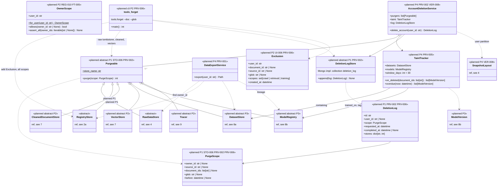

# 10b. Governance and privacy operations (planned)

[← Class diagrams](README.md) · [Hub](../README.md) · Previous: [10a. UI, API and authentication (planned)](10a_ui_api_and_authentication.md) · Next: [11. Exceptions](11_exceptions.md)

| | |
|---|---|
| Status | Planned |
| Subsystem | planned (owner scope, purge contract, exclusions, deletion, export, taint) |
| Requirements | [FEA](../requirements/requirements.md#210-feature-pipeline-fea) 005 · [FT](../requirements/requirements.md#212-fine-tuning-ft) 005 · [INF](../requirements/requirements.md#214-rag-inference-service-inf) 002 · [OBS](../requirements/requirements.md#obsidian-obs) 004 · [PRV](../requirements/requirements.md#216-privacy-and-data-subject-operations-prv) 001, 002, 005, 006 · [REG](../requirements/requirements.md#22-source-registry-and-multi-user-reg) 010 · [STO](../requirements/requirements.md#25-raw-storage-sto) 006 · [UI](../requirements/requirements.md#29-source-registration-ui-and-api-ui) 006 · [VER](../requirements/requirements.md#27-data-versioning-ver) 008 · [NFR-PRIV](../requirements/requirements.md#35-privacy-priv) 004 |
| Use cases | [UC-15](../use_cases/04_rag_chat_and_features.md#uc-15-exclude-or-forget-content), [UC-22](../use_cases/06_admin_privacy_ops.md#uc-22-export-my-data), [UC-23](../use_cases/06_admin_privacy_ops.md#uc-23-delete-my-account) |
| Sequence diagrams | [SD-6](../sequence_diagrams/sd6_datasets_training_eval.md), [SD-8](../sequence_diagrams/sd8_account_deletion.md) |
| draw.io | copy the ```mermaid block below → Arrange › Insert › Advanced › Mermaid |


The `governance` package is a leaf: it imports nothing from other planned packages, and every store and every per-user read imports it. It holds three contracts. `OwnerScope` is the one place that decides whether a record with a given `owner_id` is visible to a user (owner is the user, or null for shared external content) (FR-REG-010, FR-FT-005). `Purgeable` is implemented by every store that holds user data, so deletion, "forget" and retention fan out over one interface; a new store implements `purge()` and nothing else changes (FR-STO-006, FR-PRV-002, FR-PRV-006). `Exclusion` records what a user removed from crawling, retrieval or training; it replaces the draft's separate `ForgetRule` (FR-UI-006, FR-PRV-006).

The services in `privacy` use those contracts. Models trained on deleted data are found through the dataset manifests (`DatasetStore.containing`, `ModelRegistry.trained_on`) and flagged `tainted` (FR-PRV-005).


