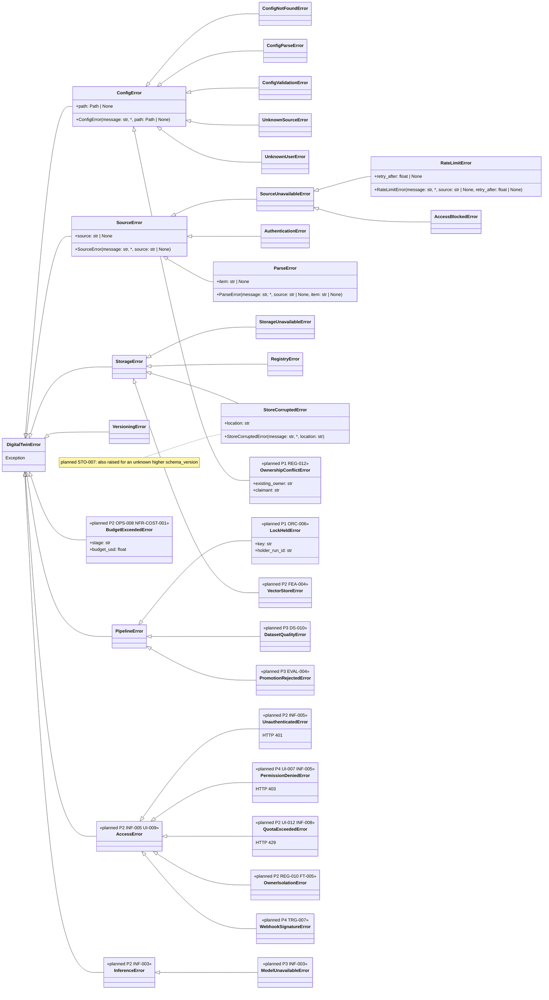

# 11. Exceptions

[← Class diagrams](README.md) · [Hub](../README.md) · Previous: [10b. Governance and privacy operations (planned)](10b_governance_and_privacy_operations.md)

| | |
|---|---|
| Status | Implemented, with planned additions |
| Subsystem | `llm_engineering/exceptions.py` plus planned subclasses |
| Requirements | [DS](../requirements/requirements.md#211-dataset-generation-ds) 010 · [ETL](../requirements/requirements.md#23-extraction-framework-etl) 002 · [EVAL](../requirements/requirements.md#213-evaluation-eval) 004 · [FEA](../requirements/requirements.md#210-feature-pipeline-fea) 004 · [FT](../requirements/requirements.md#212-fine-tuning-ft) 005 · [INF](../requirements/requirements.md#214-rag-inference-service-inf) 003, 005, 008 · [OPS](../requirements/requirements.md#215-llmops-monitoring-cicd-deployment-ops) 008 · [ORC](../requirements/requirements.md#26-orchestration-and-cli-orc) 006 · [REG](../requirements/requirements.md#22-source-registry-and-multi-user-reg) 010, 012 · [STO](../requirements/requirements.md#25-raw-storage-sto) 007 · [TRG](../requirements/requirements.md#28-triggers-and-scheduling-trg) 007 · [UI](../requirements/requirements.md#29-source-registration-ui-and-api-ui) 007, 009, 012 · [NFR-COST](../requirements/requirements.md#39-cost-cost) 001 |
| Use cases | none |
| Sequence diagrams | none |
| draw.io | copy the ```mermaid block below → Arrange › Insert › Mermaid |


Every intentional error derives from `DigitalTwinError`. Item-level `ParseError` is logged and skipped. Source-level `SourceError` fails one source. `AccessBlockedError`, `AuthenticationError` and `RateLimitError` stop the provider. `ConfigError` stops before fetching (FR-ETL-002). Planned subclasses go under the branch whose handling policy they share. Three new branches are added for budgets, access control and inference. `OwnerIsolationError` is raised by `OwnerScope.assert_all` when another owner's data reaches a user scope (FR-REG-010, FR-FT-005).


