# DigitalTwin: UML Class Diagram (draft)

| | |
|---|---|
| Document status | Draft v0.1, for owner review |
| Date | 2026-10-23 |
| Baseline | `main` at `4c40ca7` (ETL stage, P0). Code read only; nothing was run. |
| Inputs | [`requirements.md`](../requirements/requirements.md) v1.0, [`user_stories.md`](../user_stories/user_stories.md), the code under `llm_engineering/`, `steps/`, `pipelines/`, `tools/` |
| Notation | Mermaid `classDiagram` (checked with mermaid-cli 11.x) |

## How to read these diagrams

- **Implemented classes** have no `planned` stereotype. Their names, attributes, methods and types match the code at the baseline. Private helpers are shown with `-` and their real leading underscore. Python dunder methods are shown without underscores (`iadd` means `__iadd__`), because Mermaid renders `__x__` as bold.
- **Planned classes** carry the stereotype `<<planned Pn REQ-IDs>>`, for example `<<planned P1 REG-014>>`. `abstract` or `enum` is added where it applies (`<<planned abstract P2 FEA-004>>`). The `FR-` prefix is left out inside diagrams. NFR IDs keep their prefix. Section 14 has the full mapping.
- **Planned members of implemented classes** are not mixed into the class box, which shows only what exists. They are listed in a `note for <Class>` that starts with `planned`.
- Stereotypes used: `<<abstract>>` (an ABC), `<<pydantic>>` (Pydantic v2 `BaseModel`), `<<BaseSettings PREFIX_>>` (pydantic-settings, with its env prefix), `<<dataclass>>`, `<<enumeration>>` (a `Literal` type alias, shown as its values), `<<discriminated union>>`, `<<module>>` (module-level functions and constants, for example factories), `<<step>>` / `<<pipeline>>` (ZenML), `<<cli>>`, `<<external>>` (third-party class), `<<package>>` (overview only).
- `$` after a member means static, class-level or `ClassVar`. `*` after a method means abstract. `«property»` and `«cached»` mark `@property` and `@cached_property`.
- Arrows: `<|--` inheritance (including subclassing an ABC), `*--` composition (the part has no life of its own), `o--` aggregation, `-->` association (a held reference), `..>` dependency (creates, uses, or reads).
- A class that belongs to another diagram appears again, with few or no members, where a relation needs it ("ref").

## Diagram index

| # | Diagram | Subsystem |
|---|---|---|
| 0 | Overview | Packages and their dependencies |
| 1 | Settings and configuration | `settings/`, `crawl_config/`, `topics/` |
| 2a | Registry core | `registry/models`, `registry/store`, seeder, selector, keys |
| 2b | Source specs | `registry/specs` (the discriminated union) |
| 3a | Extraction framework | `raw_data/sources/base`, `raw_data/sources/registry.py` |
| 3b | Providers: Medium and GitHub | `raw_data/sources/{medium,github}`, `infrastructure/web` |
| 3c | Providers: LinkedIn, Obsidian, Articles | `raw_data/sources/{linkedin,obsidian,articles}`, `raw_data/crawlers` |
| 4 | Raw storage and versioning | `raw_data/{documents,store,snapshot}`, `infrastructure/{mongo,versioning}` |
| 5 | Orchestration | `pipelines/`, `steps/etl/`, `tools/`, planned run records, change sets and locks |
| 6 | Triggers and scheduling | planned |
| 7 | Feature pipeline | planned (clean, chunk, embed, vector store) |
| 8a | Dataset generation | planned |
| 8b | Training, model registry, evaluation | planned |
| 9 | Inference and LLMOps | planned |
| 10a | UI, API and auth | planned |
| 10b | Privacy operations | planned |
| 11 | Exceptions | `llm_engineering/exceptions.py` plus planned subclasses |

---

## 0. Overview

Each box is a package. Implemented packages name their modules. Planned packages are marked `planned`. Every package also depends on `exceptions` and `utils`. Those arrows are left out.

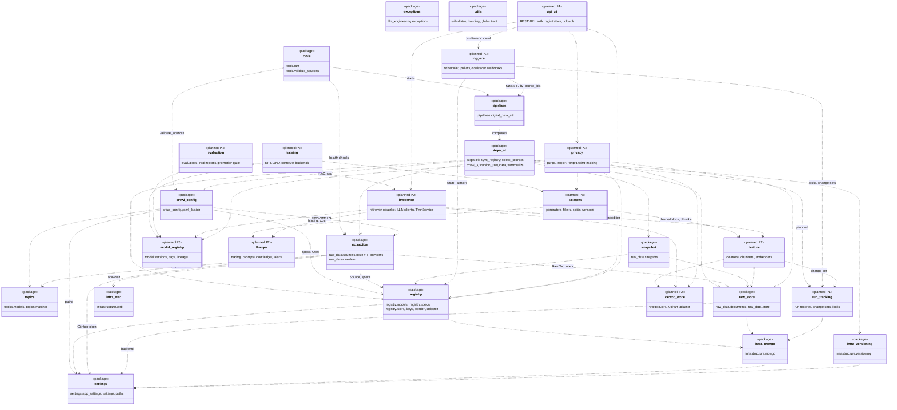

---

## 1. Settings and configuration

`get_settings()` is the only reader of the environment (FR-CFG-004). `YamlLoader` is the only reader of YAML (FR-CFG-001/002/005). Planned settings groups follow the same pattern: one `BaseSettings` class per env prefix, held by `Settings`.

Note on names: there are two classes called `GitHubSettings`. This diagram shows the environment one (`settings/app_settings.py`, token). The provider tuning one (`raw_data/sources/github/settings.py`, `request_delay_s`) is in diagram 3b.

```mermaid
classDiagram
  direction TB

  class Settings {
    <<pydantic>>
    +mongo: MongoSettings
    +github: GitHubSettings
    +versioning: VersioningSettings
    +raw_store: RawStoreSettings
  }
  class MongoSettings {
    <<BaseSettings MONGO_>>
    +uri: SecretStr | None
    +scheme: mongodb | mongodb+srv
    +host: str = localhost
    +port: int | None = 27017
    +username: str | None
    +password: SecretStr | None
    +database: str = digital_twin
    +auth_source: str | None = admin
    +options: dict[str, str]
    +timeout_ms: int = 5000
    +«property» connection_string: str
    +«property» display_uri: str
    -_build(password: str | None) str
  }
  class GitHubSettings {
    <<BaseSettings GITHUB_>>
    +token: SecretStr | None
  }
  class VersioningSettings {
    <<BaseSettings DVC_>>
    +enabled: bool = True
    +snapshot_dir: Path = RAW_SNAPSHOT_DIR
    +auto_commit: bool = True
    +auto_push: bool = True
    +remote: str | None
    -_anchor(v: Path) Path$
  }
  class RawStoreSettings {
    <<BaseSettings RAW_STORE_>>
    +backend: StoreBackend = mongo
  }
  class app_settings {
    <<module>>
    +StoreBackend = Literal mongo
    +get_settings() Settings$
    -_env(prefix: str) SettingsConfigDict$
  }
  class paths {
    <<module>>
    +PROJECT_ROOT: Path
    +CONFIG_DIR, TOPICS_FILE, PROVIDERS_DIR, USERS_DIR: Path
    +ENV_FILE: Path
    +DATA_DIR, RAW_SNAPSHOT_DIR, MANIFESTS_DIR, SOURCE_HEALTH_FILE: Path
    +DVC_SETUP_FILES: list[Path]
    +from_root(path: Path) Path$
  }
  class YamlLoader {
    +topics_file: Path
    +providers_dir: Path
    +users_dir: Path
    +read(path: Path) Any$
    +«cached» topics: dict[str, Topic]
    +«cached» providers: dict[str, BaseProviderSettings]
    +«cached» users: dict[str, UserDeclaration]
    +user_dirs() list[Path]
    +load_user(user_dir: Path) UserDeclaration
    +load_specs(path: Path) list[SourceSpec]
    +get_user(user_id: str) UserDeclaration
  }
  class Topic {
    <<pydantic>>
    +description: str
    +medium_tags: list[str]
    +obsidian_tags: list[str]
  }
  class TopicsFile {
    <<pydantic>>
    +topics: dict[str, Topic]
  }
  class TopicMatcher {
    -_by_tag: dict[str, set[str]]
    -_vault_prefixes: list[tuple[str, str]]
    +TopicMatcher(topics: dict[str, Topic])
    +from_tags(tags: Iterable[str]) set[str]
    +from_vault_tags(tags: Iterable[str]) set[str]
  }
  class BaseProviderSettings {
    <<pydantic>>
    extra = forbid
  }
  class UserDeclaration {
    <<pydantic>>
    ref, see 2a
  }
  class Provider {
    <<dataclass>>
    ref, see 3a
  }

  class QdrantSettings {
    <<planned P2 FEA-004>>
    +url: str
    +api_key: SecretStr | None
    +collection_alias: str
  }
  class EmbeddingSettings {
    <<planned P2 FEA-003 FEA-009>>
    +model_name: str
    +dimension: int
    +max_tokens: int
    +max_usd: float
  }
  class LLMSettings {
    <<planned P3 DS-007>>
    +provider: str
    +model: str
    +api_key: SecretStr | None
    +local_only: bool = True
  }
  class BudgetSettings {
    <<planned P2 NFR-COST-001>>
    +monthly_usd: dict[str, float]
    +hard_stop: bool = True
  }
  class ApiSettings {
    <<planned P2 INF-005 INF-008>>
    +bearer_token: SecretStr
    +requests_per_minute: int
    +daily_spend_usd: float
  }
  class SchedulerSettings {
    <<planned P1 TRG-002 TRG-004 TRG-006>>
    +cadence: dict[str, str]
    +poll_interval_min: int = 15
    +debounce_s: int = 300
    +blocked_cooldown_h: int = 24
    +max_attempts: int = 3
  }
  class TracingSettings {
    <<planned P2 OPS-001 NFR-PRIV-004>>
    +enabled: bool = True
    +sample_rate: float = 1.0
    +retention_days: int = 90
  }
  class TopicMigrator {
    <<planned P2 CFG-007>>
    +stale_topics(store: RawDataStore) dict[str, int]
    +apply_renames(topics: dict[str, Topic], store: RawDataStore) int
  }

  Settings "1" *-- "1" MongoSettings
  Settings "1" *-- "1" GitHubSettings
  Settings "1" *-- "1" VersioningSettings
  Settings "1" *-- "1" RawStoreSettings
  app_settings ..> Settings : builds once, cached
  VersioningSettings ..> paths : from_root
  YamlLoader ..> paths : default locations
  YamlLoader ..> TopicsFile : validates
  TopicsFile "1" *-- "1..*" Topic
  YamlLoader ..> Provider : settings_model per provider
  YamlLoader ..> BaseProviderSettings : validates
  YamlLoader ..> UserDeclaration : builds
  TopicMatcher ..> Topic : indexes tags

  Settings "1" *-- "1" QdrantSettings : planned
  Settings "1" *-- "1" EmbeddingSettings : planned
  Settings "1" *-- "1" LLMSettings : planned
  Settings "1" *-- "1" BudgetSettings : planned
  Settings "1" *-- "1" ApiSettings : planned
  Settings "1" *-- "1" SchedulerSettings : planned
  Settings "1" *-- "1" TracingSettings : planned
  TopicMigrator ..> Topic

  note for Topic "planned CFG-007: renamed_from: list[str]"
  note for YamlLoader "planned CFG-008: once the UI exists YAML is only a bootstrap. Records get declared_via = yaml"
```

---

## 2a. Registry core

Users, sources and subscriptions live in MongoDB (`users`, `sources`, `subscriptions`). A source is stored once under its canonical key, and users link to it through subscriptions (FR-REG-001/003). `owner_id` is set only for owned specs (FR-REG-004).

```mermaid
classDiagram
  direction TB

  class User {
    <<pydantic>>
    +id: str  pattern a-z0-9_-
    +name: str
    +handles: dict[str, str]
  }
  class Source {
    <<pydantic>>
    +id: str  canonical key, Mongo _id
    +type: str
    +provider: str
    +spec: dict[str, Any]
    +owner_id: str | None
    +topics: list[str]
    +enabled: bool = True
    +state: SourceState
    +from_spec(spec: SourceSpec, user_id: str) Source$
    +«cached» typed_spec: SourceSpec
  }
  class SourceState {
    <<pydantic>>
    +status: SourceStatus = never
    +last_run_id: str | None
    +last_crawled_at: datetime | None
    +error: str | None
    +items_ok: int
    +items_failed: int
    +items_skipped: int
  }
  class SourceStatus {
    <<enumeration>>
    never
    ok
    failed
  }
  class Subscription {
    <<pydantic>>
    +user_id: str
    +source_id: str
    +created_at: datetime
    +«property» id: str
  }
  class UserDeclaration {
    <<pydantic>>
    +user: User
    +sources: list[SourceSpec]
    -_no_duplicate_sources() UserDeclaration
  }
  class BaseSourceSpec {
    <<abstract>>
    ref, see 2b
    +key(user_id: str) str*
  }
  class RegistryStore {
    <<abstract>>
    +setup() None*
    +upsert_user(user: User) None*
    +upsert_source(source: Source) bool*
    +subscribe(user_id: str, source_id: str) bool*
    +users() list[User]*
    +sources(source_ids: Iterable[str] | None) list[Source]*
    +subscriptions(user_id: str | None) list[Subscription]*
    +record_state(source_id: str, state: SourceState) None*
  }
  class MongoRegistryStore {
    +users_col: Collection
    +sources_col: Collection
    +subscriptions_col: Collection
    +MongoRegistryStore(database: Database | None)
    +setup() None
    +upsert_user(user: User) None
    +upsert_source(source: Source) bool
    +source_upsert_op(source: Source) UpdateOne$
    +subscribe(user_id: str, source_id: str) bool
    +users() list[User]
    +sources(source_ids: Iterable[str] | None) list[Source]
    +subscriptions(user_id: str | None) list[Subscription]
    +record_state(source_id: str, state: SourceState) None
    -_run(operation) Any$
    -_with_id(raw: dict) dict$
    -_model(model, raw: dict, collection: str) BaseModel$
  }
  class registry_store_factory {
    <<module>>
    +create_registry_store(backend: str | None) RegistryStore$
  }
  class RegistrySeeder {
    +store: RegistryStore
    +seed(declarations: list[UserDeclaration]) SeedStats
  }
  class SeedStats {
    <<dataclass>>
    +users: int
    +sources_declared: int
    +sources_new: int
    +subscriptions_new: int
  }
  class SourceSelector {
    +store: RegistryStore
    +select(user_id: str | None, source_ids: list[str] | None) dict[str, list[str]]
  }
  class keys {
    <<module>>
    +TRACKING_PREFIXES: tuple[str, ...]
    +TRACKING_NAMES: set[str]
    +normalize_url(url: str) str$
    +slug(value: str) str$
    +medium_tag_key(tag: str) str$
    +medium_author_key(handle: str) str$
    +article_key(url: str) str$
    +github_user_key(username: str) str$
    +obsidian_key(user_id: str, vault_path: Path) str$
    +linkedin_key(user_id: str) str$
    +subscription_key(user_id: str, source_id: str) str$
  }

  class SourceCursor {
    <<planned abstract P1 REG-014>>
    +provider: str
    +updated_at: datetime
  }
  class DeclaredVia {
    <<planned enum P4 CFG-008>>
    yaml
    ui
    api
  }
  class OwnershipGuard {
    <<planned P1 REG-012>>
    +check(existing: Source | None, incoming: Source) None
  }
  class DeclarationMerger {
    <<planned P1 REG-013>>
    +merge(source: Source, subscriptions: list[Subscription]) Source
  }
  class RegistryReconciler {
    <<planned P1 REG-008 REG-009>>
    +store: RegistryStore
    +policy: OrphanSourcePolicy
    +reconcile(declarations: list[UserDeclaration]) ReconcileStats
    +unsubscribe(user_id: str, source_id: str) None
  }
  class ReconcileStats {
    <<planned P1 REG-009>>
    +subscriptions_removed: int
    +users_removed: int
    +sources_disabled: int
  }
  class OrphanSourcePolicy {
    <<planned enum P1 PRV-003>>
    retain
    purge
  }
  class SelectionResult {
    <<planned P1 REG-007>>
    +by_provider: dict[str, list[str]]
    +skipped_disabled: list[str]
  }

  RegistryStore <|-- MongoRegistryStore
  registry_store_factory ..> MongoRegistryStore : creates
  Source "1" *-- "1" SourceState : state
  SourceState --> SourceStatus
  Subscription "0..*" --> "1" User : user_id
  Subscription "0..*" --> "1" Source : source_id
  Source "0..*" --> "0..1" User : owner_id
  UserDeclaration "1" *-- "1" User
  UserDeclaration "1" *-- "0..*" BaseSourceSpec : sources
  Source ..> BaseSourceSpec : from_spec, typed_spec
  RegistrySeeder --> RegistryStore
  RegistrySeeder ..> UserDeclaration : reads
  RegistrySeeder ..> Source : creates
  RegistrySeeder ..> SeedStats : returns
  SourceSelector --> RegistryStore
  MongoRegistryStore ..> keys : subscription_key
  Subscription ..> keys : subscription_key
  RegistryStore ..> Source : persists
  RegistryStore ..> User : persists
  RegistryStore ..> Subscription : persists

  SourceState "1" o-- "0..1" SourceCursor : planned cursor
  RegistrySeeder ..> OwnershipGuard : planned
  RegistrySeeder ..> DeclarationMerger : planned
  RegistryReconciler --> RegistryStore
  RegistryReconciler ..> ReconcileStats
  RegistryReconciler --> OrphanSourcePolicy
  SourceSelector ..> SelectionResult : planned return type
  Source ..> DeclaredVia : planned

  note for SourceState "planned REG-014: last_success_at, last_success_run_id, consecutive_failures, cursor: SourceCursor, retry_not_before. record_state merges instead of overwriting"
  note for Source "planned: declared_via (CFG-008), schema_version (STO-007), license_allows_training (DS-006)"
  note for Subscription "planned REG-013 CFG-008: topics, enabled and declared_via per subscriber"
  note for RegistryStore "planned: unsubscribe, delete_subscription, delete_user (REG-008 REG-009 PRV-002). upsert_source must not overwrite owner_id (REG-012)"
```

---

## 2b. Source specs

The `type` field picks the spec model (Pydantic discriminated union, FR-CFG-002). Each spec knows its `provider`, whether it is `owned`, and how to build its canonical `key()`. Topic keys are checked against `topics.yaml` through the validation context (FR-CFG-001).

```mermaid
classDiagram
  direction TB

  class BaseSourceSpec {
    <<abstract>>
    +provider: str$
    +owned: bool$
    +enabled: bool = True
    +key(user_id: str) str*
    +declared_topics() list[str]
    +referenced_topics() set[str]
    -_check_topics(info: ValidationInfo) BaseSourceSpec
  }
  class GitHubSpec {
    +provider: str = github$
    +owned: bool = True$
    +type: Literal github
    +username: str
    +repos: list[str]
    +exclude_repos: list[str]
    +include_forks: bool = False
    +include: list[str] = README*, *.md, *.py, *.ipynb
    +exclude: list[str]
    +skip_hidden: bool = True
    +max_file_kb: int = 1024
    +min_chars: int = 40
    +topic_rules: list[RepoTopicRule]
    +key(user_id: str) str
    +referenced_topics() set[str]
  }
  class RepoTopicRule {
    <<pydantic>>
    +repo: str  glob
    +topic: str
  }
  class ObsidianSpec {
    +provider: str = obsidian$
    +owned: bool = True$
    +type: Literal obsidian
    +vault_path: Path
    +include: list[str] = *.md
    +exclude: list[str]
    +skip_hidden: bool = True
    +include_hidden: list[str]
    +min_chars: int = 40
    +pdf_include: list[str]
    +pdf_origin: Origin = external
    +pdf_max_mb: float = 100
    +topic_rules: list[TopicRule]
    -_anchor(v: Path) Path$
    +key(user_id: str) str
    +referenced_topics() set[str]
  }
  class TopicRule {
    <<pydantic>>
    +glob: str
    +topic: str
  }
  class LinkedInExportSpec {
    +provider: str = linkedin$
    +owned: bool = True$
    +type: Literal linkedin_export
    +export_dir: Path
    +include: list[posts | articles | comments]
    +min_chars: int = 40
    -_anchor(v: Path) Path$
    +key(user_id: str) str
  }
  class MediumTagSpec {
    +provider: str = medium$
    +owned: bool = False$
    +type: Literal medium_tag
    +tag: str
    +topics: list[str]  min 1
    +key(user_id: str) str
    +declared_topics() list[str]
    +«property» listing_url: str
  }
  class MediumAuthorSpec {
    +provider: str = medium$
    +owned: bool = False$
    +type: Literal medium_author
    +handle: str
    +topics: list[str]  min 1
    -_at_prefix(v: str) str$
    +key(user_id: str) str
    +declared_topics() list[str]
    +«property» listing_url: str
  }
  class ArticleSpec {
    +provider: str = articles$
    +owned: bool = False$
    +type: Literal article
    +url: HttpUrl
    +topics: list[str]
    +origin: Origin = external
    +key(user_id: str) str
    +declared_topics() list[str]
  }
  class SourceSpec {
    <<discriminated union>>
    discriminator = type
    GitHubSpec | ObsidianSpec | LinkedInExportSpec
    MediumTagSpec | MediumAuthorSpec | ArticleSpec
  }
  class specs_registry {
    <<module>>
    +SourceSpec: Annotated union
    +source_spec_adapter: TypeAdapter[SourceSpec]
  }
  class Origin {
    <<enumeration>>
    self
    external
  }
  class keys {
    <<module>>
    ref, see 2a
  }

  BaseSourceSpec <|-- GitHubSpec
  BaseSourceSpec <|-- ObsidianSpec
  BaseSourceSpec <|-- LinkedInExportSpec
  BaseSourceSpec <|-- MediumTagSpec
  BaseSourceSpec <|-- MediumAuthorSpec
  BaseSourceSpec <|-- ArticleSpec
  GitHubSpec "1" *-- "0..*" RepoTopicRule
  ObsidianSpec "1" *-- "0..*" TopicRule
  ObsidianSpec --> Origin : pdf_origin
  ArticleSpec --> Origin : origin
  SourceSpec ..> GitHubSpec : github
  SourceSpec ..> ObsidianSpec : obsidian
  SourceSpec ..> LinkedInExportSpec : linkedin_export
  SourceSpec ..> MediumTagSpec : medium_tag
  SourceSpec ..> MediumAuthorSpec : medium_author
  SourceSpec ..> ArticleSpec : article
  specs_registry ..> SourceSpec : defines, validates
  BaseSourceSpec ..> keys : key()

  note for BaseSourceSpec "planned: owned becomes an instance decision is_owned() for MED-007 and ART-005. planned license_allows_training (DS-006, NFR-CMP-005)"
  note for ArticleSpec "planned ART-005: origin = self gives an owner-scoped key and owner_id"
  note for MediumAuthorSpec "planned MED-007: own: bool"
  note for GitHubSpec "planned: include_private (GH-007), vendored_paths (GH-006)"
  note for ObsidianSpec "planned OBS-004: private_flags, default twin false or private true"
```

---

## 3a. Extraction framework

`BaseExtractor[S]` is a template method: `extract()` opens `session()`, calls `extract_source()` for each source, records per-source failures and stops the provider on `PROVIDER_WIDE_ERRORS` (`AccessBlockedError`, `AuthenticationError`, `RateLimitError`) (FR-ETL-001/002). `S` is bound to `BaseProviderSettings`. The provider registry maps a name to its settings model and extractor class.

```mermaid
classDiagram
  direction TB

  class BaseExtractor~S~ {
    <<abstract>>
    +provider: str$
    +settings: S
    +sources: list[Source]
    +context: CrawlContext
    +log: Logger
    +report: CrawlReport
    -_current: Source | None
    +BaseExtractor(settings: S, sources: list[Source], context: CrawlContext)
    +extract() Iterator[RawDocument]
    +session() AbstractContextManager
    +extract_source(source: Source) Iterator[RawDocument]*
    +health_check(offline: bool) SourceHealth*
    +«property» current: Source
    +record_failed(item: str, reason: str) None
    +record_skipped(item: str, reason: str) None
    +make_document(source, id, kind: SourceKind, origin: Origin, content, author, query, rank, topics, owned: bool, fields) RawDocument
    +health(ok: bool, summary: str, details) SourceHealth
    -_abort(exc: SourceError, failed: list[Source]) None
    -_fail_sources_without_successes() None
  }
  class BaseProviderSettings {
    <<pydantic>>
    extra = forbid
  }
  class CrawlContext {
    <<dataclass>>
    +run_id: str
    +topics: dict[str, Topic]
    +users: dict[str, User]
    +existing_topics: dict[str, set[str]]
    +matcher: TopicMatcher
    +topic_counts() Counter[str]
    +owner_name(owner_id: str | None) str
  }
  class CrawlReport {
    <<dataclass>>
    +provider: str
    +source_ids: list[str]
    +outcomes: list[ItemOutcome]
    +source_errors: dict[str, str]
    +aborted: str | None
    +ok(source_id, item, title, topics) None
    +failed(source_id, item, reason) None
    +skipped(source_id, item, reason) None
    +source_failed(source_id, reason) None
    +counts(source_id: str | None) dict[str, int]
  }
  class ItemOutcome {
    <<dataclass>>
    +source_id: str
    +item: str
    +status: ItemStatus
    +title: str | None
    +topics: list[str]
    +reason: str | None
  }
  class ItemStatus {
    <<enumeration>>
    ok
    failed
    skipped
  }
  class SourceHealth {
    <<pydantic>>
    +source: str
    +ok: bool
    +summary: str
    +details: dict[str, Any]
  }
  class Provider {
    <<dataclass>>
    frozen
    +name: str
    +settings_model: type[BaseProviderSettings]
    +extractor_class: type[BaseExtractor]
  }
  class provider_registry {
    <<module>>
    +PROVIDERS: dict[str, Provider]
    +get_provider(name: str) Provider$
    +create_extractor(provider, settings, sources, context) BaseExtractor$
  }
  class extractor_module {
    <<module>>
    +PROVIDER_WIDE_ERRORS: AccessBlockedError, AuthenticationError, RateLimitError
  }
  class MediumExtractor {
    +provider = medium$
  }
  class GitHubExtractor {
    +provider = github$
  }
  class LinkedInExportExtractor {
    +provider = linkedin$
  }
  class ObsidianExtractor {
    +provider = obsidian$
  }
  class ArticlesExtractor {
    +provider = articles$
  }
  class MediumSettings
  class ProviderGitHubSettings["GitHubSettings (provider)"]
  class LinkedInSettings
  class ObsidianSettings
  class ArticlesSettings
  class RawDocument {
    <<pydantic>>
    ref, see 4
  }
  class Source {
    <<pydantic>>
    ref, see 2a
  }
  class TopicMatcher {
    ref, see 1
  }

  class SourceCursor {
    <<planned abstract P1 REG-014>>
    ref, see 2a
  }
  class EnumerationResult {
    <<planned P1 ETL-010>>
    +source_id: str
    +complete: bool
    +seen_ids: set[str]
  }
  class CrawlMode {
    <<planned enum P1 MED-008>>
    unattended
    interactive
  }
  class CrawlerIdentity {
    <<planned P1 ART-002 NFR-CMP-003>>
    +name: str = DigitalTwinCrawler
    +version: str
    +contact_url: str
    +user_agent() str
  }
  class RetryPolicy {
    <<planned P1 NFR-REL-005 MED-005>>
    +max_retries: int
    +base_delay_s: float
    +timeout_s: float = 60
    +retry_after_s(response) float | None
    +delays() Iterator[float]
  }
  class RobotsPolicy {
    <<planned P1 ART-003>>
    +identity: CrawlerIdentity
    -_cache: dict[str, RobotFileParser]
    +allowed(url: str) bool
  }

  BaseExtractor <|-- MediumExtractor : S = MediumSettings
  BaseExtractor <|-- GitHubExtractor : S = GitHubSettings
  BaseExtractor <|-- LinkedInExportExtractor : S = LinkedInSettings
  BaseExtractor <|-- ObsidianExtractor : S = ObsidianSettings
  BaseExtractor <|-- ArticlesExtractor : S = ArticlesSettings
  BaseProviderSettings <|-- MediumSettings
  BaseProviderSettings <|-- ProviderGitHubSettings
  BaseProviderSettings <|-- LinkedInSettings
  BaseProviderSettings <|-- ObsidianSettings
  BaseProviderSettings <|-- ArticlesSettings
  BaseExtractor "1" --> "1" BaseProviderSettings : settings
  BaseExtractor "1" o-- "0..*" Source : sources
  BaseExtractor "1" --> "1" CrawlContext : context
  BaseExtractor "1" *-- "1" CrawlReport : report
  BaseExtractor ..> RawDocument : yields via make_document
  BaseExtractor ..> SourceHealth : health_check
  BaseExtractor ..> extractor_module : PROVIDER_WIDE_ERRORS
  CrawlReport "1" *-- "0..*" ItemOutcome
  ItemOutcome --> ItemStatus
  CrawlContext "1" *-- "1" TopicMatcher : matcher
  provider_registry "1" *-- "5" Provider
  Provider ..> BaseExtractor : extractor_class
  Provider ..> BaseProviderSettings : settings_model
  provider_registry ..> BaseExtractor : creates

  BaseExtractor ..> EnumerationResult : planned
  BaseExtractor ..> SourceCursor : planned
  CrawlContext --> CrawlMode : planned mode
  RobotsPolicy --> CrawlerIdentity

  note for BaseExtractor "planned ETL-012: extract() also contains non-SourceError exceptions per source, logged with traceback. planned REG-011 ETL-010: cursor_for(source), enumeration(source) hooks"
  note for CrawlContext "planned: mode: CrawlMode (MED-008), cursors: dict[str, SourceCursor] (REG-014)"
```

---

## 3b. Providers: Medium and GitHub

Medium article text comes only from official RSS feeds (FR-MED-001). The browser is used only to discover `medium_tag` links and falls back to the tag feed when blocked (FR-MED-003). GitHub uses the REST API for repos and trees and the raw host for file bodies (FR-GH-001).

```mermaid
classDiagram
  direction TB

  class BaseExtractor~S~ {
    <<abstract>>
    ref, see 3a
  }
  class MediumExtractor {
    +provider: str = medium$
    +counts: Counter[str]
    +known: dict[str, set[str]]
    +feeds: MediumFeedClient
    +listing: MediumListingPage | None
    +listing_blocked: bool
    +session() Iterator
    -_browser() Browser
    +extract_source(source: Source) Iterator[RawDocument]
    -_author_articles(source, spec: MediumAuthorSpec) Iterator[RawDocument]
    -_tag_articles(source, spec: MediumTagSpec) Iterator[RawDocument]
    -_discover(spec: MediumTagSpec) list[str]
    -_find_in_feed(url: str) FeedEntry | None
    -_accept(source, spec, entry: FeedEntry, rank: int) RawDocument | None
    +article_topics(spec, tags: list[str]) set[str]
    +health_check(offline: bool) SourceHealth
  }
  class MediumSettings {
    +limit_per_topic: int = 100
    +skip_member_only: bool = True
    +feed_delay_s: float = 3.0
    +feed_max_retries: int = 3
    +headless: bool = True
    +browser_binary: str | None
    +user_data_dir: Path | None
    +profile_directory: str | None
    +page_load_timeout_s: float = 30
    +max_scrolls: int = 80
    +action_delay_min_s: float = 2.0
    +action_delay_max_s: float = 5.0
    -_delays_ordered() MediumSettings
  }
  class MediumFeedClient {
    +source: str
    +delay_s: float = 3.0
    +max_retries: int = 3
    -_http: httpx.Client
    -_cache: dict[str, list[FeedEntry]]
    -_last_request: float
    +author_feed(handle: str) list[FeedEntry]
    +tag_feed(tag: str) list[FeedEntry]
    +entries(feed_url: str) list[FeedEntry]
    -_get(url: str) str
    +enter() MediumFeedClient
    +exit() None
  }
  class FeedEntry {
    <<dataclass>>
    +article_id: str
    +url: str
    +title: str | None
    +author: str | None
    +published_at: datetime | None
    +tags: list[str]
    +content: str
    +full_text: bool
    +from_feedparser(entry) FeedEntry$
  }
  class MediumListingPage {
    +browser: Browser
    +max_scrolls: int
    +collect(url: str, limit: int) list[str]
  }
  class medium_helpers {
    <<module>>
    +feed_url_for_article(url: str) str | None$
    +article_id(url: str) str | None$
    +article_links(html: str) list[str]$
  }
  class Browser {
    +source: str
    +headless: bool
    +page_load_timeout_s: float
    +challenge_wait_s: float
    +binary_path: str | None
    +user_data_dir: Path | None
    +profile_directory: str | None
    +delay_s: tuple[float, float]
    -_driver: webdriver.Chrome | None
    +enter() Browser
    +exit() None
    +«property» driver: webdriver.Chrome
    +«property» page_source: str
    +pause() None
    +open(url: str) str
    +scroll_down() bool
    +is_challenge(html: str) bool$
    -_wait_for_challenge(url: str) str
    -_profile_hint() str
  }
  class GitHubExtractor {
    +provider: str = github$
    +client: GitHubClient
    -_client() GitHubClient$
    +session() Iterator
    +extract_source(source: Source) Iterator[RawDocument]
    -_repo_documents(source, spec: GitHubSpec, repo: dict) Iterator[RawDocument]
    -_file_text(repo: dict, path: str) str | None
    -_repo_topics(spec: GitHubSpec, repo: dict) set[str]
    +health_check(offline: bool) SourceHealth
  }
  class ProviderGitHubSettings["GitHubSettings (provider)"] {
    +request_delay_s: float = 0.5
  }
  class AppGitHubSettings["GitHubSettings (app_settings)"] {
    <<BaseSettings GITHUB_>>
    +token: SecretStr | None
  }
  class GitHubClient {
    +source: str
    -_http: httpx.Client
    +GitHubClient(source: str, token: str | None)
    +user_repos(username: str) list[dict]
    +repo_tree(repo: dict) dict
    +raw_file(repo: dict, path: str) str
    +rate_limit_remaining() int
    -_get(url: str, params: dict | None) httpx.Response
    +enter() GitHubClient
    +exit() None
  }
  class github_files {
    <<module>>
    +DOC_SUFFIXES: set[str]
    +select_repos(repos: list[dict], cfg: GitHubSpec) list[dict]$
    +is_wanted(path: str, size: int, cfg: GitHubSpec) bool$
    +select_files(tree: dict, cfg: GitHubSpec) list[str]$
    +file_type(path: str) str$
  }
  class github_support {
    <<module>>
    +notebook_to_markdown(raw: str) str$
    -_parse_retry_after(resp: httpx.Response) float | None$
  }
  class MediumTagSpec {
    ref, see 2b
  }
  class MediumAuthorSpec {
    ref, see 2b
  }
  class GitHubSpec {
    ref, see 2b
  }

  class FeedCursor {
    <<planned P1 REG-014 TRG-003>>
    +last_guid: str | None
    +etag: str | None
    +last_modified: str | None
  }
  class GitHubCursor {
    <<planned P1 GH-005 REG-011>>
    +pushed_at: dict[str, datetime]
    +blob_shas: dict[str, str]
  }
  class SourceCursor {
    <<planned abstract P1 REG-014>>
    ref, see 2a
  }
  class VendoredCodeClassifier {
    <<planned P2 GH-006>>
    +vendored_paths: list[str]
    +is_vendored(path: str, text: str) bool
  }
  class RetryPolicy {
    <<planned P1 MED-005>>
    ref, see 3a
  }

  BaseExtractor <|-- MediumExtractor
  BaseExtractor <|-- GitHubExtractor
  MediumExtractor --> MediumSettings : settings
  MediumExtractor "1" *-- "1" MediumFeedClient : feeds, per session
  MediumExtractor "1" *-- "0..1" MediumListingPage : listing, tag sources only
  MediumExtractor ..> Browser : creates in session
  MediumExtractor ..> medium_helpers
  MediumExtractor ..> MediumTagSpec
  MediumExtractor ..> MediumAuthorSpec
  MediumFeedClient ..> FeedEntry : parses
  MediumListingPage --> Browser
  MediumListingPage ..> medium_helpers : article_links
  GitHubExtractor --> ProviderGitHubSettings : settings
  GitHubExtractor "1" *-- "1" GitHubClient : client, per session
  GitHubExtractor ..> AppGitHubSettings : token via get_settings
  GitHubExtractor ..> github_files
  GitHubExtractor ..> github_support : notebook_to_markdown
  GitHubExtractor ..> GitHubSpec
  GitHubClient ..> github_support : retry after

  SourceCursor <|-- FeedCursor
  SourceCursor <|-- GitHubCursor
  MediumExtractor ..> FeedCursor : planned
  GitHubExtractor ..> GitHubCursor : planned
  GitHubExtractor ..> VendoredCodeClassifier : planned
  MediumFeedClient ..> RetryPolicy : planned

  note for MediumSettings "skip_member_only is declared but never read (CFG-005). planned MED-008: interactive flag, browser only when interactive"
  note for MediumFeedClient "planned MED-005: honour Retry-After, 5xx exhaustion raises SourceUnavailableError. _find_in_feed must re-raise RateLimitError"
  note for GitHubClient "planned: truncated tree recorded in report (GH-004), blob sha into metadata.sha (GH-005), /user/repos with opt-in (GH-007)"
```

---

## 3c. Providers: LinkedIn, Obsidian and Articles

LinkedIn is read only from the official export (FR-LI-001). Obsidian notes are the owner's writing, and vault PDFs are `external` by default with no `owner_id` (FR-ETL-005, FR-OBS-002). Articles are fetched by plain HTTP and converted to markdown (FR-ART-001).

```mermaid
classDiagram
  direction TB

  class BaseExtractor~S~ {
    <<abstract>>
    ref, see 3a
  }
  class LinkedInExportExtractor {
    +provider: str = linkedin$
    +export(source: Source) LinkedInExport$
    +extract_source(source: Source) Iterator[RawDocument]
    -_from_csv(source, export: LinkedInExport, filename: str, parse: Callable) Iterator[RawDocument]
    -_document(source, item: LinkedInItem) RawDocument | None
    +health_check(offline: bool) SourceHealth
  }
  class LinkedInSettings {
    no fields yet
  }
  class LinkedInExport {
    +root: Path
    +source: str
    +exists() bool
    +find(name: str) Path | None
    +article_files() list[Path]
    +read_csv(path: Path) Iterator[dict[str, str]]
    +read_text(path: Path) str
  }
  class LinkedInItem {
    <<dataclass>>
    +kind: SourceKind
    +native_id: str
    +text: str
    +title: str | None
    +url: str | None
    +created_at: datetime | None
    +metadata: dict[str, Any]
    +«property» hashtags: list[str]
  }
  class linkedin_parsers {
    <<module>>
    +SHARES_CSV, COMMENTS_CSV: str
    +parse_post(row: dict[str, str]) LinkedInItem$
    +parse_comment(row: dict[str, str]) LinkedInItem$
    +parse_article(html: str, path: Path) LinkedInItem$
  }
  class ObsidianExtractor {
    +provider: str = obsidian$
    +vault(source: Source) ObsidianVault$
    +extract_source(source: Source) Iterator[RawDocument]
    -_note_document(source, spec: ObsidianSpec, note: Note) RawDocument | None
    -_pdf_document(source, spec: ObsidianSpec, root: Path, rel: Path) RawDocument | None
    -_topics(spec: ObsidianSpec, rel: str, tags: list[str]) set[str]
    +health_check(offline: bool) SourceHealth
  }
  class ObsidianSettings {
    no fields yet
  }
  class ObsidianVault {
    +root: Path
    +include: list[str]
    +exclude: list[str]
    +skip_hidden: bool = True
    +include_hidden: list[str]
    +source: str
    +exists() bool
    +wanted(rel: str, include: list[str]) bool
    +notes() Iterator[Note]
    +pdf_paths(patterns: list[str]) Iterator[Path]
  }
  class ObsidianNote["Note"] {
    <<dataclass>>
    +path: Path
    +body: str
    +metadata: dict
    +tags: list[str]
    +modified_at: datetime | None
    +«property» rel: str
  }
  class CodeAwareObsidianLoader {
    -_parse_document_tags(content: str) set[str]
  }
  class ObsidianLoader {
    <<external>>
    langchain_community
  }
  class PdfText {
    <<dataclass>>
    +text: str
    +pages: int
    +title: str | None
    +author: str | None
  }
  class obsidian_helpers {
    <<module>>
    +read_pdf(path: Path, source: str) PdfText$
    +clean_obsidian_markdown(text: str) str$
    +strip_code_fences(text: str) str$
  }
  class ArticlesExtractor {
    +provider: str = articles$
    +«property» crawler: CustomArticleCrawler
    +extract_source(source: Source) Iterator[RawDocument]
    +health_check(offline: bool) SourceHealth
  }
  class ArticlesSettings {
    +request_delay_s: float = 1.0
    +min_chars: int = 200
  }
  class CustomArticleCrawler {
    +source: str
    +min_chars: int = 200
    -_transformer: Html2TextTransformer
    +crawl(url: str) CrawledArticle
    -_fetch(url: str) Document
    +to_article(html_doc: Document) CrawledArticle
  }
  class CrawledArticle {
    <<dataclass>>
    +url: str
    +title: str | None
    +content: str
    +metadata: dict[str, Any]
  }
  class LinkedInExportSpec {
    ref, see 2b
  }
  class ObsidianSpec {
    ref, see 2b
  }
  class ArticleSpec {
    ref, see 2b
  }

  class SourceCursor {
    <<planned abstract P1 REG-014>>
    ref, see 2a
  }
  class VaultCursor {
    <<planned P1 REG-011>>
    +mtime_watermark: datetime
    +note_hashes: dict[str, str]
  }
  class HttpCacheCursor {
    <<planned P1 REG-011>>
    +etag: str | None
    +last_modified: str | None
  }
  class NotePrivacyFilter {
    <<planned P1 OBS-004>>
    +flags: dict[str, bool]
    +is_private(note: Note) bool
  }
  class BylineExtractor {
    <<planned P2 ART-004>>
    +author(html_doc: Document) str | None
  }
  class RobotsPolicy {
    <<planned P1 ART-003>>
    ref, see 3a
  }
  class CrawlerIdentity {
    <<planned P1 ART-002>>
    ref, see 3a
  }

  BaseExtractor <|-- LinkedInExportExtractor
  BaseExtractor <|-- ObsidianExtractor
  BaseExtractor <|-- ArticlesExtractor
  LinkedInExportExtractor --> LinkedInSettings : settings
  LinkedInExportExtractor ..> LinkedInExport : creates per source
  LinkedInExportExtractor ..> linkedin_parsers
  LinkedInExportExtractor ..> LinkedInExportSpec
  linkedin_parsers ..> LinkedInItem : creates
  ObsidianExtractor --> ObsidianSettings : settings
  ObsidianExtractor ..> ObsidianVault : creates per source
  ObsidianExtractor ..> obsidian_helpers
  ObsidianExtractor ..> ObsidianSpec
  ObsidianVault ..> CodeAwareObsidianLoader : loads notes
  ObsidianVault ..> ObsidianNote : yields
  ObsidianLoader <|-- CodeAwareObsidianLoader
  obsidian_helpers ..> PdfText : read_pdf
  ArticlesExtractor --> ArticlesSettings : settings
  ArticlesExtractor ..> CustomArticleCrawler : creates
  ArticlesExtractor ..> ArticleSpec
  CustomArticleCrawler ..> CrawledArticle : returns

  SourceCursor <|-- VaultCursor
  SourceCursor <|-- HttpCacheCursor
  ObsidianExtractor ..> VaultCursor : planned
  ObsidianExtractor ..> NotePrivacyFilter : planned
  ArticlesExtractor ..> HttpCacheCursor : planned
  CustomArticleCrawler ..> RobotsPolicy : planned
  CustomArticleCrawler ..> CrawlerIdentity : planned UA
  CustomArticleCrawler ..> BylineExtractor : planned

  note for ObsidianVault "planned OBS-006: load notes one file at a time so one bad note fails only itself"
  note for CustomArticleCrawler "USER_AGENT is a copied desktop Chrome string today. planned ART-002: CrawlerIdentity UA"
```

---

## 4. Raw storage and versioning

`RawDataStore` is the repository for `RawDocument`. Upserts are idempotent by `_id`. Topics and `source_ids` are merged, and provenance is appended and capped at 50 (FR-STO-002, FR-ETL-006). After each run, the exporter writes deterministic JSONL that DVC versions (FR-VER-001/002).

```mermaid
classDiagram
  direction TB

  class RawDocument {
    <<pydantic>>
    +id: str
    +provider: str
    +source: SourceKind
    +owner_id: str | None
    +source_ids: list[str]
    +origin: Origin
    +title: str | None
    +content: str
    +url: str | None
    +author: str
    +created_at: datetime | None
    +updated_at: datetime | None
    +content_hash: str
    +topics: list[str]
    +provenance: list[Provenance]
    +metadata: dict[str, Any]
  }
  class Provenance {
    <<pydantic>>
    +source_id: str
    +query: str
    +rank: int | None
    +run_id: str
    +collected_at: datetime
  }
  class SourceKind {
    <<enumeration>>
    medium
    linkedin_post
    linkedin_article
    linkedin_comment
    obsidian
    github
    article
  }
  class Origin {
    <<enumeration>>
    self
    external
  }
  class RawDataStore {
    <<abstract>>
    +setup() None*
    +upsert_many(docs: Iterable[RawDocument]) UpsertStats*
    +find(provider: str | None, owner_id: str | None) Iterator[RawDocument]*
    +topics_by_id(provider: str) dict[str, set[str]]*
    +counts_by_topic(provider: str) Counter[str]*
    +count(provider: str | None) int*
  }
  class MongoRawDataStore {
    +COLLECTION: str = raw_documents$
    +PROVENANCE_KEPT: int = 50$
    +collection: Collection
    +MongoRawDataStore(database: Database | None)
    +setup() None
    +upsert_many(docs: Iterable[RawDocument]) UpsertStats
    -_upsert_op(doc: RawDocument) UpdateOne$
    +find(provider: str | None, owner_id: str | None) Iterator[RawDocument]
    +topics_by_id(provider: str) dict[str, set[str]]
    +counts_by_topic(provider: str) Counter[str]
    +count(provider: str | None) int
    -_filter(provider: str | None) dict$
    -_to_document(raw: dict) RawDocument$
  }
  class UpsertStats {
    <<dataclass>>
    +inserted: int = 0
    +matched: int = 0
    +iadd(other: UpsertStats) UpsertStats
  }
  class raw_store_factory {
    <<module>>
    +create_raw_data_store(backend: str | None) RawDataStore$
  }
  class mongo_client {
    <<module>>
    +get_client() MongoClient$
    +get_database() Database$
  }
  class RawDataSnapshotExporter {
    +SNAPSHOT_EXCLUDE: set[str] = provenance$
    +store: RawDataStore
    +registry: RegistryStore
    +out_dir: Path
    +export(providers: list[str]) dict[str, int]
    -_write(path: Path, records: Iterable[BaseModel], exclude: set[str] | None) int$
  }
  class DvcRepo {
    +root: Path = PROJECT_ROOT
    -_dvc(args: str) str
    +add(path: Path) Path
    +push(remote: str | None) None
    +tracked_hash(pointer: Path) str
  }
  class GitRepo {
    +root: Path = PROJECT_ROOT
    -_git(args: str, ok_codes: tuple[int, ...]) CompletedProcess
    +commit_paths(paths: list[Path], message: str) str | None
  }
  class versioning_command {
    <<module>>
    +run_command(args: list[str], cwd: Path, ok_codes: tuple[int, ...]) CompletedProcess$
  }
  class RegistryStore {
    <<abstract>>
    ref, see 2a
  }

  class TombstonePolicy {
    <<planned P1 ETL-010>>
    +tombstones(enumeration: EnumerationResult, stored_ids: set[str]) set[str]
  }
  class EnumerationResult {
    <<planned P1 ETL-010>>
    ref, see 3a
  }
  class SchemaMigration {
    <<planned abstract P1 STO-007>>
    +from_version: int
    +to_version: int
    +apply(raw: dict) dict*
  }
  class SchemaMigrator {
    <<planned P1 STO-007>>
    +CURRENT_VERSION: int$
    +migrations: list[SchemaMigration]
    +upgrade(raw: dict) dict
    +run(store: RawDataStore) int
  }
  class SnapshotPublisher {
    <<planned P1 VER-006>>
    +dvc: DvcRepo
    +git: GitRepo
    +branch: str = data
    +publish(snapshot_dir: Path, message: str) SnapshotRef
  }
  class SnapshotRef {
    <<planned P1 VER-006 ORC-007>>
    +data_md5: str
    +git_commit: str | None
    +ref_name: str
  }
  class SnapshotRestorer {
    <<planned P1 VER-007>>
    +restore(rev: str, store: RawDataStore, registry: RegistryStore) dict[str, int]
  }
  class SnapshotLayout {
    <<planned P4 VER-008>>
    +path_for(doc: RawDocument) Path
  }

  RawDocument "1" *-- "0..50" Provenance : provenance
  RawDocument --> SourceKind : source
  RawDocument --> Origin
  RawDataStore <|-- MongoRawDataStore
  RawDataStore ..> RawDocument : persists
  RawDataStore ..> UpsertStats : returns
  raw_store_factory ..> MongoRawDataStore : creates
  MongoRawDataStore ..> mongo_client : get_database
  RawDataSnapshotExporter --> RawDataStore
  RawDataSnapshotExporter --> RegistryStore
  DvcRepo ..> versioning_command
  GitRepo ..> versioning_command

  TombstonePolicy ..> EnumerationResult
  TombstonePolicy ..> RawDataStore : planned tombstone
  SchemaMigrator "1" o-- "0..*" SchemaMigration
  SchemaMigrator ..> RawDataStore
  SnapshotPublisher --> DvcRepo
  SnapshotPublisher --> GitRepo
  SnapshotPublisher ..> SnapshotRef : returns
  SnapshotRestorer ..> RawDataStore
  SnapshotRestorer ..> RegistryStore
  RawDataSnapshotExporter ..> SnapshotLayout : planned

  note for RawDocument "planned: deleted_at (ETL-010 STO-006), changed_at and previous_content_hash (STO-005), schema_version (STO-007), metadata.sha for GitHub (GH-005)"
  note for RawDataStore "planned STO-006: tombstone, untombstone, purge by ids, source_id or owner_id, find(include_deleted=False). planned ETL-013: replace_derived_topics(source_id, doc_id, topics)"
  note for UpsertStats "planned STO-005: changed, unchanged, inserted_ids, changed_ids for the ChangeSet"
```

---

## 5. Orchestration

The ZenML pipeline `digital_data_etl` composes the steps (FR-ORC-001). Each crawl step is a thin wrapper around `run_crawl_step(provider, selection)`, which calls `crawl_provider` (a plain function, usable outside ZenML) and returns a summary dict plus an HTML report artifact (FR-ORC-003, FR-ETL-003).

```mermaid
classDiagram
  direction TB

  class digital_data_etl {
    <<pipeline>>
    enable_cache = False
    +digital_data_etl(user_id: str | None, source_ids: list[str] | None) None
  }
  class sync_registry {
    <<step>>
    +sync_registry() dict[str, int]  registry_sync
  }
  class select_sources {
    <<step>>
    +select_sources(registry_sync: dict[str, int], user_id: str | None, source_ids: list[str] | None) dict[str, list[str]]  selection
  }
  class crawl_medium {
    <<step>>
    +crawl_medium(selection) tuple[medium_summary, medium_report]
  }
  class crawl_github {
    <<step>>
    +crawl_github(selection) tuple[github_summary, github_report]
  }
  class crawl_linkedin {
    <<step>>
    +crawl_linkedin(selection) tuple[linkedin_summary, linkedin_report]
  }
  class crawl_obsidian {
    <<step>>
    +crawl_obsidian(selection) tuple[obsidian_summary, obsidian_report]
  }
  class crawl_articles {
    <<step>>
    +crawl_articles(selection) tuple[articles_summary, articles_report]
  }
  class version_raw_data {
    <<step>>
    +version_raw_data(crawl_summaries: list[dict[str, Any]]) dict[str, Any]  versioning_summary
  }
  class summarize_crawl {
    <<step>>
    +summarize_crawl(crawl_summaries: list[dict[str, Any]], versioning: dict[str, Any]) None
    +format_summary(summary: dict[str, Any]) str$
  }
  class crawl_module {
    <<module>>
    +BATCH_SIZE: int = 50$
    +crawl_provider(provider: str, source_ids: list[str], run_id: str) tuple[dict[str, Any], CrawlReport]$
    +record_states(registry: RegistryStore, report: CrawlReport, run_id: str) None$
  }
  class zenml_helpers {
    <<module>>
    +current_run_id() str$
    +log_summary(summary: dict[str, Any]) None$
    +run_crawl_step(provider: str, selection: dict[str, list[str]]) tuple[dict[str, Any], HTMLString]$
  }
  class html_report {
    <<module>>
    +STATUS_ORDER, STATUS_COLOR: dict$
    +render_crawl_report(report: CrawlReport) str$
  }
  class tools_run {
    <<cli>>
    tools.run --etl --user --source
    +main() int
  }
  class tools_validate_sources {
    <<cli>>
    tools.validate_sources --offline --user
    +main() int
  }
  class YamlLoader {
    ref, see 1
  }
  class RegistrySeeder {
    ref, see 2a
  }
  class SourceSelector {
    ref, see 2a
  }
  class CrawlReport {
    <<dataclass>>
    ref, see 3a
  }
  class provider_registry {
    <<module>>
    ref, see 3a
  }
  class RawDataStore {
    <<abstract>>
    ref, see 4
  }
  class RegistryStore {
    <<abstract>>
    ref, see 2a
  }
  class RawDataSnapshotExporter {
    ref, see 4
  }

  class RunRecord {
    <<planned P1 ORC-007>>
    +run_id: str
    +trigger: TriggerKind
    +selection: dict[str, list[str]]
    +code_commit: str
    +config_hash: str
    +summaries: list[CrawlSummary]
    +change_set_id: str | None
    +data_md5: str | None
    +snapshot_commit: str | None
    +cost_usd: float
    +started_at: datetime
    +finished_at: datetime | None
  }
  class CrawlSummary {
    <<planned P1 ORC-003 ORC-007>>
    +provider: str
    +status: ok | partial | failed | skipped
    +sources_failed: list[str]
    +items_ok, items_failed, items_skipped: int
    +inserted, matched, changed: int
    +stored_total: int
    +topics: dict[str, int]
  }
  class ChangeSet {
    <<planned P2 ORC-008>>
    +id: str
    +run_id: str
    +inserted: list[str]
    +changed: list[str]
    +tombstoned: list[str]
    +is_empty() bool
  }
  class RunRecordStore {
    <<planned abstract P1 ORC-007>>
    +save(record: RunRecord) None*
    +get(run_id: str) RunRecord*
  }
  class MongoRunRecordStore {
    <<planned P1 ORC-007>>
    collection runs
  }
  class ChangeSetStore {
    <<planned abstract P2 ORC-008>>
    +save(change_set: ChangeSet) None*
    +get(change_set_id: str) ChangeSet*
  }
  class MongoChangeSetStore {
    <<planned P2 ORC-008>>
    collection change_sets
  }
  class LockManager {
    <<planned abstract P1 ORC-006>>
    +acquire(key: str, owner: str, ttl_s: int) Lease | None*
    +renew(lease: Lease) Lease*
    +release(lease: Lease) None*
  }
  class MongoLockManager {
    <<planned P1 ORC-006>>
    collection locks, TTL index
  }
  class Lease {
    <<planned P1 ORC-006>>
    +key: str
    +owner_run_id: str
    +expires_at: datetime
  }
  class RunOptions {
    <<planned P1 MED-008 TRG-002>>
    +interactive: bool = False
    +trigger: TriggerKind = manual
  }
  class record_run {
    <<planned step P1 ORC-007>>
    +record_run(crawl_summaries, versioning) RunRecord
  }
  class publish_change_set {
    <<planned step P2 ORC-008>>
    +publish_change_set(crawl_summaries) ChangeSet
  }
  class tools_restore_snapshot {
    <<planned cli P1 VER-007>>
    tools.restore_snapshot --rev
    +main() int
  }

  digital_data_etl *-- sync_registry
  digital_data_etl *-- select_sources
  digital_data_etl *-- crawl_medium
  digital_data_etl *-- crawl_github
  digital_data_etl *-- crawl_linkedin
  digital_data_etl *-- crawl_obsidian
  digital_data_etl *-- crawl_articles
  digital_data_etl *-- version_raw_data
  digital_data_etl *-- summarize_crawl
  tools_run ..> digital_data_etl : with_options run_name
  tools_validate_sources ..> YamlLoader
  tools_validate_sources ..> provider_registry : health_check
  sync_registry ..> YamlLoader
  sync_registry ..> RegistrySeeder
  select_sources ..> SourceSelector
  crawl_medium ..> zenml_helpers : run_crawl_step
  crawl_github ..> zenml_helpers
  crawl_linkedin ..> zenml_helpers
  crawl_obsidian ..> zenml_helpers
  crawl_articles ..> zenml_helpers
  zenml_helpers ..> crawl_module : crawl_provider
  zenml_helpers ..> html_report : render_crawl_report
  crawl_module ..> provider_registry : create_extractor
  crawl_module ..> RawDataStore : upsert_many in batches
  crawl_module ..> RegistryStore : record_state
  crawl_module ..> CrawlReport
  html_report ..> CrawlReport
  version_raw_data ..> RawDataSnapshotExporter
  version_raw_data ..> zenml_helpers : current_run_id

  digital_data_etl *-- record_run : planned
  digital_data_etl *-- publish_change_set : planned
  record_run ..> RunRecordStore
  publish_change_set ..> ChangeSetStore
  RunRecord "1" *-- "1..*" CrawlSummary
  RunRecord ..> ChangeSet : change_set_id
  RunRecordStore <|-- MongoRunRecordStore
  ChangeSetStore <|-- MongoChangeSetStore
  LockManager <|-- MongoLockManager
  LockManager ..> Lease
  crawl_module ..> LockManager : planned, per source and browser profile
  version_raw_data ..> LockManager : planned, snapshot lock
  digital_data_etl ..> RunOptions : planned parameter

  note for crawl_module "planned ETL-012 ORC-004: a non-SourceError in one source is contained, so later steps still run"
  note for summarize_crawl "Raises PipelineError at the end if a provider failed or versioning failed"
```

---

## 6. Triggers and scheduling (planned)

Triggers decide *when* to run and *which* `source_ids`. Every path ends in `TriggerDispatcher`, which calls `digital_data_etl(source_ids=...)` in unattended mode (FR-MED-008), and only after the locks and back-off checks pass.

```mermaid
classDiagram
  direction TB

  class TriggerKind {
    <<planned enum P1 TRG-008>>
    schedule
    poll
    watch
    webhook
    manual
    change_set
  }
  class TriggerEvent {
    <<planned P1 TRG-008>>
    +id: str
    +source_id: str
    +kind: TriggerKind
    +received_at: datetime
    +coalesced_into_run: str | None
    +attempt: int
    +status: str
  }
  class TriggerEventStore {
    <<planned abstract P1 TRG-008>>
    +append(event: TriggerEvent) None*
    +update(event: TriggerEvent) None*
    +pending() list[TriggerEvent]*
  }
  class MongoTriggerEventStore {
    <<planned P1 TRG-008>>
    collection trigger_events
  }
  class TriggerSource {
    <<planned abstract P1 TRG-003>>
    +poll(now: datetime) list[TriggerEvent]*
  }
  class GitHubPushPoller {
    <<planned P1 TRG-003>>
    +client: GitHubClient
    +poll(now: datetime) list[TriggerEvent]
  }
  class MediumFeedPoller {
    <<planned P1 TRG-003>>
    +feeds: MediumFeedClient
    +poll(now: datetime) list[TriggerEvent]
  }
  class VaultWatcher {
    <<planned P1 TRG-003>>
    +debounce_s: int
    +poll(now: datetime) list[TriggerEvent]
  }
  class Scheduler {
    <<planned P1 TRG-002>>
    +entries: list[ScheduleEntry]
    +due(now: datetime) list[TriggerEvent]
  }
  class ScheduleEntry {
    <<planned P1 TRG-002>>
    +provider: str
    +cron: str
    +source_ids: list[str] | None
  }
  class Coalescer {
    <<planned P1 TRG-004>>
    +window_s: int
    +add(event: TriggerEvent) None
    +flush(now: datetime) list[TriggerBatch]
  }
  class TriggerBatch {
    <<planned P1 TRG-004>>
    +source_ids: list[str]
    +events: list[TriggerEvent]
  }
  class BackoffGate {
    <<planned P1 TRG-006>>
    +registry: RegistryStore
    +blocked_cooldown_h: int = 24
    +allowed(source_id: str, now: datetime) bool
  }
  class TriggerRetryPolicy {
    <<planned P1 TRG-008>>
    +max_attempts: int = 3
    +next_attempt_at(event: TriggerEvent) datetime | None
  }
  class TriggerDispatcher {
    <<planned P1 TRG-002 TRG-003>>
    +gate: BackoffGate
    +locks: LockManager
    +events: TriggerEventStore
    +retry: TriggerRetryPolicy
    +dispatch(batch: TriggerBatch) str | None
  }
  class FeatureRunTrigger {
    <<planned P2 TRG-005>>
    +on_change_set(change_set: ChangeSet) str | None
  }
  class WebhookVerifier {
    <<planned abstract P4 TRG-007>>
    +verify(headers: dict[str, str], body: bytes) bool*
  }
  class GitHubWebhookVerifier {
    <<planned P4 TRG-007>>
    +secret: SecretStr
    +seen_delivery_ids: set[str]
    +verify(headers: dict[str, str], body: bytes) bool
  }
  class digital_data_etl {
    <<pipeline>>
    ref, see 5
  }
  class feature_engineering {
    <<planned pipeline P2>>
    ref, see 7
  }
  class LockManager {
    <<planned abstract P1 ORC-006>>
    ref, see 5
  }
  class RegistryStore {
    <<abstract>>
    ref, see 2a
  }
  class SourceState {
    <<pydantic>>
    ref, see 2a
  }
  class ChangeSet {
    <<planned P2 ORC-008>>
    ref, see 5
  }
  class RunOptions {
    <<planned P1 MED-008>>
    ref, see 5
  }
  class GitHubCursor {
    <<planned P1 GH-005>>
    ref, see 3b
  }
  class FeedCursor {
    <<planned P1 TRG-003>>
    ref, see 3b
  }

  TriggerEvent --> TriggerKind
  TriggerEventStore <|-- MongoTriggerEventStore
  TriggerEventStore ..> TriggerEvent : persists
  TriggerSource <|-- GitHubPushPoller
  TriggerSource <|-- MediumFeedPoller
  TriggerSource <|-- VaultWatcher
  GitHubPushPoller ..> GitHubCursor : compares pushed_at
  MediumFeedPoller ..> FeedCursor : compares last_guid
  Scheduler "1" *-- "0..*" ScheduleEntry
  TriggerSource ..> TriggerEvent : emits
  Scheduler ..> TriggerEvent : emits
  Coalescer ..> TriggerBatch : produces
  TriggerBatch "1" o-- "1..*" TriggerEvent
  TriggerDispatcher --> BackoffGate
  TriggerDispatcher --> LockManager
  TriggerDispatcher --> TriggerEventStore
  TriggerDispatcher --> TriggerRetryPolicy
  TriggerDispatcher ..> digital_data_etl : source_ids, RunOptions unattended
  TriggerDispatcher ..> RunOptions
  BackoffGate --> RegistryStore
  BackoffGate ..> SourceState : retry_not_before
  FeatureRunTrigger ..> ChangeSet
  FeatureRunTrigger ..> feature_engineering : document ids only
  WebhookVerifier <|-- GitHubWebhookVerifier
  GitHubWebhookVerifier ..> TriggerEvent : emits on valid delivery
```

---

## 7. Feature pipeline (planned)

The feature pipeline takes a change set (or a filter for a full rebuild) and turns raw documents into cleaned documents, chunks and vectors (FR-FEA-001..010). It follows the existing patterns: an ABC plus a Mongo or Qdrant implementation plus a factory, and one strategy class per source kind.

```mermaid
classDiagram
  direction TB

  class feature_engineering {
    <<planned pipeline P2 FEA-001 ORC-005>>
    +feature_engineering(change_set_id: str | None, user_id: str | None, provider: str | None) None
    «step» load_documents
    «step» clean_documents
    «step» chunk_and_embed
    «step» sync_vector_index
  }
  class CleanedDocument {
    <<planned P2 FEA-001 FEA-006>>
    +id: str  equal to raw id
    +owner_id: str | None
    +origin: Origin
    +kind: SourceKind
    +topics: list[str]
    +title: str | None
    +url: str | None
    +content: str
    +raw_content_hash: str
    +cleaner_version: str
    +raw_snapshot_md5: str
    +style_eligible: bool | None
    +quarantine_reason: str | None
    +deleted_at: datetime | None
  }
  class Cleaner {
    <<planned abstract P2 FEA-001>>
    +version: str$
    +kinds: set[SourceKind]$
    +clean(doc: RawDocument) str*
  }
  class MarkdownCleaner {
    <<planned P2 FEA-001>>
    notes, articles, medium
  }
  class CodeCleaner {
    <<planned P2 FEA-001>>
    github code and notebooks
  }
  class PostCleaner {
    <<planned P2 FEA-001>>
    linkedin posts and comments
  }
  class CleanerRegistry {
    <<planned P2 FEA-001>>
    +for_kind(kind: SourceKind) Cleaner
  }
  class QualityGate {
    <<planned P2 FEA-007>>
    +min_chars: int
    +min_alpha_ratio: float = 0.3
    +max_blob_run: int = 1000
    +check(doc: CleanedDocument) str | None
  }
  class SecretMasker {
    <<planned P2 FEA-008>>
    +patterns: list[Pattern]
    +mask(text: str) str
  }
  class DuplicateDetector {
    <<planned P2 ETL-011>>
    +threshold: float = 0.9
    +num_perm: int
    +groups(docs: Iterable[CleanedDocument]) list[DuplicateGroup]
  }
  class DuplicateGroup {
    <<planned P2 ETL-011>>
    +representative_id: str
    +member_ids: list[str]
    +exact: bool
  }
  class CleanedDocumentStore {
    <<planned abstract P2 FEA-006>>
    +upsert(docs: Iterable[CleanedDocument]) UpsertStats*
    +find(ids: list[str] | None, owner_id: str | None) Iterator[CleanedDocument]*
    +mark_deleted(ids: list[str]) int*
  }
  class MongoCleanedDocumentStore {
    <<planned P2 FEA-006>>
    collection cleaned_documents
  }
  class Chunk {
    <<planned P2 FEA-002>>
    +point_id: str
    +document_id: str
    +chunk_index: int
    +text: str
    +owner_id: str | None
    +origin: Origin
    +topics: list[str]
    +kind: SourceKind
    +url: str | None
    +title: str | None
    +position: int
  }
  class Chunker {
    <<planned abstract P2 FEA-002>>
    +chunk_size: int
    +overlap: int
    +chunk(doc: CleanedDocument) list[Chunk]*
  }
  class HeadingChunker {
    <<planned P2 FEA-002>>
    markdown by headings and token window
  }
  class CodeChunker {
    <<planned P2 FEA-002>>
    by function or class
  }
  class WholeDocumentChunker {
    <<planned P2 FEA-002>>
    short posts and comments
  }
  class ChunkerRegistry {
    <<planned P2 FEA-002>>
    +for_kind(kind: SourceKind) Chunker
  }
  class EmbeddingModelInfo {
    <<planned P2 FEA-003>>
    +name: str
    +version: str
    +dimension: int
    +max_tokens: int
  }
  class Embedder {
    <<planned abstract P2 FEA-003>>
    +model: EmbeddingModelInfo
    +embed(texts: list[str]) list[list[float]]*
    +estimate_cost_usd(texts: list[str]) float*
  }
  class LocalEmbedder {
    <<planned P2 FEA-009>>
    default, no cost
  }
  class HostedEmbedder {
    <<planned P2 FEA-009>>
    +max_usd: float
  }
  class VectorPoint {
    <<planned P2 FEA-004>>
    +point_id: str
    +vector: list[float]
    +payload: Chunk
  }
  class VectorFilter {
    <<planned P2 FEA-004 REG-010>>
    +owner_id: str | None
    +origins: set[Origin]
    +topics: set[str]
    +kinds: set[SourceKind]
    +include_deleted: bool = False
    +for_user(user_id: str) VectorFilter$
  }
  class ScoredChunk {
    <<planned P2 INF-002>>
    +chunk: Chunk
    +score: float
  }
  class VectorStore {
    <<planned abstract P2 FEA-004 NFR-SCL-002>>
    +ensure_collection(model: EmbeddingModelInfo) str*
    +upsert(points: list[VectorPoint]) int*
    +delete_by_document(document_ids: list[str]) int*
    +point_ids(document_id: str) set[str]*
    +search(vector: list[float], filter: VectorFilter, k: int) list[ScoredChunk]*
  }
  class QdrantVectorStore {
    <<planned P2 FEA-004>>
    +client: QdrantClient
    +alias: str
  }
  class CollectionAliasManager {
    <<planned P2 FEA-010>>
    +build_new(model: EmbeddingModelInfo) str
    +switch(alias: str, collection: str) None
  }
  class vector_store_factory {
    <<planned module P2 NFR-SCL-002>>
    +create_vector_store(backend: str | None) VectorStore$
  }
  class RawDataStore {
    <<abstract>>
    ref, see 4
  }
  class ChangeSet {
    <<planned P2 ORC-008>>
    ref, see 5
  }
  class RawDocument {
    <<pydantic>>
    ref, see 4
  }

  feature_engineering ..> ChangeSet : input
  feature_engineering ..> RawDataStore : reads
  feature_engineering ..> CleanerRegistry
  feature_engineering ..> ChunkerRegistry
  feature_engineering ..> QualityGate
  feature_engineering ..> SecretMasker
  feature_engineering ..> DuplicateDetector
  feature_engineering ..> CleanedDocumentStore
  feature_engineering ..> Embedder
  feature_engineering ..> VectorStore
  Cleaner <|-- MarkdownCleaner
  Cleaner <|-- CodeCleaner
  Cleaner <|-- PostCleaner
  CleanerRegistry "1" o-- "1..*" Cleaner
  Cleaner ..> RawDocument : reads
  Cleaner ..> CleanedDocument : produces
  DuplicateDetector ..> DuplicateGroup
  CleanedDocumentStore <|-- MongoCleanedDocumentStore
  Chunker <|-- HeadingChunker
  Chunker <|-- CodeChunker
  Chunker <|-- WholeDocumentChunker
  ChunkerRegistry "1" o-- "1..*" Chunker
  Chunker ..> Chunk : produces
  Embedder <|-- LocalEmbedder
  Embedder <|-- HostedEmbedder
  Embedder "1" *-- "1" EmbeddingModelInfo
  VectorPoint "1" *-- "1" Chunk : payload
  VectorStore <|-- QdrantVectorStore
  VectorStore ..> VectorPoint
  VectorStore ..> VectorFilter
  VectorStore ..> ScoredChunk
  QdrantVectorStore --> CollectionAliasManager
  vector_store_factory ..> QdrantVectorStore : creates
```

---

## 8a. Dataset generation (planned)

Datasets are built from cleaned documents. Only style-eligible `self` content teaches style (FR-DS-008), and `external` content is used only when its licence allows (FR-DS-006). Splits are by source document (FR-DS-004). Every version is immutable and has a card (FR-VER-005, FR-DS-005).

```mermaid
classDiagram
  direction TB

  class generate_datasets {
    <<planned pipeline P3 DS-001 ORC-005>>
    +generate_datasets(owner_id: str, cleaned_version: str) DatasetVersion
    «step» select_eligible
    «step» mask_pii
    «step» generate_samples
    «step» filter_and_split
    «step» publish_dataset
  }
  class InstructionSample {
    <<planned P3 DS-001>>
    +id: str
    +owner_id: str | None
    +instruction: str
    +answer: str
    +source_document_ids: list[str]
    +origin: Origin
    +generator_model: str
    +prompt_version: str
    +split: train | test
  }
  class PreferenceSample {
    <<planned P3 DS-002>>
    +id: str
    +owner_id: str | None
    +prompt: str
    +chosen: str
    +rejected: str
    +source_document_ids: list[str]
    +generator_model: str
    +split: train | test
  }
  class DatasetKind {
    <<planned enum P3 VER-005>>
    instruction
    preference
    eval
  }
  class DatasetVersion {
    <<planned P3 VER-005 VER-004>>
    +name: str
    +version: str
    +kind: DatasetKind
    +owner_id: str
    +raw_snapshot_md5: str
    +cleaned_version: str
    +counts: dict[str, int]
    +card: DatasetCard
  }
  class DatasetCard {
    <<planned P3 DS-005>>
    +sources: list[str]
    +counts_by_topic: dict[str, int]
    +counts_by_kind: dict[str, int]
    +generator_model: str
    +filters: dict[str, int]
    +license_notes: str
  }
  class StyleEligibilityPolicy {
    <<planned P3 DS-008>>
    +path_rules: list[TopicRule]
    +max_quotation_ratio: float
    +overrides: dict[str, bool]
    +eligible(doc: CleanedDocument) bool
  }
  class LicensePolicy {
    <<planned P3 DS-006>>
    +allows_training(doc: CleanedDocument, source: Source) bool
  }
  class PiiMasker {
    <<planned abstract P3 FEA-008 PRV-004>>
    +mask(text: str) str*
  }
  class RegexPiiMasker {
    <<planned P3 FEA-008>>
    emails, phones, addresses
  }
  class NerPiiRedactor {
    <<planned P3 PRV-004>>
    third-party names to typed placeholders
  }
  class SampleGenerator {
    <<planned abstract P3 DS-001>>
    +llm: LLMClient
    +prompt: PromptTemplate
    +generate(chunks: list[Chunk]) list[BaseModel]*
  }
  class InstructionGenerator {
    <<planned P3 DS-001>>
  }
  class PreferenceGenerator {
    <<planned P3 DS-002>>
  }
  class SampleFilter {
    <<planned abstract P3 DS-003>>
    +name: str
    +apply(samples: list[BaseModel]) list[BaseModel]*
  }
  class DedupFilter {
    <<planned P3 DS-003>>
  }
  class LengthFilter {
    <<planned P3 DS-003>>
    +min_tokens: int
    +max_tokens: int
  }
  class JudgeFilter {
    <<planned P3 DS-003>>
    +judge: LLMClient
  }
  class FilterReport {
    <<planned P3 DS-003>>
    +removed_per_rule: dict[str, int]
    +removal_rate: float
  }
  class DocumentSplitter {
    <<planned P3 DS-004>>
    +test_ratio: float
    +seed: int
    +split(samples: list[BaseModel], groups: list[DuplicateGroup]) dict[str, list[BaseModel]]
  }
  class DatasetQualityGate {
    <<planned P3 DS-010>>
    +min_samples: int = 1000
    +max_removal_rate: float = 0.5
    +check(version: DatasetVersion, report: FilterReport) None
  }
  class CostEstimator {
    <<planned P3 DS-007 FEA-009>>
    +estimate_usd(n_tokens: int, model: str) float
  }
  class DatasetStore {
    <<planned abstract P3 VER-005>>
    +publish(version: DatasetVersion, files: list[Path]) DatasetVersion*
    +get(name: str, version: str) DatasetVersion*
  }
  class PrivateHubDatasetStore {
    <<planned P3 VER-005 NFR-PRIV-001>>
  }
  class DvcDatasetStore {
    <<planned P3 VER-005>>
  }
  class CuratedEvalSet {
    <<planned P3 DS-009>>
    +version: str
    +items: list[EvalItem]
  }
  class EvalItem {
    <<planned P3 DS-009>>
    +prompt: str
    +reference_answer: str
    +topic: str
    +aspect: style | knowledge
    +approved_by_owner: bool
  }
  class CleanedDocument {
    <<planned P2>>
    ref, see 7
  }
  class Chunk {
    <<planned P2>>
    ref, see 7
  }
  class DuplicateGroup {
    <<planned P2>>
    ref, see 7
  }
  class LLMClient {
    <<planned abstract P2>>
    ref, see 9
  }
  class PromptTemplate {
    <<planned P2 OPS-002>>
    ref, see 9
  }
  class BudgetGuard {
    <<planned P2 OPS-008>>
    ref, see 9
  }

  generate_datasets ..> StyleEligibilityPolicy
  generate_datasets ..> LicensePolicy
  generate_datasets ..> PiiMasker
  generate_datasets ..> SampleGenerator
  generate_datasets ..> SampleFilter
  generate_datasets ..> DocumentSplitter
  generate_datasets ..> DatasetQualityGate
  generate_datasets ..> DatasetStore
  generate_datasets ..> CostEstimator
  generate_datasets ..> BudgetGuard : hard stop
  StyleEligibilityPolicy ..> CleanedDocument
  LicensePolicy ..> CleanedDocument
  PiiMasker <|-- RegexPiiMasker
  PiiMasker <|-- NerPiiRedactor
  SampleGenerator <|-- InstructionGenerator
  SampleGenerator <|-- PreferenceGenerator
  SampleGenerator --> LLMClient
  SampleGenerator --> PromptTemplate
  SampleGenerator ..> Chunk : reads
  InstructionGenerator ..> InstructionSample : produces
  PreferenceGenerator ..> PreferenceSample : produces
  SampleFilter <|-- DedupFilter
  SampleFilter <|-- LengthFilter
  SampleFilter <|-- JudgeFilter
  SampleFilter ..> FilterReport
  DocumentSplitter ..> DuplicateGroup : one split per group
  DatasetVersion --> DatasetKind
  DatasetVersion "1" *-- "1" DatasetCard
  DatasetStore <|-- PrivateHubDatasetStore
  DatasetStore <|-- DvcDatasetStore
  DatasetStore ..> DatasetVersion
  CuratedEvalSet "1" *-- "50..*" EvalItem
```

---

## 8b. Training, model registry and evaluation (planned)

SFT then DPO, on bounded compute (FR-FT-001/002/006). Every model version records its lineage (FR-FT-004, FR-VER-004). Promotion to `production` is gated on an eval report compared with the current production model (FR-EVAL-004).

```mermaid
classDiagram
  direction TB

  class training {
    <<planned pipeline P3 FT-001 ORC-005>>
    +training(owner_id: str, dataset: str, config: TrainingConfig) ModelVersion
    «step» check_dataset
    «step» train_sft
    «step» train_dpo
    «step» evaluate
    «step» promote
  }
  class TrainingConfig {
    <<planned P3 FT-003>>
    +base_model: str
    +base_revision: str
    +method: lora | qlora
    +hyperparams: dict[str, Any]
    +seed: int
    +max_hours: float
    +max_usd: float
  }
  class Trainer {
    <<planned abstract P3 FT-001>>
    +train(config: TrainingConfig, dataset: DatasetVersion, parent: ModelVersion | None) ModelVersion*
  }
  class SftTrainer {
    <<planned P3 FT-001>>
  }
  class DpoTrainer {
    <<planned P3 FT-002>>
  }
  class ComputeBackend {
    <<planned abstract P3 FT-006>>
    +hardware_class: str
    +submit(job: TrainingConfig) JobHandle*
    +cancel(handle: JobHandle) None*
  }
  class LocalGpuBackend {
    <<planned P3 FT-006>>
  }
  class CloudGpuBackend {
    <<planned P3 FT-006>>
  }
  class JobHandle {
    <<planned P3 FT-006>>
    +id: str
    +status: str
    +elapsed_h: float
    +cost_usd: float
  }
  class OwnerIsolationCheck {
    <<planned P4 FT-005 REG-010>>
    +assert_samples(samples: list[BaseModel], owner_id: str) None
  }
  class ModelVersion {
    <<planned P3 FT-004 PRV-005>>
    +id: str
    +owner_id: str
    +base_model_rev: str
    +stage: sft | dpo
    +parent_id: str | None
    +dataset_versions: list[str]
    +raw_snapshot_md5: str
    +code_commit: str
    +hyperparams: dict[str, Any]
    +eval_report_id: str | None
    +tags: set[ModelTag]
  }
  class ModelTag {
    <<planned enum P3 FT-004 PRV-005>>
    staging
    production
    tainted
    retired
  }
  class ModelRegistry {
    <<planned abstract P3 FT-004>>
    +register(version: ModelVersion) None*
    +get(model_id: str) ModelVersion*
    +tag(model_id: str, tag: ModelTag) None*
    +current(owner_id: str, tag: ModelTag) ModelVersion | None*
    +lineage(model_id: str) list[ModelVersion]*
  }
  class PrivateHubModelRegistry {
    <<planned P3 FT-004 NFR-PRIV-001>>
  }
  class Evaluator {
    <<planned abstract P3 EVAL-001>>
    +suite: str
    +evaluate(model: ModelVersion, data: CuratedEvalSet) EvalReport*
  }
  class StyleSimilarityEvaluator {
    <<planned P3 EVAL-001>>
  }
  class AnswerQualityEvaluator {
    <<planned P3 EVAL-001>>
    relevance, faithfulness
  }
  class BenchmarkRegressionEvaluator {
    <<planned P3 EVAL-002>>
    +max_drop_points: float = 5
  }
  class RagEvaluator {
    <<planned P2 EVAL-003>>
    recall at k, MRR, faithfulness
  }
  class SafetyEvaluator {
    <<planned P3 EVAL-005 NFR-SEC-006>>
    +min_pass_rate: float = 0.95
  }
  class MetricScore {
    <<planned P3 EVAL-001>>
    +value: float
    +ci_low: float
    +ci_high: float
  }
  class EvalReport {
    <<planned P3 EVAL-001>>
    +id: str
    +model_id: str
    +suite: str
    +metrics: dict[str, MetricScore]
    +thresholds: dict[str, float]
    +passed: bool
    +judge_model: str
    +judge_prompt_version: str
  }
  class PromotionGate {
    <<planned P3 EVAL-004>>
    +thresholds: dict[str, float]
    +decide(candidate: EvalReport, production: EvalReport | None) bool
  }
  class DatasetVersion {
    <<planned P3>>
    ref, see 8a
  }
  class CuratedEvalSet {
    <<planned P3>>
    ref, see 8a
  }
  class LLMClient {
    <<planned abstract P2>>
    ref, see 9
  }
  class TwinService {
    <<planned P2>>
    ref, see 9
  }
  class BudgetGuard {
    <<planned P2>>
    ref, see 9
  }

  training ..> TrainingConfig
  training ..> Trainer
  training ..> OwnerIsolationCheck
  training ..> Evaluator
  training ..> PromotionGate
  training ..> ModelRegistry
  Trainer <|-- SftTrainer
  Trainer <|-- DpoTrainer
  Trainer --> ComputeBackend
  Trainer ..> DatasetVersion : input
  Trainer ..> ModelVersion : produces
  ComputeBackend <|-- LocalGpuBackend
  ComputeBackend <|-- CloudGpuBackend
  ComputeBackend ..> JobHandle
  ComputeBackend ..> BudgetGuard : max_usd
  DpoTrainer ..> SftTrainer : parent model
  ModelVersion --> ModelTag
  ModelVersion ..> ModelVersion : parent_id
  ModelRegistry <|-- PrivateHubModelRegistry
  ModelRegistry ..> ModelVersion : stores
  Evaluator <|-- StyleSimilarityEvaluator
  Evaluator <|-- AnswerQualityEvaluator
  Evaluator <|-- BenchmarkRegressionEvaluator
  Evaluator <|-- RagEvaluator
  Evaluator <|-- SafetyEvaluator
  Evaluator ..> EvalReport : produces
  Evaluator ..> CuratedEvalSet
  Evaluator ..> LLMClient : judge
  RagEvaluator ..> TwinService
  EvalReport "1" *-- "1..*" MetricScore
  PromotionGate ..> EvalReport
  PromotionGate ..> ModelRegistry : tag production
```

---

## 9. Inference and LLMOps (planned)

`TwinService` answers a `ChatRequest` with cited sources, a model version, a trace id and an AI disclosure (FR-INF-001/006). Retrieval is always scoped with `VectorFilter.for_user` (owner is the user or null, not deleted) (FR-INF-002, FR-REG-010). Every request is traced and costed, and paid calls go through `BudgetGuard` (FR-OPS-001/008).

```mermaid
classDiagram
  direction TB

  class TwinService {
    <<planned P2 INF-001 INF-006 INF-007>>
    +retriever: Retriever
    +models: ModelResolver
    +prompts: PromptRegistry
    +tracer: Tracer
    +budget: BudgetGuard
    +answer(request: ChatRequest) ChatResponse
    +stream(request: ChatRequest) Iterator[str]
  }
  class ChatRequest {
    <<planned P2 INF-001>>
    +user_id: str
    +query: str
    +history: list[ChatTurn]
  }
  class ChatTurn {
    <<planned P2 INF-001>>
    +role: user | assistant
    +text: str
  }
  class ChatResponse {
    <<planned P2 INF-001 INF-006>>
    +answer: str
    +sources: list[SourceCitation]
    +model_version: str
    +trace_id: str
    +ai_disclosure: str
  }
  class SourceCitation {
    <<planned P2 INF-001 INF-007>>
    +document_id: str
    +title: str | None
    +url: str | None
    +origin: Origin
  }
  class Retriever {
    <<planned P2 INF-002>>
    +embedder: Embedder
    +store: VectorStore
    +rewriter: QueryRewriter | None
    +self_query: SelfQueryExtractor | None
    +reranker: Reranker | None
    +top_k: int
    +min_score: float
    +retrieve(query: str, user_id: str) list[ScoredChunk]
  }
  class QueryRewriter {
    <<planned abstract P2 INF-002>>
    +rewrite(query: str) list[str]*
  }
  class LlmQueryExpander {
    <<planned P2 INF-002>>
    +llm: LLMClient
  }
  class SelfQueryExtractor {
    <<planned P2 INF-002>>
    +extract(query: str) VectorFilter
  }
  class Reranker {
    <<planned abstract P2 INF-002>>
    +rerank(query: str, chunks: list[ScoredChunk], k: int) list[ScoredChunk]*
  }
  class CrossEncoderReranker {
    <<planned P2 INF-002>>
    +model_name: str
  }
  class PromptTemplate {
    <<planned P2 OPS-002>>
    +name: str
    +version: str
    +text: str
    +render(values: dict[str, str]) str
  }
  class PromptRegistry {
    <<planned P2 OPS-002>>
    +get(name: str, version: str | None) PromptTemplate
  }
  class LLMClient {
    <<planned abstract P2 INF-003>>
    +model_version: str
    +generate(prompt: str, max_tokens: int) Completion*
    +stream(prompt: str, max_tokens: int) Iterator[str]*
  }
  class AdapterModelClient {
    <<planned P3 INF-003>>
    base model plus user LoRA adapter
  }
  class BaseModelClient {
    <<planned P2 INF-003>>
    base model plus style prompt, fallback
  }
  class HostedLLMClient {
    <<planned P3 DS-001 EVAL-001>>
    API model for generation and judging
  }
  class ModelResolver {
    <<planned P3 INF-003>>
    +registry: ModelRegistry
    +client_for(user_id: str) LLMClient
  }
  class Completion {
    <<planned P2 OPS-001>>
    +text: str
    +tokens_in: int
    +tokens_out: int
    +cost_usd: float
  }
  class Tracer {
    <<planned abstract P2 OPS-001>>
    +start(request: ChatRequest) str*
    +record(trace: Trace) None*
  }
  class OpikTracer {
    <<planned P2 OPS-001>>
  }
  class Trace {
    <<planned P2 OPS-001>>
    +trace_id: str
    +user_id: str
    +query: str
    +retrieved_chunk_ids: list[str]
    +prompt_version: str
    +model_version: str
    +latency_ms: dict[str, float]
    +tokens: int
    +cost_usd: float
    +feedback: Feedback | None
  }
  class Feedback {
    <<planned P4 OPS-007>>
    +trace_id: str
    +rating: int
    +correction: str | None
  }
  class CostEntry {
    <<planned P2 OPS-008>>
    +id: str
    +stage: str
    +resource: str
    +amount_usd: float
    +run_id: str | None
    +trace_id: str | None
    +at: datetime
  }
  class CostLedger {
    <<planned abstract P2 OPS-008>>
    +record(entry: CostEntry) None*
    +spent(stage: str, since: datetime) float*
  }
  class MongoCostLedger {
    <<planned P2 OPS-008>>
    collection cost_ledger
  }
  class BudgetGuard {
    <<planned P2 OPS-008 NFR-COST-001 INF-008>>
    +ledger: CostLedger
    +budgets: BudgetSettings
    +ensure(stage: str, estimate_usd: float) None
  }
  class RateLimiter {
    <<planned P2 INF-008 UI-004>>
    +allow(key: str, limit: int, window_s: int) bool
  }
  class Alerter {
    <<planned abstract P1 OPS-005 OPS-006>>
    +fire(rule: AlertRule, detail: str) None*
  }
  class AlertRule {
    <<planned P1 OPS-005 OPS-006>>
    +name: str
    +metric: str
    +threshold: float
  }
  class MetricsExporter {
    <<planned P1 NFR-OBSV-004>>
    +emit(name: str, value: float, labels: dict[str, str]) None
  }
  class TraceRetentionJob {
    <<planned P2 NFR-PRIV-004>>
    +retention_days: int = 90
    +run(now: datetime) int
  }
  class BackupJob {
    <<planned P1 OPS-009 NFR-REL-007>>
    +run() Path
    +restore_drill(backup: Path) bool
  }
  class Embedder {
    <<planned abstract P2>>
    ref, see 7
  }
  class VectorStore {
    <<planned abstract P2>>
    ref, see 7
  }
  class VectorFilter {
    <<planned P2>>
    ref, see 7
  }
  class ScoredChunk {
    <<planned P2>>
    ref, see 7
  }
  class ModelRegistry {
    <<planned abstract P3>>
    ref, see 8b
  }

  TwinService --> Retriever
  TwinService --> ModelResolver
  TwinService --> PromptRegistry
  TwinService --> Tracer
  TwinService --> BudgetGuard
  TwinService ..> ChatRequest
  TwinService ..> ChatResponse
  ChatRequest "1" *-- "0..*" ChatTurn
  ChatResponse "1" *-- "0..*" SourceCitation
  Retriever --> Embedder
  Retriever --> VectorStore
  Retriever o-- QueryRewriter
  Retriever o-- SelfQueryExtractor
  Retriever o-- Reranker
  Retriever ..> VectorFilter : for_user
  Retriever ..> ScoredChunk
  QueryRewriter <|-- LlmQueryExpander
  Reranker <|-- CrossEncoderReranker
  PromptRegistry "1" o-- "0..*" PromptTemplate
  LLMClient <|-- AdapterModelClient
  LLMClient <|-- BaseModelClient
  LLMClient <|-- HostedLLMClient
  LLMClient ..> Completion
  ModelResolver --> ModelRegistry
  ModelResolver ..> LLMClient : adapter or fallback
  Tracer <|-- OpikTracer
  Tracer ..> Trace
  Trace "1" o-- "0..1" Feedback
  CostLedger <|-- MongoCostLedger
  CostLedger ..> CostEntry
  BudgetGuard --> CostLedger
  Alerter ..> AlertRule
```

---

## 10a. UI, API and authentication (planned)

A versioned REST API (`/api/v1`, OpenAPI) is the only entry point for the UI (FR-UI-008). In P2 a static bearer token protects the RAG API (FR-INF-005). In P4, invite-only sessions with roles replace it (FR-UI-009). Sources are registered with the same spec models that YAML uses (FR-UI-001).

```mermaid
classDiagram
  direction TB

  class ApiApp {
    <<planned P2 UI-008 INF-001>>
    FastAPI app, prefix /api/v1, OpenAPI
    +routers: list[APIRouter]
  }
  class AuthRouter {
    <<planned P4 UI-009>>
    login, logout, invites
  }
  class SourcesRouter {
    <<planned P4 UI-001 UI-002 UI-003 UI-004>>
  }
  class TwinRouter {
    <<planned P2 INF-001 INF-005>>
    POST twins user_id chat
  }
  class AdminRouter {
    <<planned P4 UI-007>>
    users, topics, provider settings, quotas
  }
  class UploadRouter {
    <<planned P4 LI-004 OBS-005>>
  }
  class WebhookRouter {
    <<planned P4 TRG-007>>
  }
  class AuthService {
    <<planned abstract P2 INF-005 UI-009>>
    +authenticate(token: str) Principal*
  }
  class BearerTokenAuth {
    <<planned P2 INF-005>>
    static token from ApiSettings
  }
  class SessionAuthService {
    <<planned P4 UI-009>>
    mechanism decided by OQ-14
    +login(credentials) str
    +logout(session_id: str) None
  }
  class Principal {
    <<planned P2 UI-009>>
    +user_id: str
    +role: Role
    +require(role: Role) None
  }
  class Role {
    <<planned enum P4 UI-009>>
    user
    admin
  }
  class Invite {
    <<planned P4 UI-009>>
    +code_hash: str
    +email: str
    +expires_at: datetime
    +used_at: datetime | None
  }
  class Consent {
    <<planned P4 UI-010 NFR-CMP-006>>
    +user_id: str
    +terms_version: str
    +accepted_at: datetime
  }
  class Credential {
    <<planned P4 UI-005 NFR-SEC-004>>
    +user_id: str
    +provider: str
    +encrypted_secret: bytes
    +scopes: list[str]
    +created_at: datetime
    +revoked_at: datetime | None
  }
  class CredentialVault {
    <<planned P4 NFR-SEC-004>>
    +encrypt(secret: str) bytes
    +decrypt(blob: bytes) str
    +revoke(credential: Credential) None
  }
  class GitHubOAuthVerifier {
    <<planned P4 UI-011 REG-012>>
    +verify_owner(token: str, username: str) bool
  }
  class SourceRegistrationService {
    <<planned P4 UI-001 UI-002 CFG-008>>
    +registry: RegistryStore
    +register(principal: Principal, payload: dict) Subscription
    +list_subscriptions(principal: Principal) list[SubscriptionView]
  }
  class SubscriptionView {
    <<planned P4 UI-003>>
    +source_id: str
    +type: str
    +status: SourceStatus
    +last_crawled_at: datetime | None
    +last_success_at: datetime | None
    +error: str | None
    +items_ok: int
  }
  class OnDemandCrawlService {
    <<planned P4 UI-004>>
    +limiter: RateLimiter
    +quota: QuotaPolicy
    +dispatcher: TriggerDispatcher
    +trigger(principal: Principal, source_ids: list[str]) str
  }
  class QuotaPolicy {
    <<planned P4 UI-012>>
    +max_sources: int
    +max_documents: int
    +crawls_per_day: int
    +inference_usd_per_day: float
    +check(principal: Principal, action: str) None
  }
  class ExclusionService {
    <<planned P4 UI-006>>
    +exclude(principal: Principal, exclusion: Exclusion) None
  }
  class Exclusion {
    <<planned P4 UI-006>>
    +user_id: str
    +document_id: str | None
    +source_id: str | None
    +scope: training | retrieval | both
  }
  class UploadService {
    <<planned P4 LI-004 OBS-005>>
    +upload_linkedin(principal: Principal, archive: Path) None
    +upload_vault(principal: Principal, archive: Path) None
  }
  class SafeZipExtractor {
    <<planned P4 LI-004>>
    +max_bytes: int
    +extract(archive: Path, dest: Path) list[Path]
  }
  class specs_registry {
    <<module>>
    ref, see 2b
  }
  class RegistryStore {
    <<abstract>>
    ref, see 2a
  }
  class TwinService {
    <<planned P2>>
    ref, see 9
  }
  class TriggerDispatcher {
    <<planned P1>>
    ref, see 6
  }
  class RateLimiter {
    <<planned P2>>
    ref, see 9
  }
  class GitHubWebhookVerifier {
    <<planned P4>>
    ref, see 6
  }

  ApiApp *-- AuthRouter
  ApiApp *-- SourcesRouter
  ApiApp *-- TwinRouter
  ApiApp *-- AdminRouter
  ApiApp *-- UploadRouter
  ApiApp *-- WebhookRouter
  ApiApp --> AuthService
  AuthService <|-- BearerTokenAuth
  AuthService <|-- SessionAuthService
  AuthService ..> Principal : returns
  Principal --> Role
  SessionAuthService ..> Invite
  SessionAuthService ..> Consent : required before crawling
  SourcesRouter ..> SourceRegistrationService
  SourcesRouter ..> OnDemandCrawlService
  SourcesRouter ..> ExclusionService
  SourceRegistrationService --> RegistryStore
  SourceRegistrationService ..> specs_registry : validates payload
  SourceRegistrationService ..> GitHubOAuthVerifier : owned GitHub sources
  SourceRegistrationService ..> QuotaPolicy
  SourceRegistrationService ..> SubscriptionView
  GitHubOAuthVerifier ..> CredentialVault
  CredentialVault ..> Credential
  OnDemandCrawlService --> RateLimiter
  OnDemandCrawlService --> QuotaPolicy
  OnDemandCrawlService --> TriggerDispatcher
  ExclusionService ..> Exclusion
  TwinRouter ..> TwinService
  UploadRouter ..> UploadService
  UploadService --> SafeZipExtractor
  UploadService ..> TriggerDispatcher : starts ingestion
  WebhookRouter ..> GitHubWebhookVerifier

  note for Principal "planned on User (UI-009): role, disabled, email. A disabled account loses access within 5 minutes"
```

---

## 10b. Privacy operations (planned)

Deletion, export and "forget" fan out to one `Purger` per store, so a new store adds one purger and nothing else (FR-PRV-001/002/006). Models trained on deleted data are flagged `tainted` (FR-PRV-005).

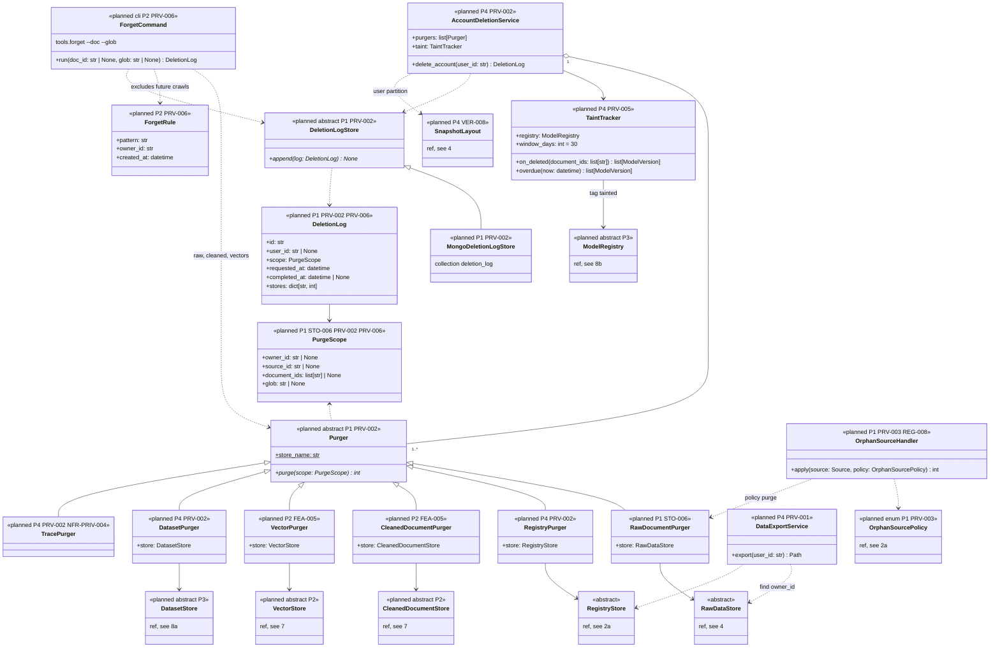

---

## 11. Exceptions

Every intentional error derives from `DigitalTwinError`. Item-level `ParseError` is logged and skipped. Source-level `SourceError` fails one source. `AccessBlockedError`, `AuthenticationError` and `RateLimitError` stop the provider. `ConfigError` stops before fetching (FR-ETL-002). Planned subclasses go under the branch whose handling policy they share. Three new branches are added for budgets, access control and inference.

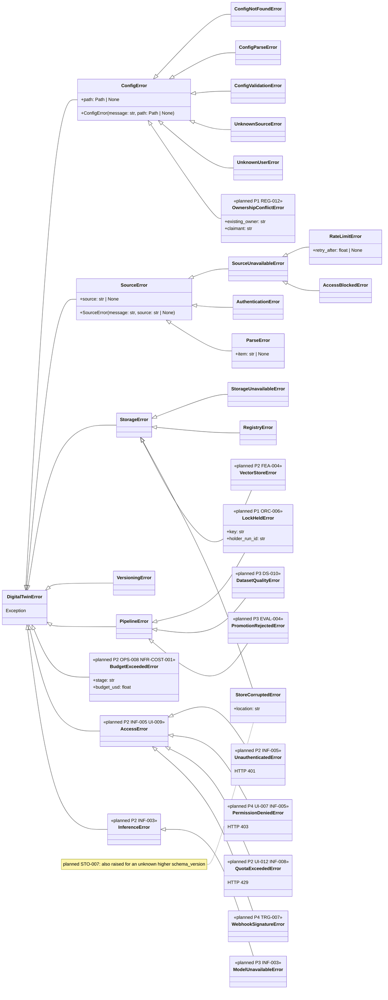

---

## 12. Design notes

### 12.1 Key patterns in the implemented code (keep them in planned work)

1. **Template method plus strategy for extraction.** `BaseExtractor[S].extract()` fixes the control flow: session, loop over sources, error levels, abort, "all items failed means the source failed". Providers fill in `extract_source`, `health_check` and optionally `session`. The generic parameter `S` (bound to `BaseProviderSettings`) types each provider's tuning. Planned hooks (cursor, enumeration result, containing non-`SourceError` exceptions) go into the base class, so every provider gets them at once.
2. **Plugin registries keyed by name.** `PROVIDERS` (name to settings model and extractor class) and the `SourceSpec` discriminated union (`type` to spec model) are the only places that list providers and source types. Adding a source type means one spec module, one union entry and one extractor branch (NFR-MNT-001). Planned registries follow this: `CleanerRegistry` and `ChunkerRegistry` (kind to strategy), `vector_store_factory`, `PromptRegistry`.
3. **Repository plus factory per store.** `RawDataStore` / `RegistryStore` (ABCs) have `Mongo*` implementations and are chosen by `create_*_store(backend)` from `Settings`. The driver is imported only inside the factory branch. Implementations raise only `StorageError` subclasses. Planned stores follow the same three-part shape: `RunRecordStore`, `ChangeSetStore`, `LockManager`, `TriggerEventStore`, `CleanedDocumentStore`, `VectorStore` (Qdrant), `DatasetStore`, `ModelRegistry`, `CostLedger`, `DeletionLogStore`.
4. **Context object and collecting parameter.** `CrawlContext` carries run-wide inputs (run id, topics, users, existing topic counts) into every extractor. `CrawlReport` collects per-item outcomes that become both the HTML artifact and the registry state. The planned `RunRecord` and `ChangeSet` are built the same way, from the reports and `UpsertStats` of one run.
5. **Pydantic models as contracts.** `RawDocument` is the single output contract of extraction. Specs use `extra="forbid"` and validation context (topics). `Settings` groups one `BaseSettings` class per env prefix. Planned contracts (`CleanedDocument`, `Chunk`, `InstructionSample`, `ModelVersion`, `Trace`) are Pydantic models too, so they can be validated at every boundary and serialised into artifacts.
6. **Thin infrastructure adapters.** `Browser`, `GitHubClient`, `MediumFeedClient`, `DvcRepo`, `GitRepo` and `get_client()` wrap external tools and turn their errors into project exceptions. They are context managers where they hold resources. Planned adapters (`QdrantVectorStore`, `OpikTracer`, `HostedLLMClient`, `CloudGpuBackend`) must do the same.
7. **Steps are thin, logic is plain Python.** ZenML steps call plain functions or classes (`crawl_provider`, `RegistrySeeder`, `SourceSelector`, `RawDataSnapshotExporter`), so the logic runs and tests without ZenML. Planned pipelines (`feature_engineering`, `generate_datasets`, `training`) list their steps the same way and take an explicit upstream version as input (FR-ORC-005).
8. **Idempotency by stable ids.** Canonical source keys, stable document ids, `$setOnInsert` for state, `$addToSet` for lists. Planned downstream ids follow this: chunk `point_id` is a hash of document id, chunk index and cleaner version (FR-FEA-005), and dataset and model versions are immutable.

### 12.2 Cross-cutting rules

- **`owner_id` isolation (G5, FR-REG-010).** `owner_id` is set only by `make_document` from `Source.owner_id`, and only for owned specs. It must flow unchanged through `CleanedDocument`, `Chunk` payloads, samples and `ModelVersion`. Every read on behalf of a user goes through one filter: `VectorFilter.for_user(user_id)` (owner is the user or null), `RawDataStore.find(owner_id=...)`, and the dataset build filter plus `OwnerIsolationCheck` before training. The precondition is `OwnershipGuard` (FR-REG-012). Without it, a second user who declares the owner's GitHub account becomes its owner.
- **Self/external origin (G2).** `origin` is decided once, at extraction (`make_document`, `pdf_origin`, `ArticleSpec.origin`). Invariant DQ-4: `owner_id` is set if and only if `origin=self`. Today `ArticleSpec(origin=self)` breaks it (FR-ART-005). Downstream only reads `origin`: style samples need `self` plus `StyleEligibilityPolicy`, external samples need `LicensePolicy`, and retrieval may return both.
- **Canonical keys and dedup.** All source ids come from `registry/keys.py`. A key change is a data migration (it would duplicate sources), so any change needs `SchemaMigrator` and tests (RISK-05).
- **Error levels.** Item, source, provider, run (FR-ETL-002). Planned code raises project exceptions only (section 11). New infrastructure errors map into `StorageError` or `SourceError`, never driver types.
- **Lineage.** `run_id` (ZenML run name) is in `Provenance`, `SourceState` and, later, `RunRecord`. `data_md5` plus the git commit identify a raw snapshot. Each downstream artifact records the version it was built from (FR-VER-004).
- **Change-set contract.** The only ETL to feature-pipeline interface is `ChangeSet` (inserted, changed, tombstoned ids) (FR-ORC-008). Tombstones are inferred only from a complete enumeration (`EnumerationResult.complete`), never from feeds (FR-ETL-010).
- **Unattended by default.** `RunOptions.interactive=False` for scheduled and triggered runs. No browser in that mode (FR-MED-008, NFR-CMP-002).
- **Money.** Every paid call estimates its cost first and goes through `BudgetGuard`, which writes to `CostLedger` (FR-OPS-008).
- **One reader per input.** The environment is read only by `get_settings()`, YAML only by `YamlLoader`. Planned settings groups (Qdrant, embeddings, LLM, budgets, API, scheduler, tracing) are new `BaseSettings` classes on `Settings`.

### 12.3 Code and requirements mismatches noticed while drawing

1. **The brief says `RawDocument` has a `kind` field. The code calls it `source: SourceKind`.** `make_document(kind=...)` maps `kind` to `source`. Requirements FR-ETL-004 and section 5.1 already use `source`. The planned `CleanedDocument` and `Chunk` use `kind`, which is clearer. Consider renaming `RawDocument.source` to `kind` with a schema migration (FR-STO-007).
2. **Two classes are named `GitHubSettings`.** `settings/app_settings.py` (token) and `raw_data/sources/github/settings.py` (`request_delay_s`). They are in different modules and are not imported together today, but the clash makes diagrams and imports confusing. Suggest renaming the first to `GitHubApiSettings`.
3. **`MediumSettings.skip_member_only` is never read** (already FR-CFG-005).
4. **The `crawl_medium` step docstring says "(Selenium)".** Article text comes from RSS, and Selenium is used only for tag discovery.
5. **Extractors set attributes outside `__init__`.** `GitHubExtractor.client` and `MediumExtractor.counts`, `known`, `feeds`, `listing` and `listing_blocked` exist only inside `session()`. The diagrams show them as attributes. Declaring them in `__init__` (as `None`) would help type checking (NFR-MNT-003).
6. **`create_registry_store` reads `RAW_STORE_BACKEND`.** The registry and the raw store cannot use different backends. That is fine today but undocumented in `Settings`.
7. **`ArticlesExtractor.crawler` is a property that builds a new `CustomArticleCrawler` on each access.** It runs once per source and once in the health check. This is harmless, but a session-scoped crawler would match the other providers.
8. **The requirements' gap statements match the code.** These were confirmed while drawing: `_find_in_feed` catches `RateLimitError` (FR-MED-005), 5xx exhaustion raises `RateLimitError`, `upsert_source` `$set`s `owner_id` (FR-REG-012), `record_state` overwrites the whole state (FR-REG-014), `ObsidianVault.notes()` fails the whole vault on one bad file (FR-OBS-006), and the article UA is a copied Chrome string (FR-ART-002). No requirement claims an implemented behaviour that the code lacks.

---

## 13. Class counts

| Diagram | Implemented classes in the diagram (not counting refs) | Planned classes in the diagram (not counting refs) |
|---|---|---|
| 1 Settings and configuration | 12 | 8 |
| 2a Registry core | 13 | 8 |
| 2b Source specs | 12 | 0 |
| 3a Extraction framework | 20 | 5 |
| 3b Medium and GitHub | 13 | 3 |
| 3c LinkedIn, Obsidian, Articles | 17 | 4 |
| 4 Raw storage and versioning | 13 | 7 |
| 5 Orchestration | 15 | 14 |
| 6 Triggers | 0 | 18 |
| 7 Feature pipeline | 0 | 30 |
| 8a Datasets | 0 | 27 |
| 8b Training and evaluation | 0 | 23 |
| 9 Inference and LLMOps | 0 | 33 |
| 10a UI and API | 0 | 25 |
| 10b Privacy | 0 | 17 |
| 11 Exceptions | 19 | 13 |
| **Unique across all diagrams** | **121** | **235** |

Some classes appear in full in two diagrams, for example the five extractors in 3a (as stubs) and in 3b/3c, so the column sums are larger than the unique totals. These counts include `<<module>>`, `<<step>>`, `<<pipeline>>`, `<<cli>>` and `<<enumeration>>` boxes. The overview's package boxes are not counted.

---

## 14. Planned classes mapped to requirements

| Planned class | Diagram | Phase | Requirement IDs |
|---|---|---|---|
| QdrantSettings | 1 | P2 | FR-FEA-004 |
| EmbeddingSettings | 1 | P2 | FR-FEA-003, FR-FEA-009 |
| LLMSettings | 1 | P3 | FR-DS-007, OQ-05 |
| BudgetSettings | 1 | P2 | NFR-COST-001, FR-OPS-008 |
| ApiSettings | 1 | P2 | FR-INF-005, FR-INF-008 |
| SchedulerSettings | 1 | P1 | FR-TRG-002, FR-TRG-003, FR-TRG-004, FR-TRG-006, FR-TRG-008 |
| TracingSettings | 1 | P2 | FR-OPS-001, NFR-PRIV-004 |
| TopicMigrator | 1 | P2 | FR-CFG-007 |
| SourceCursor (+ FeedCursor, GitHubCursor, VaultCursor, HttpCacheCursor) | 2a, 3b, 3c | P1 | FR-REG-014, FR-REG-011, FR-GH-005, FR-TRG-003 |
| DeclaredVia | 2a | P4 | FR-CFG-008 |
| OwnershipGuard | 2a | P1 | FR-REG-012, DQ-5 |
| DeclarationMerger | 2a | P1 | FR-REG-013, NFR-SCL-001 |
| RegistryReconciler, ReconcileStats | 2a | P1 | FR-REG-008, FR-REG-009 |
| OrphanSourcePolicy | 2a | P1 | FR-PRV-003, FR-REG-008 |
| SelectionResult | 2a | P1 | FR-REG-007 |
| EnumerationResult | 3a | P1 | FR-ETL-010, FR-GH-004 |
| CrawlMode | 3a | P1 | FR-MED-008, FR-MED-003, NFR-CMP-002 |
| CrawlerIdentity | 3a | P1 | FR-ART-002, NFR-CMP-003 |
| RetryPolicy | 3a | P1 | FR-MED-005, NFR-REL-005, NFR-CMP-003 |
| RobotsPolicy | 3a | P1 | FR-ART-003, NFR-CMP-001 |
| VendoredCodeClassifier | 3b | P2 | FR-GH-006 |
| NotePrivacyFilter | 3c | P1 | FR-OBS-004, NFR-PRIV-003 |
| BylineExtractor | 3c | P2 | FR-ART-004 |
| TombstonePolicy | 4 | P1 | FR-ETL-010, FR-STO-006 |
| SchemaMigration, SchemaMigrator | 4 | P1 | FR-STO-007 |
| SnapshotPublisher, SnapshotRef | 4 | P1 | FR-VER-006, FR-ORC-007 |
| SnapshotRestorer | 4 | P1 | FR-VER-007, FR-OPS-009 |
| SnapshotLayout | 4 | P4 | FR-VER-008, FR-PRV-002 |
| RunRecord, CrawlSummary | 5 | P1 | FR-ORC-007, FR-ORC-003, NFR-COST-002 |
| RunRecordStore, MongoRunRecordStore | 5 | P1 | FR-ORC-007 |
| ChangeSet, ChangeSetStore, MongoChangeSetStore | 5 | P2 | FR-ORC-008, FR-STO-005, FR-TRG-005 |
| LockManager, MongoLockManager, Lease | 5 | P1 | FR-ORC-006 |
| RunOptions | 5 | P1 | FR-MED-008, FR-TRG-002 |
| record_run (step) | 5 | P1 | FR-ORC-007 |
| publish_change_set (step) | 5 | P2 | FR-ORC-008 |
| tools_restore_snapshot (cli) | 5 | P1 | FR-VER-007 |
| TriggerKind, TriggerEvent, TriggerEventStore, MongoTriggerEventStore | 6 | P1 | FR-TRG-008 |
| TriggerSource, GitHubPushPoller, MediumFeedPoller, VaultWatcher | 6 | P1 | FR-TRG-003 |
| Scheduler, ScheduleEntry | 6 | P1 | FR-TRG-002 |
| Coalescer, TriggerBatch | 6 | P1 | FR-TRG-004 |
| BackoffGate | 6 | P1 | FR-TRG-006, FR-REG-014 |
| TriggerRetryPolicy | 6 | P1 | FR-TRG-008, FR-OPS-006 |
| TriggerDispatcher | 6 | P1 | FR-TRG-002, FR-TRG-003, FR-ORC-006 |
| FeatureRunTrigger | 6 | P2 | FR-TRG-005 |
| WebhookVerifier, GitHubWebhookVerifier | 6 | P4 | FR-TRG-007 |
| feature_engineering (pipeline) | 7 | P2 | FR-FEA-001, FR-ORC-005, FR-VER-004 |
| CleanedDocument | 7 | P2 | FR-FEA-001, FR-FEA-006, FR-DS-008 |
| Cleaner, MarkdownCleaner, CodeCleaner, PostCleaner, CleanerRegistry | 7 | P2 | FR-FEA-001 |
| QualityGate | 7 | P2 | FR-FEA-007 |
| SecretMasker | 7 | P2 | FR-FEA-008 |
| DuplicateDetector, DuplicateGroup | 7 | P2 | FR-ETL-011, FR-DS-004 |
| CleanedDocumentStore, MongoCleanedDocumentStore | 7 | P2 | FR-FEA-006, OQ-04 |
| Chunk, Chunker, HeadingChunker, CodeChunker, WholeDocumentChunker, ChunkerRegistry | 7 | P2 | FR-FEA-002 |
| EmbeddingModelInfo, Embedder, LocalEmbedder, HostedEmbedder | 7 | P2 | FR-FEA-003, FR-FEA-009 |
| VectorPoint, VectorFilter, ScoredChunk | 7 | P2 | FR-FEA-004, FR-REG-010, FR-INF-002 |
| VectorStore, QdrantVectorStore, vector_store_factory | 7 | P2 | FR-FEA-004, FR-FEA-005, NFR-SCL-002, NFR-PERF-005 |
| CollectionAliasManager | 7 | P2 | FR-FEA-010 |
| generate_datasets (pipeline) | 8a | P3 | FR-DS-001, FR-ORC-005 |
| InstructionSample | 8a | P3 | FR-DS-001 |
| PreferenceSample | 8a | P3 | FR-DS-002 |
| DatasetKind, DatasetVersion | 8a | P3 | FR-VER-005, FR-VER-004 |
| DatasetCard | 8a | P3 | FR-DS-005, NFR-CMP-005 |
| StyleEligibilityPolicy | 8a | P3 | FR-DS-008 |
| LicensePolicy | 8a | P3 | FR-DS-006, NFR-CMP-004 |
| PiiMasker, RegexPiiMasker, NerPiiRedactor | 8a | P3 | FR-FEA-008, FR-PRV-004 |
| SampleGenerator, InstructionGenerator, PreferenceGenerator | 8a | P3 | FR-DS-001, FR-DS-002 |
| SampleFilter, DedupFilter, LengthFilter, JudgeFilter, FilterReport | 8a | P3 | FR-DS-003 |
| DocumentSplitter | 8a | P3 | FR-DS-004 |
| DatasetQualityGate | 8a | P3 | FR-DS-010 |
| CostEstimator | 8a | P3 | FR-DS-007, FR-FEA-009 |
| DatasetStore, PrivateHubDatasetStore, DvcDatasetStore | 8a | P3 | FR-VER-005, NFR-PRIV-001 |
| CuratedEvalSet, EvalItem | 8a | P3 | FR-DS-009 |
| training (pipeline) | 8b | P3 | FR-FT-001, FR-ORC-005 |
| TrainingConfig | 8b | P3 | FR-FT-003 |
| Trainer, SftTrainer, DpoTrainer | 8b | P3 | FR-FT-001, FR-FT-002 |
| ComputeBackend, LocalGpuBackend, CloudGpuBackend, JobHandle | 8b | P3 | FR-FT-006 |
| OwnerIsolationCheck | 8b | P4 | FR-FT-005, FR-REG-010 |
| ModelVersion, ModelTag | 8b | P3 | FR-FT-004, FR-PRV-005 |
| ModelRegistry, PrivateHubModelRegistry | 8b | P3 | FR-FT-004, NFR-PRIV-001 |
| Evaluator, StyleSimilarityEvaluator, AnswerQualityEvaluator | 8b | P3 | FR-EVAL-001 |
| BenchmarkRegressionEvaluator | 8b | P3 | FR-EVAL-002 |
| RagEvaluator | 8b | P2 | FR-EVAL-003 |
| SafetyEvaluator | 8b | P3 | FR-EVAL-005, NFR-SEC-006 |
| MetricScore, EvalReport | 8b | P3 | FR-EVAL-001 |
| PromotionGate | 8b | P3 | FR-EVAL-004, FR-OPS-004 |
| TwinService | 9 | P2 | FR-INF-001, FR-INF-004, FR-INF-006, FR-INF-007 |
| ChatRequest, ChatTurn, ChatResponse, SourceCitation | 9 | P2 | FR-INF-001, FR-INF-006, FR-INF-007 |
| Retriever | 9 | P2 | FR-INF-002, FR-INF-007, FR-REG-010 |
| QueryRewriter, LlmQueryExpander, SelfQueryExtractor | 9 | P2 | FR-INF-002 |
| Reranker, CrossEncoderReranker | 9 | P2 | FR-INF-002 |
| PromptTemplate, PromptRegistry | 9 | P2 | FR-OPS-002 |
| LLMClient, BaseModelClient | 9 | P2 | FR-INF-003 |
| AdapterModelClient, ModelResolver | 9 | P3 | FR-INF-003, FR-FT-004 |
| HostedLLMClient | 9 | P3 | FR-DS-001, FR-EVAL-001, OQ-05 |
| Completion | 9 | P2 | FR-OPS-001, FR-OPS-008 |
| Tracer, OpikTracer, Trace | 9 | P2 | FR-OPS-001 |
| Feedback | 9 | P4 | FR-OPS-007 |
| CostEntry, CostLedger, MongoCostLedger, BudgetGuard | 9 | P2 | FR-OPS-008, NFR-COST-001, NFR-COST-002, FR-INF-008 |
| RateLimiter | 9 | P2 | FR-INF-008, FR-UI-004 |
| Alerter, AlertRule | 9 | P1 | FR-OPS-005, FR-OPS-006 |
| MetricsExporter | 9 | P1 | NFR-OBSV-004 |
| TraceRetentionJob | 9 | P2 | NFR-PRIV-004 |
| BackupJob | 9 | P1 | FR-OPS-009, NFR-REL-007 |
| ApiApp | 10a | P2 | FR-UI-008, FR-INF-001 |
| AuthRouter, SourcesRouter, TwinRouter, AdminRouter, UploadRouter, WebhookRouter | 10a | P2/P4 | FR-UI-001..009, FR-INF-001, FR-LI-004, FR-TRG-007 |
| AuthService, BearerTokenAuth | 10a | P2 | FR-INF-005 |
| SessionAuthService, Principal, Role, Invite | 10a | P4 | FR-UI-009, NFR-SEC-003, OQ-14 |
| Consent | 10a | P4 | FR-UI-010, NFR-CMP-006 |
| Credential, CredentialVault | 10a | P4 | FR-UI-005, NFR-SEC-004 |
| GitHubOAuthVerifier | 10a | P4 | FR-UI-011, FR-REG-012 |
| SourceRegistrationService, SubscriptionView | 10a | P4 | FR-UI-001, FR-UI-002, FR-UI-003, FR-CFG-008 |
| OnDemandCrawlService | 10a | P4 | FR-UI-004 |
| QuotaPolicy | 10a | P4 | FR-UI-012 |
| ExclusionService, Exclusion | 10a | P4 | FR-UI-006 |
| UploadService, SafeZipExtractor | 10a | P4 | FR-LI-004, FR-OBS-005, FR-UI-005 |
| PurgeScope, Purger, RawDocumentPurger | 10b | P1 | FR-STO-006, FR-PRV-002, FR-PRV-006 |
| RegistryPurger, DatasetPurger, TracePurger | 10b | P4 | FR-PRV-002 |
| CleanedDocumentPurger, VectorPurger | 10b | P2 | FR-FEA-005, FR-PRV-006 |
| AccountDeletionService | 10b | P4 | FR-PRV-002, FR-VER-008 |
| DataExportService | 10b | P4 | FR-PRV-001 |
| ForgetCommand, ForgetRule | 10b | P2 | FR-PRV-006 |
| DeletionLog, DeletionLogStore, MongoDeletionLogStore | 10b | P1 | FR-PRV-002, FR-PRV-006 |
| TaintTracker | 10b | P4 | FR-PRV-005 |
| OrphanSourceHandler | 10b | P1 | FR-PRV-003, FR-REG-008 |
| OwnershipConflictError | 11 | P1 | FR-REG-012 |
| LockHeldError | 11 | P1 | FR-ORC-006 |
| VectorStoreError | 11 | P2 | FR-FEA-004 |
| DatasetQualityError | 11 | P3 | FR-DS-010 |
| PromotionRejectedError | 11 | P3 | FR-EVAL-004 |
| BudgetExceededError | 11 | P2 | FR-OPS-008, NFR-COST-001 |
| AccessError, UnauthenticatedError, PermissionDeniedError, QuotaExceededError | 11 | P2/P4 | FR-INF-005, FR-UI-007, FR-UI-009, FR-UI-012, FR-INF-008 |
| WebhookSignatureError | 11 | P4 | FR-TRG-007 |
| InferenceError, ModelUnavailableError | 11 | P2/P3 | FR-INF-003 |

Planned members of implemented classes (shown in notes, not as classes): `SourceState` cursor and success fields (FR-REG-014), `Source.declared_via` / `schema_version` (FR-CFG-008, FR-STO-007), `Subscription` per-subscriber fields (FR-REG-013), `RegistryStore` unsubscribe and delete (FR-REG-008/009), `RawDocument` lifecycle fields (FR-ETL-010, FR-STO-005/006/007), `RawDataStore` tombstone, purge and topic replacement (FR-STO-006, FR-ETL-013), `UpsertStats.changed` (FR-STO-005), spec additions (FR-MED-007, FR-ART-005, FR-GH-006/007, FR-OBS-004, FR-DS-006), `BaseExtractor` hooks and fault containment (FR-ETL-012, FR-REG-011), `CrawlContext.mode` (FR-MED-008), `MediumFeedClient` back-off fixes (FR-MED-005), `GitHubClient` truncation and SHA (FR-GH-004/005/007), `ObsidianVault` per-file loading (FR-OBS-006), `CustomArticleCrawler` UA (FR-ART-002), `Topic.renamed_from` (FR-CFG-007), `User` role and disabled (FR-UI-009).
