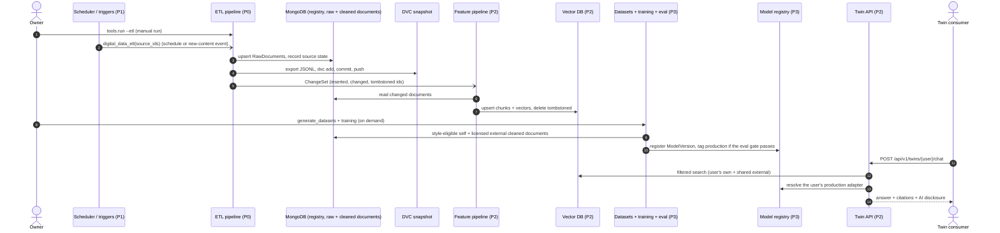

# SD-0. End-to-end overview

[← Sequence diagrams](README.md) · [Hub](../README.md) · Next: [SD-1](sd1_etl_pipeline_run.md)

| | |
|---|---|
| Status | Mixed |
| Requirements | none |
| User stories | none |
| Use cases | [UC-06](../use_cases/02_run_etl.md#uc-06-run-the-etl-pipeline) |
| Class diagrams | [0](../class_diagrams/00_overview.md), [2a](../class_diagrams/02a_registry_core.md), [3a](../class_diagrams/03a_extraction_framework.md), [4](../class_diagrams/04_raw_storage_and_versioning.md), [5](../class_diagrams/05_orchestration.md), [6](../class_diagrams/06_triggers_and_scheduling.md), [8b](../class_diagrams/08b_training_model_registry_and_evaluation.md) |
| draw.io | copy the ```mermaid block below → Arrange › Insert › Advanced › Mermaid |


The whole application at one level of abstraction: how content moves from a platform to a twin's answer. Each lifeline is a subsystem; [SD-1](sd1_etl_pipeline_run.md) to [SD-8](sd8_account_deletion.md) open them up.


