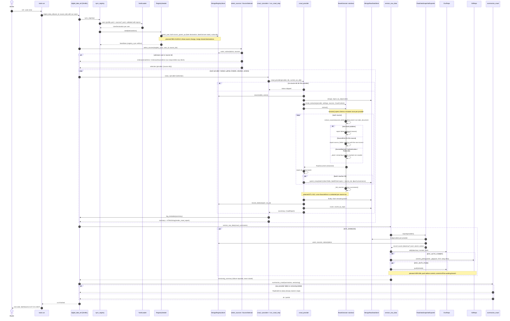

# SD-1. ETL pipeline run (implemented)

[← Sequence diagrams](README.md) · [Hub](../README.md) · Previous: [SD-0](sd0_end_to_end.md) · Next: [SD-2](sd2_medium_extraction.md)

| | |
|---|---|
| Status | Implemented (P0) |
| Requirements | [ETL](../requirements/requirements.md#23-extraction-framework-etl) 001, 002, 003, 004, 005, 006, 007, 008, 009 · [ORC](../requirements/requirements.md#26-orchestration-and-cli-orc) 001, 002, 003, 004 · [REG](../requirements/requirements.md#22-source-registry-and-multi-user-reg) 005, 006, 007 · [VER](../requirements/requirements.md#27-data-versioning-ver) 001, 002, 003 |
| User stories | US-007, US-008, US-009, US-015, US-016, US-017, US-018, US-019, US-039, US-040, US-043 ([backlog](../user_stories/user_stories.md)) |
| Use cases | [UC-01](../use_cases/01_configure_and_register_sources.md#uc-01-declare-topics-and-sources-in-yaml), [UC-06](../use_cases/02_run_etl.md#uc-06-run-the-etl-pipeline) |
| Class diagrams | [0](../class_diagrams/00_overview.md), [1](../class_diagrams/01_settings_and_configuration.md), [2a](../class_diagrams/02a_registry_core.md), [2b](../class_diagrams/02b_source_specs.md), [3a](../class_diagrams/03a_extraction_framework.md), [4](../class_diagrams/04_raw_storage_and_versioning.md), [5](../class_diagrams/05_orchestration.md) |
| draw.io | copy the ```mermaid block below → Arrange › Insert › Mermaid |


`uv run python -m tools.run --etl [--user U] [--source ID ...]` builds and runs the ZenML pipeline. The five crawl steps have the same body (`run_crawl_step` → `crawl_provider`); the loop shows one provider. On the local orchestrator they run one after another.


