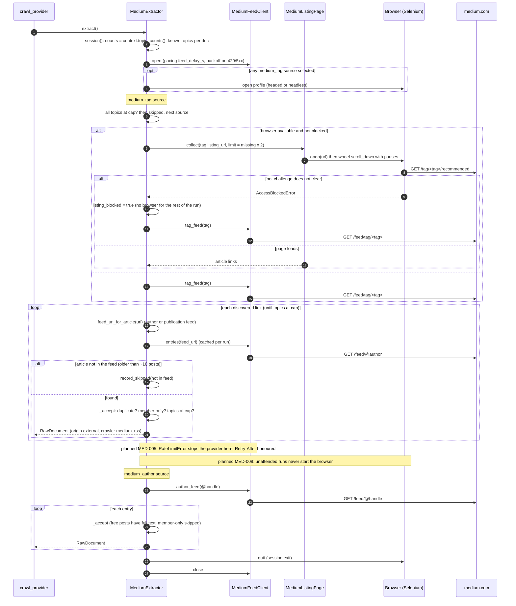

# SD-2. Medium extraction inside a crawl step (implemented)

[← Sequence diagrams](README.md) · [Hub](../README.md) · Previous: [SD-1](sd1_etl_pipeline_run.md) · Next: [SD-3](sd3_trigger_incremental_etl.md)

| | |
|---|---|
| Status | Implemented (P0) |
| Requirements | [ETL](../requirements/requirements.md#23-extraction-framework-etl) 002, 008 · [MED](../requirements/requirements.md#medium-med) 001, 002, 003, 004, 005, 006 |
| User stories | US-016, US-019, US-023, US-024, US-025 ([backlog](../user_stories/user_stories.md)) |
| Use cases | [UC-07](../use_cases/02_run_etl.md#uc-07-extract-content-from-a-provider) |
| Class diagrams | [3a](../class_diagrams/03a_extraction_framework.md), [3b](../class_diagrams/03b_providers_medium_and_github.md), [3c](../class_diagrams/03c_providers_linkedin_obsidian_and_articles.md) |
| draw.io | copy the ```mermaid block below → Arrange › Insert › Mermaid |


The detail of `MediumExtractor` for one `medium_tag` source and one `medium_author` source. Article text comes only from official RSS feeds (FR-MED-001). The browser is started only if a tag source is selected, and only discovers links.


