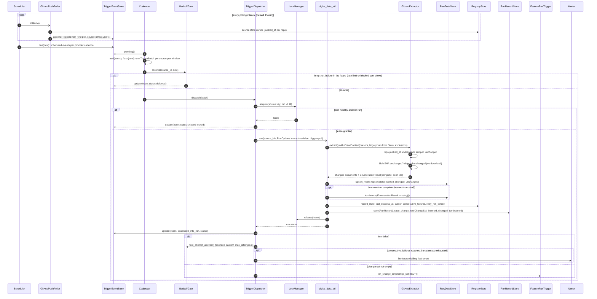

# SD-3. Trigger to targeted, incremental ETL run (planned P1)

[← Sequence diagrams](README.md) · [Hub](../README.md) · Previous: [SD-2](sd2_medium_extraction.md) · Next: [SD-4](sd4_feature_pipeline.md)

| | |
|---|---|
| Status | Planned P1 |
| Requirements | [ETL](../requirements/requirements.md#23-extraction-framework-etl) 010 · [ORC](../requirements/requirements.md#26-orchestration-and-cli-orc) 006, 007, 008 · [REG](../requirements/requirements.md#22-source-registry-and-multi-user-reg) 011, 014 · [STO](../requirements/requirements.md#25-raw-storage-sto) 005, 006 · [TRG](../requirements/requirements.md#28-triggers-and-scheduling-trg) 002, 003, 004, 005, 006, 007, 008 |
| User stories | US-013, US-020, US-038, US-041, US-042, US-046, US-047, US-048, US-049, US-050 ([backlog](../user_stories/user_stories.md)) |
| Use cases | [UC-08](../use_cases/02_run_etl.md#uc-08-detect-changes-and-deletions-upstream), [UC-11](../use_cases/03_triggers_and_scheduling.md#uc-11-run-sources-on-a-schedule), [UC-12](../use_cases/03_triggers_and_scheduling.md#uc-12-trigger-ingestion-from-new-content) |
| Class diagrams | [2a](../class_diagrams/02a_registry_core.md), [3a](../class_diagrams/03a_extraction_framework.md), [3b](../class_diagrams/03b_providers_medium_and_github.md), [4](../class_diagrams/04_raw_storage_and_versioning.md), [5](../class_diagrams/05_orchestration.md), [6](../class_diagrams/06_triggers_and_scheduling.md), [9](../class_diagrams/09_llm_clients_inference_and_llmops.md) |
| draw.io | copy the ```mermaid block below → Arrange › Insert › Advanced › Mermaid |


TRG-002..008, REG-011, REG-014, ORC-006..008, ETL-010, ETL-012, STO-005/006, MED-008. A new commit on GitHub reaches the store without a full run. Pollers are the P1 mechanism; webhooks (TRG-007) enter at the same `TriggerEventStore` in P4.


