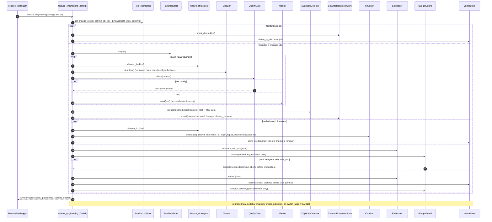

# SD-4. Feature pipeline from a change set (planned P2)

[← Sequence diagrams](README.md) · [Hub](../README.md) · Previous: [SD-3](sd3_trigger_incremental_etl.md) · Next: [SD-5](sd5_rag_chat.md)

| | |
|---|---|
| Status | Planned P2 |
| Requirements | [FEA](../requirements/requirements.md#210-feature-pipeline-fea) 001, 002, 003, 004, 005, 006, 007, 008, 009, 010 · [TRG](../requirements/requirements.md#28-triggers-and-scheduling-trg) 005 · [VER](../requirements/requirements.md#27-data-versioning-ver) 004 |
| User stories | US-049, US-059, US-060, US-061, US-062, US-063, US-064, US-065, US-078 ([backlog](../user_stories/user_stories.md)) |
| Use cases | [UC-14](../use_cases/04_rag_chat_and_features.md#uc-14-build-and-update-the-search-index) |
| Class diagrams | [4](../class_diagrams/04_raw_storage_and_versioning.md), [5](../class_diagrams/05_orchestration.md), [6](../class_diagrams/06_triggers_and_scheduling.md), [7](../class_diagrams/07_feature_pipeline.md), [9](../class_diagrams/09_llm_clients_inference_and_llmops.md) |
| draw.io | copy the ```mermaid block below → Arrange › Insert › Mermaid |


TRG-005, FEA-001..010, VER-004, ETL-011, PRV-006. Only the documents in the change set are processed; a second run on the same change set writes nothing.


