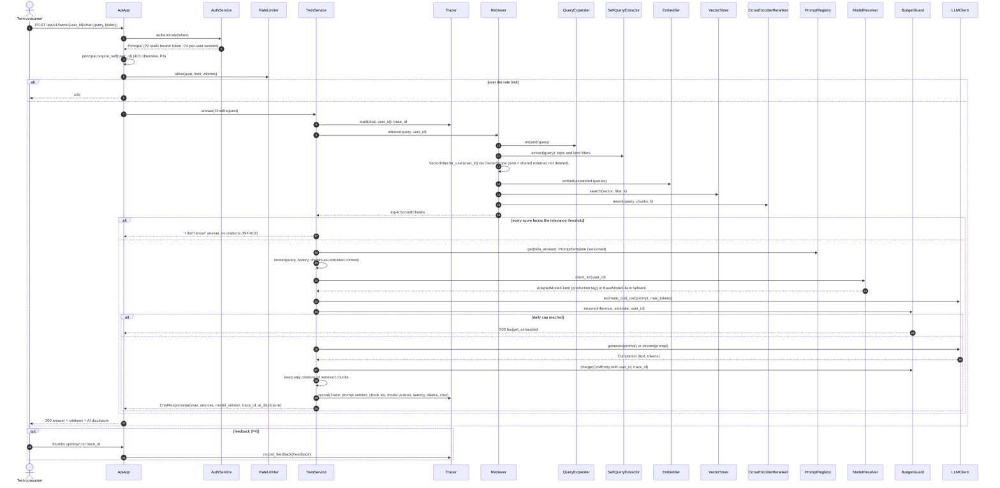

# SD-5. RAG chat request (planned P2, adapter from P3)

[← Sequence diagrams](README.md) · [Hub](../README.md) · Previous: [SD-4](sd4_feature_pipeline.md) · Next: [SD-6](sd6_datasets_training_eval.md)

| | |
|---|---|
| Status | Planned P2 (P3 adapter) |
| Requirements | [INF](../requirements/requirements.md#214-rag-inference-service-inf) 001, 002, 003, 004, 005, 006, 007, 008 · [OPS](../requirements/requirements.md#215-llmops-monitoring-cicd-deployment-ops) 001, 008 · [REG](../requirements/requirements.md#22-source-registry-and-multi-user-reg) 010 |
| User stories | US-014, US-067, US-068, US-069, US-070, US-071, US-072, US-087, US-088 ([backlog](../user_stories/user_stories.md)) |
| Use cases | [UC-16](../use_cases/04_rag_chat_and_features.md#uc-16-chat-with-the-twin), [UC-17](../use_cases/04_rag_chat_and_features.md#uc-17-give-feedback-on-an-answer) |
| Class diagrams | [7](../class_diagrams/07_feature_pipeline.md), [9](../class_diagrams/09_llm_clients_inference_and_llmops.md), [10a](../class_diagrams/10a_ui_api_and_authentication.md) |
| draw.io | copy the ```mermaid block below → Arrange › Insert › Advanced › Mermaid |


INF-001..008, OPS-001, OPS-008, REG-010, NFR-SEC-006. `OwnerScope` is the only place the user filter is built; the answer cites only retrieved chunks.


