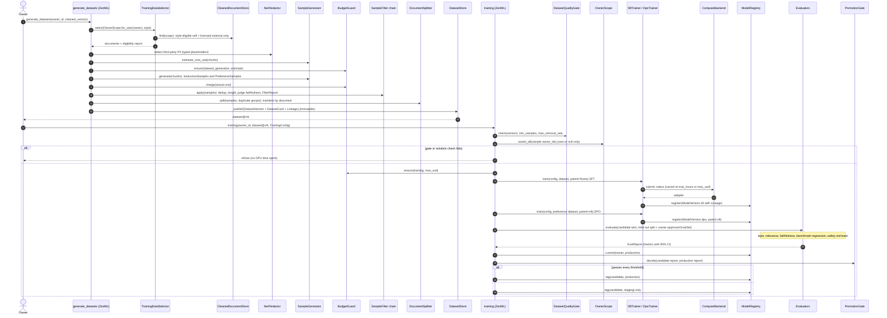

# SD-6. Datasets, fine-tuning, evaluation and promotion (planned P3)

[← Sequence diagrams](README.md) · [Hub](../README.md) · Previous: [SD-5](sd5_rag_chat.md) · Next: [SD-7](sd7_register_source_ui.md)

| | |
|---|---|
| Status | Planned P3 |
| Requirements | [DS](../requirements/requirements.md#211-dataset-generation-ds) 001, 002, 003, 004, 005, 006, 007, 008, 009, 010 · [EVAL](../requirements/requirements.md#213-evaluation-eval) 001, 002, 003, 004, 005 · [FT](../requirements/requirements.md#212-fine-tuning-ft) 001, 002, 003, 004, 005, 006 · [VER](../requirements/requirements.md#27-data-versioning-ver) 005 |
| User stories | US-073, US-074, US-075, US-076, US-077, US-078, US-079, US-080, US-081, US-082, US-083 ([backlog](../user_stories/user_stories.md)) |
| Use cases | [UC-18](../use_cases/05_datasets_training_eval.md#uc-18-generate-training-datasets), [UC-19](../use_cases/05_datasets_training_eval.md#uc-19-fine-tune-and-register-a-twin-model), [UC-20](../use_cases/05_datasets_training_eval.md#uc-20-evaluate-and-promote-a-model) |
| Class diagrams | [7](../class_diagrams/07_feature_pipeline.md), [8a](../class_diagrams/08a_dataset_generation.md), [8b](../class_diagrams/08b_training_model_registry_and_evaluation.md), [9](../class_diagrams/09_llm_clients_inference_and_llmops.md), [10b](../class_diagrams/10b_governance_and_privacy_operations.md) |
| draw.io | copy the ```mermaid block below → Arrange › Insert › Advanced › Mermaid |


DS-001..010, FT-001..006, EVAL-001..005, VER-004/005, PRV-004. `TrainingDataSelector` is the only gate for what enters a dataset, and `OwnerScope.assert_all` runs before any GPU time is spent.


