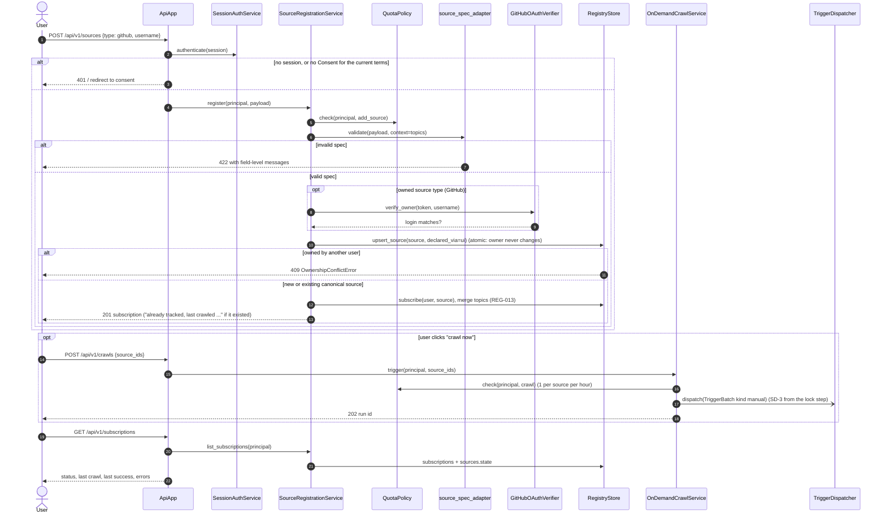

# SD-7. User registers a source in the UI (planned P4)

[← Sequence diagrams](README.md) · [Hub](../README.md) · Previous: [SD-6](sd6_datasets_training_eval.md) · Next: [SD-8](sd8_account_deletion.md)

| | |
|---|---|
| Status | Planned P4 |
| Requirements | [REG](../requirements/requirements.md#22-source-registry-and-multi-user-reg) 012, 013 · [UI](../requirements/requirements.md#29-source-registration-ui-and-api-ui) 001, 002, 003, 009, 010, 011, 012 |
| User stories | US-011, US-012, US-051, US-052, US-053, US-054, US-055, US-057 ([backlog](../user_stories/user_stories.md)) |
| Use cases | [UC-04](../use_cases/01_configure_and_register_sources.md#uc-04-register-a-source-through-the-ui-or-api), [UC-05](../use_cases/01_configure_and_register_sources.md#uc-05-manage-subscriptions-and-see-crawl-status), [UC-13](../use_cases/03_triggers_and_scheduling.md#uc-13-crawl-my-sources-on-demand) |
| Class diagrams | [2a](../class_diagrams/02a_registry_core.md), [2b](../class_diagrams/02b_source_specs.md), [6](../class_diagrams/06_triggers_and_scheduling.md), [10a](../class_diagrams/10a_ui_api_and_authentication.md) |
| draw.io | copy the ```mermaid block below → Arrange › Insert › Advanced › Mermaid |


UI-001..003, UI-009..012, REG-012/013, CFG-008. The form uses the same Pydantic spec models as YAML, and an existing canonical source is reused, not duplicated.


