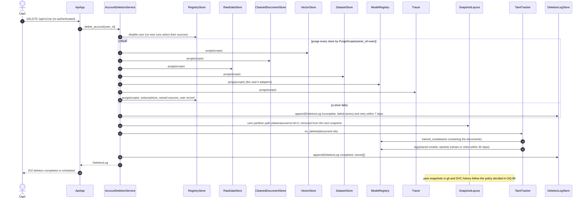

# SD-8. Account deletion (planned P4)

[← Sequence diagrams](README.md) · [Hub](../README.md) · Previous: [SD-7](sd7_register_source_ui.md)

| | |
|---|---|
| Status | Planned P4 |
| Requirements | [PRV](../requirements/requirements.md#216-privacy-and-data-subject-operations-prv) 002, 005 · [VER](../requirements/requirements.md#27-data-versioning-ver) 008 |
| User stories | US-045, US-093, US-095 ([backlog](../user_stories/user_stories.md)) |
| Use cases | [UC-23](../use_cases/06_admin_privacy_ops.md#uc-23-delete-my-account) |
| Class diagrams | [2a](../class_diagrams/02a_registry_core.md), [4](../class_diagrams/04_raw_storage_and_versioning.md), [7](../class_diagrams/07_feature_pipeline.md), [8a](../class_diagrams/08a_dataset_generation.md), [8b](../class_diagrams/08b_training_model_registry_and_evaluation.md), [9](../class_diagrams/09_llm_clients_inference_and_llmops.md), [10a](../class_diagrams/10a_ui_api_and_authentication.md), [10b](../class_diagrams/10b_governance_and_privacy_operations.md) |
| draw.io | copy the ```mermaid block below → Arrange › Insert › Advanced › Mermaid |


PRV-002, PRV-005, VER-008, NFR-CMP-006. Every store that holds user data implements `Purgeable`; the deletion completes across all of them or is logged as incomplete.


