# Use cases 00: Overview

[← Use cases](README.md) · [Hub](../README.md) · Next: [Use cases 01](01_configure_and_register_sources.md)

Every actor and every use case on one page. Each group file (01 to 06) zooms into one box, with its `«include»` / `«extend»` relations and a written specification per use case. System actors (the scheduler, the orchestrator, the platforms, the LLM and GPU providers) take part in a use case or start one; human actors start them.

```mermaid
flowchart LR
  owner["«actor»<br/>Owner"]
  user["«actor»<br/>Future user"]
  admin["«actor»<br/>Admin"]
  consumer["«actor»<br/>Twin consumer"]
  subgraph g01["01 Configure and register sources"]
    direction TB
    uc01(["UC-01<br/>Declare topics and sources in YAML"])
    uc02(["UC-02<br/>Check configuration and provider health"])
    uc03(["UC-03<br/>Sign in and accept the terms"])
    uc04(["UC-04<br/>Register a source through the UI or API"])
    uc05(["UC-05<br/>Manage subscriptions and see crawl status"])
  end
  subgraph g02["02 Run the ETL"]
    direction TB
    uc06(["UC-06<br/>Run the ETL pipeline"])
    uc07(["UC-07<br/>Extract content from a provider"])
    uc08(["UC-08<br/>Detect changes and deletions upstream"])
    uc09(["UC-09<br/>Upload a LinkedIn export or Obsidian vault"])
    uc10(["UC-10<br/>Restore a raw-data snapshot"])
  end
  subgraph g03["03 Triggers and scheduling"]
    direction TB
    uc11(["UC-11<br/>Run sources on a schedule"])
    uc12(["UC-12<br/>Trigger ingestion from new content"])
    uc13(["UC-13<br/>Crawl my sources on demand"])
  end
  subgraph g04["04 Search index and RAG chat"]
    direction TB
    uc14(["UC-14<br/>Build and update the search index"])
    uc15(["UC-15<br/>Exclude or forget content"])
    uc16(["UC-16<br/>Chat with the twin"])
    uc17(["UC-17<br/>Give feedback on an answer"])
  end
  subgraph g05["05 Datasets, training and evaluation"]
    direction TB
    uc18(["UC-18<br/>Generate training datasets"])
    uc19(["UC-19<br/>Fine-tune and register a twin model"])
    uc20(["UC-20<br/>Evaluate and promote a model"])
  end
  subgraph g06["06 Administration, privacy and operations"]
    direction TB
    uc21(["UC-21<br/>Administer the platform"])
    uc22(["UC-22<br/>Export my data"])
    uc23(["UC-23<br/>Delete my account"])
    uc24(["UC-24<br/>Operate and monitor the system"])
  end
  sched["«actor»<br/>Scheduler"]
  zenml["«actor»<br/>Pipeline orchestrator (ZenML)"]
  ext["«actor»<br/>External platforms"]
  llm["«actor»<br/>LLM and GPU providers"]
  owner --- uc01
  owner --- uc02
  uc02 --- ext
  user --- uc03
  user --- uc04
  uc04 --- ext
  user --- uc05
  owner --- uc05
  owner --- uc06
  uc06 --- zenml
  uc07 --- zenml
  uc07 --- ext
  uc08 --- zenml
  uc08 --- ext
  user --- uc09
  owner --- uc10
  uc11 --- sched
  uc11 --- zenml
  uc12 --- ext
  uc12 --- sched
  user --- uc13
  uc14 --- zenml
  uc14 --- llm
  user --- uc15
  owner --- uc15
  consumer --- uc16
  uc16 --- llm
  consumer --- uc17
  owner --- uc18
  uc18 --- zenml
  uc18 --- llm
  owner --- uc19
  uc19 --- zenml
  uc19 --- llm
  owner --- uc20
  uc20 --- llm
  admin --- uc21
  user --- uc22
  user --- uc23
  owner --- uc24
  classDef actor fill:#eef2ff,stroke:#4f46e5,color:#1e1b4b
  classDef done fill:#dcfce7,stroke:#15803d,color:#14532d
  classDef partial fill:#fef9c3,stroke:#a16207,color:#422006
  classDef planned fill:#f4f4f5,stroke:#71717a,color:#18181b,stroke-dasharray:5 5
  class owner,user,admin,sched,zenml,ext,llm,consumer actor
  class uc02 done
  class uc01,uc05,uc06,uc07,uc08,uc16 partial
  class uc03,uc04,uc09,uc10,uc11,uc12,uc13,uc14,uc15,uc17,uc18,uc19,uc20,uc21,uc22,uc23,uc24 planned
```

Legend: green = implemented · yellow = partially implemented · grey dashed = planned. This diagram is large; in draw.io, paste one group file's diagram at a time if the layout is too dense.
