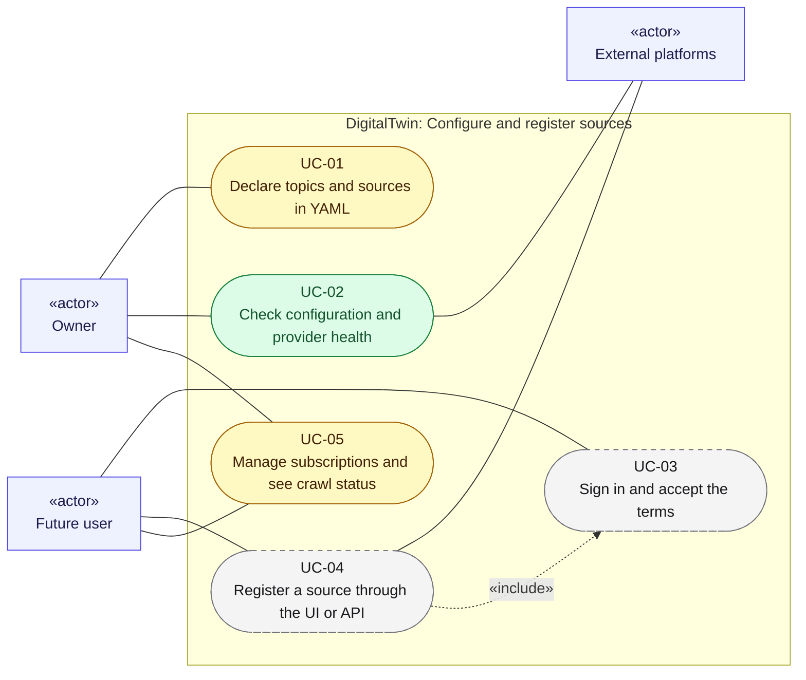

# Use cases 01: Configure and register sources

[← Use cases](README.md) · [Hub](../README.md) · Previous: [Overview](00_overview.md) · Next: [Use cases 02](02_run_etl.md)

How sources enter the registry: today from per-user YAML ([UC-01](#uc-01-declare-topics-and-sources-in-yaml), [UC-02](#uc-02-check-configuration-and-provider-health)), later through the UI and API ([UC-03](#uc-03-sign-in-and-accept-the-terms) to [UC-05](#uc-05-manage-subscriptions-and-see-crawl-status)). Both paths end in the same `users`, `sources` and `subscriptions` collections, under the same canonical keys.

Legend: green = implemented · yellow = partially implemented · grey dashed = planned. `«include»` = always part of the flow; `«extend»` = optional add-on to it.

---

## UC-01. Declare topics and sources in YAML

| | |
|---|---|
| Primary actor | Owner |
| Secondary actors | none |
| Status | Partially implemented · phase P0–P2 · Must |
| User stories | US-001, US-002, US-003, US-004, US-006, US-007, US-011 ([backlog](../user_stories/user_stories.md)) |
| Requirements | [CFG](../requirements/requirements.md#21-configuration-and-topics-cfg) 001, 002, 003, 004, 005, 007 · [REG](../requirements/requirements.md#22-source-registry-and-multi-user-reg) 001, 002, 003, 004, 005, 012 |
| Sequence diagrams | [SD-1](../sequence_diagrams/sd1_etl_pipeline_run.md) |
| Class diagrams | [1](../class_diagrams/01_settings_and_configuration.md), [2a](../class_diagrams/02a_registry_core.md), [2b](../class_diagrams/02b_source_specs.md) |

**Goal.** The owner describes what to collect (topics, a profile, sources per provider) in files that are validated before anything is crawled.

**Preconditions.** The repo is checked out and `.env` holds the connection settings and secrets.

**Main flow.**
1. The owner edits `configs/topics.yaml`, mapping each topic to Medium tags and Obsidian tag prefixes.
2. The owner edits `configs/users/<id>/profile.yaml` and `configs/users/<id>/sources/*.yaml`.
3. The owner tunes provider behaviour (delays, caps, retries) in `configs/providers/<provider>.yaml`.
4. On the next run, `sync_registry` loads every declaration through `YamlLoader`, validates it against the `SourceSpec` union and the topics, and seeds the registry under canonical keys (`RegistrySeeder`).
5. The system reports `SeedStats`. Unchanged YAML produces zero new sources and zero new subscriptions.

**Alternative flows.**
- 4a. Unknown `type`, an extra field, an unknown topic key, a duplicate source or a profile `id` that differs from its folder: a `ConfigError` naming the field and the file stops the run before any network access.
- 4b. *(planned)* A declaration would change the owner of an owned source: `OwnershipConflictError` naming both users, and the stored owner is unchanged.
- 4c. *(planned)* A topic is renamed (`renamed_from`) or removed: stored documents are migrated or flagged.

**Postconditions.** The registry holds one source per canonical key and one subscription per (user, source). Crawl state is never overwritten by seeding.

---

## UC-02. Check configuration and provider health

| | |
|---|---|
| Primary actor | Owner |
| Secondary actors | External platforms |
| Status | Implemented · phase P0 · Should |
| User stories | US-005 ([backlog](../user_stories/user_stories.md)) |
| Requirements | [CFG](../requirements/requirements.md#21-configuration-and-topics-cfg) 006 |
| Sequence diagrams | none yet |
| Class diagrams | [1](../class_diagrams/01_settings_and_configuration.md), [3a](../class_diagrams/03a_extraction_framework.md), [5](../class_diagrams/05_orchestration.md) |

**Goal.** Before a run, the owner learns whether the configuration is valid and every provider is reachable.

**Main flow.**
1. The owner runs `tools/validate_sources.py`, optionally with `--offline`.
2. The tool validates all configuration with the same loaders the pipeline uses.
3. Unless offline, it calls each extractor's `health_check` (for example one Medium author feed, the GitHub API).
4. The tool writes `data/manifests/source_health.json` and exits 0.

**Alternative flows.**
- 2a/3a. Invalid configuration or an unhealthy provider: the tool exits 1 and names the problem.

**Postconditions.** A health manifest exists. No MongoDB is needed and nothing is stored.

---

## UC-03. Sign in and accept the terms

| | |
|---|---|
| Primary actor | Future user |
| Secondary actors | none |
| Status | Planned · phase P4 · Must |
| User stories | US-051 ([backlog](../user_stories/user_stories.md)) |
| Requirements | [UI](../requirements/requirements.md#29-source-registration-ui-and-api-ui) 009, 010 |
| Sequence diagrams | none yet |
| Class diagrams | [10a](../class_diagrams/10a_ui_api_and_authentication.md) |

**Goal.** Only invited people use the system, and each user's consent to the current terms is recorded.

**Main flow.**
1. An invited user opens the UI and signs in.
2. If the user has not accepted the current terms, the system shows them and records a `Consent`.
3. The system creates a session with the user's roles and an expiry.

**Alternative flows.**
- 1a. No invite: sign-in is refused.
- 3a. The session expires: the next request returns 401 and the user signs in again.

**Postconditions.** An authenticated `Principal` exists for this session, and consent is on record.

---

## UC-04. Register a source through the UI or API

| | |
|---|---|
| Primary actor | Future user |
| Secondary actors | External platforms |
| Status | Planned · phase P1–P4 · Must |
| User stories | US-012, US-052, US-055, US-058 ([backlog](../user_stories/user_stories.md)) |
| Requirements | [CFG](../requirements/requirements.md#21-configuration-and-topics-cfg) 008 · [REG](../requirements/requirements.md#22-source-registry-and-multi-user-reg) 013 · [UI](../requirements/requirements.md#29-source-registration-ui-and-api-ui) 001, 002, 005, 008, 011 |
| Sequence diagrams | [SD-7](../sequence_diagrams/sd7_register_source_ui.md) |
| Class diagrams | [10a](../class_diagrams/10a_ui_api_and_authentication.md), [2a](../class_diagrams/02a_registry_core.md), [2b](../class_diagrams/02b_source_specs.md) |
| Includes | [UC-03](#uc-03-sign-in-and-accept-the-terms) |

**Goal.** A user adds a source without editing YAML, and never duplicates a source someone else already tracks.

**Preconditions.** [UC-03](#uc-03-sign-in-and-accept-the-terms) is done (valid session and consent).

**Main flow.**
1. The user submits `POST /api/v1/sources` (for example `{type: github, username}`) from the form.
2. `SourceRegistrationService` checks the user's quota and validates the payload with the same Pydantic spec models as YAML.
3. For an owned source type (GitHub), the system checks through OAuth that the account is the user's.
4. The system upserts the source with `declared_via=ui`. It never changes an existing owner.
5. The system subscribes the user and merges topics with the other subscribers.
6. The system answers 201. If the source already existed, the reply says so ("already tracked, last crawled …").

**Alternative flows.**
- 2a. Invalid spec: 422 with field-level messages.
- 2b. Quota exceeded: the request is refused.
- 3a. The OAuth login doesn't match the username: the source is refused.
- 4a. The source is owned by another user: 409 `OwnershipConflictError`.

**Postconditions.** A subscription exists. A later YAML sync never overwrites a UI-created record.

---

## UC-05. Manage subscriptions and see crawl status

| | |
|---|---|
| Primary actor | Future user, Owner |
| Secondary actors | none |
| Status | Partially implemented · phase P0–P4 · Must |
| User stories | US-008, US-010, US-053, US-096 ([backlog](../user_stories/user_stories.md)) |
| Requirements | [PRV](../requirements/requirements.md#216-privacy-and-data-subject-operations-prv) 003 · [REG](../requirements/requirements.md#22-source-registry-and-multi-user-reg) 006, 008, 009 · [UI](../requirements/requirements.md#29-source-registration-ui-and-api-ui) 003 |
| Sequence diagrams | [SD-7](../sequence_diagrams/sd7_register_source_ui.md) |
| Class diagrams | [2a](../class_diagrams/02a_registry_core.md), [10a](../class_diagrams/10a_ui_api_and_authentication.md) |

**Goal.** A user or the owner sees whether each source is healthy and up to date, and removes the ones they no longer want.

**Main flow.**
1. The user requests `GET /api/v1/subscriptions`. The owner can read the same data in the registry.
2. The system lists each subscription with its source state: status, last run, last success, error and item counts.
3. The user unsubscribes from a source, or removes it from YAML or the UI.
4. The system deletes the subscription. Sync reports `subscriptions_removed`.

**Alternative flows.**
- 4a. That was the last subscriber of a shared source: the source is disabled, and its documents are kept or purged according to the orphan-source policy.

**Postconditions.** Removed sources are no longer selected by any run.
