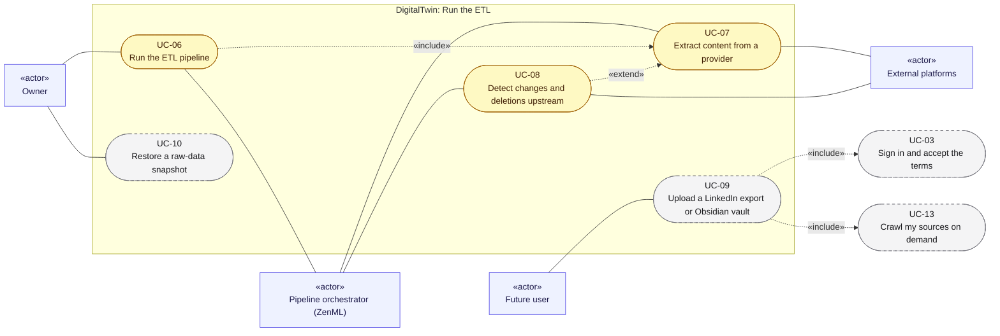

# Use cases 02: Run the ETL

[← Use cases](README.md) · [Hub](../README.md) · Previous: [Use cases 01](01_configure_and_register_sources.md) · Next: [Use cases 03](03_triggers_and_scheduling.md)

Collecting raw documents: the pipeline run ([UC-06](#uc-06-run-the-etl-pipeline)) includes the per-provider extraction ([UC-07](#uc-07-extract-content-from-a-provider)). Change and deletion detection ([UC-08](#uc-08-detect-changes-and-deletions-upstream)) extends extraction. Uploading exports ([UC-09](#uc-09-upload-a-linkedin-export-or-obsidian-vault)) and restoring snapshots ([UC-10](#uc-10-restore-a-raw-data-snapshot)) are side doors into the same store.

Legend: green = implemented · yellow = partially implemented · grey dashed = planned. `«include»` = always part of the flow; `«extend»` = optional add-on to it.

---

## UC-06. Run the ETL pipeline

| | |
|---|---|
| Primary actor | Owner |
| Secondary actors | Pipeline orchestrator (ZenML) |
| Status | Partially implemented · phase P0–P1 · Must |
| User stories | US-009, US-016, US-017, US-019, US-037, US-039, US-040, US-041, US-042, US-043 ([backlog](../user_stories/user_stories.md)) |
| Requirements | [ETL](../requirements/requirements.md#23-extraction-framework-etl) 002, 003, 007, 008, 009, 012 · [ORC](../requirements/requirements.md#26-orchestration-and-cli-orc) 001, 002, 003, 004, 006, 007, 008 · [REG](../requirements/requirements.md#22-source-registry-and-multi-user-reg) 007 · [STO](../requirements/requirements.md#25-raw-storage-sto) 001, 002, 003, 004 · [VER](../requirements/requirements.md#27-data-versioning-ver) 001, 002, 003 |
| Sequence diagrams | [SD-0](../sequence_diagrams/sd0_end_to_end.md), [SD-1](../sequence_diagrams/sd1_etl_pipeline_run.md) |
| Class diagrams | [5](../class_diagrams/05_orchestration.md), [4](../class_diagrams/04_raw_storage_and_versioning.md), [3a](../class_diagrams/03a_extraction_framework.md), [2a](../class_diagrams/02a_registry_core.md) |
| Includes | [UC-07](#uc-07-extract-content-from-a-provider) |

**Goal.** Collect raw documents from the selected sources, store them idempotently, and snapshot the result.

**Preconditions.** [UC-01](01_configure_and_register_sources.md#uc-01-declare-topics-and-sources-in-yaml) is done. MongoDB is reachable.

**Main flow.**
1. The owner runs `uv run python -m tools.run --etl`, optionally with `--user U` or `--source ID …`.
2. ZenML runs `digital_data_etl`. The first step is `sync_registry` ([UC-01](01_configure_and_register_sources.md#uc-01-declare-topics-and-sources-in-yaml), step 4).
3. `select_sources` picks all enabled sources, one user's subscriptions, or the given source ids.
4. For each provider, a crawl step runs `crawl_provider`, which runs the extractor ([UC-07](#uc-07-extract-content-from-a-provider)). It upserts documents in batches of 50 and records each source's crawl state.
5. `version_raw_data` exports deterministic JSONL, runs `dvc add`, and commits and pushes when enabled.
6. `summarize_crawl` reports per-provider summaries. The per-item `CrawlReport` is shown in the ZenML dashboard.

**Alternative flows.**
- 3a. Unknown user or source id: the run stops before any fetch.
- 3b. *(planned)* A requested source is disabled: it is reported as `skipped: disabled`, not dropped silently.
- 4a. A provider fails: the other providers still run, collected data is kept, and the run fails clearly at the end.
- 4b. *(planned)* Another run holds the lock on a source: that source is skipped.
- 5a. Versioning fails: the failure is reported, never raised mid-run.
- 6a. *(planned)* A `RunRecord` and a `ChangeSet` are saved for the run.

**Postconditions.** `raw_documents` and the source states are updated, and the snapshot (`data_md5`) identifies the data version.

---

## UC-07. Extract content from a provider

| | |
|---|---|
| Primary actor | Pipeline orchestrator (ZenML) |
| Secondary actors | External platforms |
| Status | Partially implemented · phase P0–P4 · Must |
| User stories | US-015, US-018, US-023, US-024, US-025, US-026, US-027, US-028, US-029, US-030, US-032, US-033, US-035, US-036 ([backlog](../user_stories/user_stories.md)) |
| Requirements | [ART](../requirements/requirements.md#articles-art) 001, 002, 003, 004, 005 · [ETL](../requirements/requirements.md#23-extraction-framework-etl) 001, 004, 005, 006 · [GH](../requirements/requirements.md#github-gh) 001, 002, 003, 004, 005, 006, 007 · [LI](../requirements/requirements.md#linkedin-li) 001, 002, 003 · [MED](../requirements/requirements.md#medium-med) 001, 002, 003, 004, 005, 006, 007, 008 · [OBS](../requirements/requirements.md#obsidian-obs) 001, 002, 003, 004, 006 |
| Sequence diagrams | [SD-2](../sequence_diagrams/sd2_medium_extraction.md) |
| Class diagrams | [3a](../class_diagrams/03a_extraction_framework.md), [3b](../class_diagrams/03b_providers_medium_and_github.md), [3c](../class_diagrams/03c_providers_linkedin_obsidian_and_articles.md) |

**Goal.** Turn each selected source into `RawDocument`s with provenance and a self/external origin, without breaking any platform's rules.

**Main flow.**
1. `BaseExtractor.extract()` opens a session (clients, or a browser only when needed).
2. For each source, the provider's `extract_source` fetches items:
   - Medium: official RSS only. Member-only stories are skipped.
   - GitHub: public repos, with file filters.
   - LinkedIn: the official data export.
   - Obsidian: the vault, with include/exclude rules and private notes left out.
   - Articles: by URL.
3. `make_document` builds each document with provenance (source, query, rank, run, time), origin and `owner_id`.
4. Documents stream back to `crawl_provider`. Topic caps (~100 per topic across runs) are enforced.

**Alternative flows.**
- 2a. An item-level problem: the item is marked failed or skipped with a reason, and the source continues.
- 2b. `SourceError`: that source fails, and the next one continues.
- 2c. Access blocked, an authentication failure or a rate limit: the provider aborts, and the remaining sources are marked not crawled.
- 2d. *(planned)* Unattended run: Medium never starts a browser and honours `Retry-After`.
- 2e. Interactive run (on hold): tag discovery uses a browser and falls back to RSS when challenged.

**Postconditions.** Every document follows the single `RawDocument` contract.

---

## UC-08. Detect changes and deletions upstream

| | |
|---|---|
| Primary actor | Pipeline orchestrator (ZenML) |
| Secondary actors | External platforms |
| Status | Partially implemented · phase P1–P2 · Must |
| User stories | US-013, US-020, US-021, US-022, US-038 ([backlog](../user_stories/user_stories.md)) |
| Requirements | [ETL](../requirements/requirements.md#23-extraction-framework-etl) 010, 011, 013 · [REG](../requirements/requirements.md#22-source-registry-and-multi-user-reg) 011, 014 · [STO](../requirements/requirements.md#25-raw-storage-sto) 005, 006, 007 |
| Sequence diagrams | [SD-3](../sequence_diagrams/sd3_trigger_incremental_etl.md) |
| Class diagrams | [2a](../class_diagrams/02a_registry_core.md), [3a](../class_diagrams/03a_extraction_framework.md), [4](../class_diagrams/04_raw_storage_and_versioning.md), [5](../class_diagrams/05_orchestration.md) |
| Extends | [UC-07](#uc-07-extract-content-from-a-provider) |

**Goal.** Re-runs skip unchanged content, and content deleted upstream is marked deleted, so frequent runs are cheap and the twin never answers from removed notes.

**Main flow.**
1. The extractor receives cursors and per-item fingerprints in its `CrawlContext`.
2. It skips sources and items whose change signal is unchanged (ETag, `pushed_at`, blob SHA, feed GUID, mtime or hash). They are reported as `skipped: unchanged`.
3. The store reports `UpsertStats` (inserted, changed, unchanged) and flags changed documents.
4. If the source was enumerated completely, missing documents are tombstoned.
5. The crawl state keeps the cursor, last success and `retry_not_before`.

**Alternative flows.**
- 4a. Incomplete enumeration (a feed, a truncated tree): no tombstones are inferred.
- 3a. Near-duplicates under different ids are grouped. Topic rules that changed are recomputed.

**Postconditions.** The run produces an exact change set: inserted, changed and tombstoned ids.

---

## UC-09. Upload a LinkedIn export or Obsidian vault

| | |
|---|---|
| Primary actor | Future user |
| Secondary actors | none |
| Status | Planned · phase P4 · Should |
| User stories | US-031, US-034 ([backlog](../user_stories/user_stories.md)) |
| Requirements | [LI](../requirements/requirements.md#linkedin-li) 004 · [OBS](../requirements/requirements.md#obsidian-obs) 005 |
| Sequence diagrams | none yet |
| Class diagrams | [10a](../class_diagrams/10a_ui_api_and_authentication.md), [3c](../class_diagrams/03c_providers_linkedin_obsidian_and_articles.md) |
| Includes | [UC-03](01_configure_and_register_sources.md#uc-03-sign-in-and-accept-the-terms), [UC-13](03_triggers_and_scheduling.md#uc-13-crawl-my-sources-on-demand) |

**Goal.** A user without shell access, or with a vault on another machine, still gets that content ingested.

**Preconditions.** [UC-03](01_configure_and_register_sources.md#uc-03-sign-in-and-accept-the-terms) is done.

**Main flow.**
1. The user uploads a LinkedIn export zip, or syncs or uploads a vault, in the UI.
2. The system validates the archive and stores it in the user's area.
3. The system registers or updates the matching owned source and triggers a crawl of it ([UC-13](03_triggers_and_scheduling.md#uc-13-crawl-my-sources-on-demand)).

**Alternative flows.**
- 2a. The archive is invalid or too large: it is refused with a reason.

**Postconditions.** The user's posts or notes are ingested as their own writing (`origin=self`).

---

## UC-10. Restore a raw-data snapshot

| | |
|---|---|
| Primary actor | Owner |
| Secondary actors | none |
| Status | Planned · phase P1 · Should |
| User stories | US-044 ([backlog](../user_stories/user_stories.md)) |
| Requirements | [VER](../requirements/requirements.md#27-data-versioning-ver) 006, 007 |
| Sequence diagrams | none yet |
| Class diagrams | [4](../class_diagrams/04_raw_storage_and_versioning.md), [5](../class_diagrams/05_orchestration.md) |

**Goal.** Rebuild the raw store from any snapshot version, for example after a disk failure or to reproduce an old run.

**Preconditions.** The snapshot was pushed to the DVC remote before its commit, off the working branch.

**Main flow.**
1. The owner runs the restore CLI with a snapshot reference (commit or `data_md5`).
2. `SnapshotRestorer` fetches the version from DVC.
3. It loads the documents and registry records into an empty database.

**Alternative flows.**
- 2a. The version isn't on the remote: the restore stops, and nothing is written.

**Postconditions.** The store matches the snapshot exactly.
