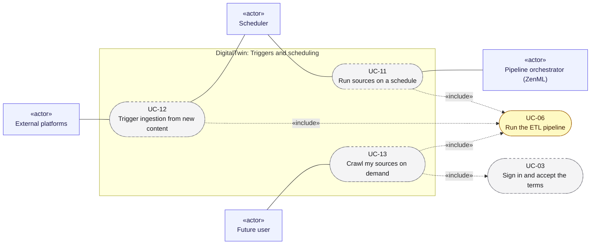

# Use cases 03: Triggers and scheduling

[← Use cases](README.md) · [Hub](../README.md) · Previous: [Use cases 02](02_run_etl.md) · Next: [Use cases 04](04_rag_chat_and_features.md)

Three ways to start the ETL without the owner typing `tools.run`: a cadence ([UC-11](#uc-11-run-sources-on-a-schedule)), new content upstream ([UC-12](#uc-12-trigger-ingestion-from-new-content)), and a user's "crawl now" button ([UC-13](#uc-13-crawl-my-sources-on-demand)). All three end in the same targeted ETL run ([UC-06](02_run_etl.md#uc-06-run-the-etl-pipeline)), behind locks and back-off.

Legend: green = implemented · yellow = partially implemented · grey dashed = planned. `«include»` = always part of the flow; `«extend»` = optional add-on to it.

---

## UC-11. Run sources on a schedule

| | |
|---|---|
| Primary actor | Scheduler |
| Secondary actors | Pipeline orchestrator (ZenML) |
| Status | Planned · phase P1 · Must |
| User stories | US-046, US-048 ([backlog](../user_stories/user_stories.md)) |
| Requirements | [TRG](../requirements/requirements.md#28-triggers-and-scheduling-trg) 002, 006, 008 |
| Sequence diagrams | [SD-3](../sequence_diagrams/sd3_trigger_incremental_etl.md) |
| Class diagrams | [6](../class_diagrams/06_triggers_and_scheduling.md), [5](../class_diagrams/05_orchestration.md) |
| Includes | [UC-06](02_run_etl.md#uc-06-run-the-etl-pipeline) |

**Goal.** Each provider runs on its configured cadence, unattended, so the twin stays current.

**Main flow.**
1. The `Scheduler` emits due `TriggerEvent`s for each provider's cadence.
2. The `Coalescer` groups events into one `TriggerBatch` per source per window.
3. The `BackoffGate` checks the source's `retry_not_before`.
4. The `TriggerDispatcher` acquires a lock and starts the ETL for those source ids, with `RunOptions(interactive=false)` ([UC-06](02_run_etl.md#uc-06-run-the-etl-pipeline)).
5. The event is updated with the run it was coalesced into and the run's status.

**Alternative flows.**
- 3a. The source is cooling down after a rate limit or blocked access: the event is deferred.
- 4a. The lock is held by another run: the event is skipped (`locked`).
- 5a. The run failed: a bounded retry with back-off (at most 3 attempts). After repeated failures the owner is alerted ([UC-24](06_admin_privacy_ops.md#uc-24-operate-and-monitor-the-system)).

**Postconditions.** Every trigger event is logged with its outcome.

---

## UC-12. Trigger ingestion from new content

| | |
|---|---|
| Primary actor | External platforms |
| Secondary actors | Scheduler |
| Status | Planned · phase P1–P4 · Must |
| User stories | US-047, US-050 ([backlog](../user_stories/user_stories.md)) |
| Requirements | [TRG](../requirements/requirements.md#28-triggers-and-scheduling-trg) 003, 004, 007 |
| Sequence diagrams | [SD-3](../sequence_diagrams/sd3_trigger_incremental_etl.md) |
| Class diagrams | [6](../class_diagrams/06_triggers_and_scheduling.md) |
| Includes | [UC-06](02_run_etl.md#uc-06-run-the-etl-pipeline) |

**Goal.** A new GitHub push, Medium post or vault edit reaches the twin within minutes, without a full run.

**Main flow.**
1. A poller (`GitHubPushPoller`, `MediumFeedPoller`, `VaultWatcher`) compares the platform's signal with the stored cursor.
2. On a change, it appends a `TriggerEvent` for that source only.
3. The flow continues as in [UC-11](#uc-11-run-sources-on-a-schedule) from step 2 (debounce, gate, lock, targeted ETL).
4. A non-empty change set triggers the feature pipeline ([UC-14](04_rag_chat_and_features.md#uc-14-build-and-update-the-search-index)).

**Alternative flows.**
- 1a. *(P4)* A platform webhook arrives instead. Its signature is verified and replays are rejected before it becomes an event.

**Postconditions.** Only the changed source is crawled.

---

## UC-13. Crawl my sources on demand

| | |
|---|---|
| Primary actor | Future user |
| Secondary actors | none |
| Status | Planned · phase P4 · Should |
| User stories | US-054 ([backlog](../user_stories/user_stories.md)) |
| Requirements | [UI](../requirements/requirements.md#29-source-registration-ui-and-api-ui) 004, 012 |
| Sequence diagrams | [SD-7](../sequence_diagrams/sd7_register_source_ui.md) |
| Class diagrams | [10a](../class_diagrams/10a_ui_api_and_authentication.md), [6](../class_diagrams/06_triggers_and_scheduling.md) |
| Includes | [UC-03](01_configure_and_register_sources.md#uc-03-sign-in-and-accept-the-terms), [UC-06](02_run_etl.md#uc-06-run-the-etl-pipeline) |

**Goal.** A user refreshes their twin now, within a rate limit and their quotas.

**Preconditions.** [UC-03](01_configure_and_register_sources.md#uc-03-sign-in-and-accept-the-terms) is done. The user is subscribed to the sources.

**Main flow.**
1. The user clicks "crawl now", which sends `POST /api/v1/crawls {source_ids}`.
2. `OnDemandCrawlService` checks the quota (one crawl per source per hour).
3. It dispatches a `TriggerBatch` of kind `manual` ([UC-11](#uc-11-run-sources-on-a-schedule) from the lock step) and answers 202 with the run id.

**Alternative flows.**
- 2a. Over quota, or the source is not the user's: the request is refused.

**Postconditions.** The run appears in the user's subscription status ([UC-05](01_configure_and_register_sources.md#uc-05-manage-subscriptions-and-see-crawl-status)).
