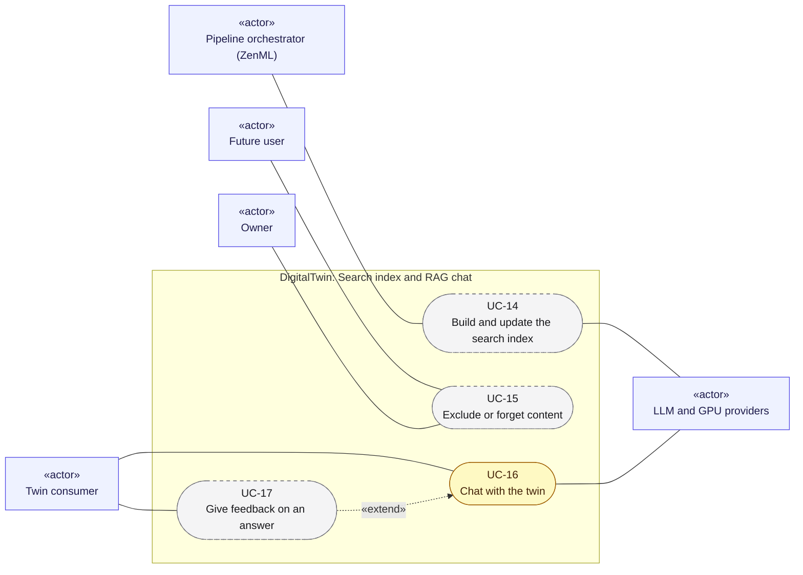

# Use cases 04: Search index and RAG chat

[← Use cases](README.md) · [Hub](../README.md) · Previous: [Use cases 03](03_triggers_and_scheduling.md) · Next: [Use cases 05](05_datasets_training_eval.md)

From raw documents to answers: the feature pipeline keeps the vector index exact ([UC-14](#uc-14-build-and-update-the-search-index)), and users can pull content out of it ([UC-15](#uc-15-exclude-or-forget-content)). Twin consumers chat with the twin ([UC-16](#uc-16-chat-with-the-twin)) and rate its answers ([UC-17](#uc-17-give-feedback-on-an-answer)).

Legend: green = implemented · yellow = partially implemented · grey dashed = planned. `«include»` = always part of the flow; `«extend»` = optional add-on to it.

---

## UC-14. Build and update the search index

| | |
|---|---|
| Primary actor | Pipeline orchestrator (ZenML) |
| Secondary actors | LLM and GPU providers |
| Status | Planned · phase P2 · Must |
| User stories | US-049, US-059, US-060, US-061, US-062, US-063, US-064, US-065 ([backlog](../user_stories/user_stories.md)) |
| Requirements | [FEA](../requirements/requirements.md#210-feature-pipeline-fea) 001, 002, 003, 004, 005, 006, 007, 008, 009, 010 · [ORC](../requirements/requirements.md#26-orchestration-and-cli-orc) 005 · [TRG](../requirements/requirements.md#28-triggers-and-scheduling-trg) 005 |
| Sequence diagrams | [SD-4](../sequence_diagrams/sd4_feature_pipeline.md) |
| Class diagrams | [7](../class_diagrams/07_feature_pipeline.md) |

**Goal.** New and changed documents become searchable, and removed ones disappear, by processing only the ETL change set.

**Preconditions.** An ETL run produced a non-empty `ChangeSet` ([UC-06](02_run_etl.md#uc-06-run-the-etl-pipeline), [UC-08](02_run_etl.md#uc-08-detect-changes-and-deletions-upstream)).

**Main flow.**
1. `FeatureRunTrigger` starts `feature_engineering(change_set_id)`.
2. Tombstoned ids: the cleaned documents are marked deleted and their vectors removed.
3. Inserted and changed ids are processed in order:
   1. clean with the versioned per-kind rules,
   2. pass the quality gate,
   3. mask secrets,
   4. group duplicates,
   5. store the cleaned documents with `Lineage`.
4. Chunk by kind (headings, code structure, whole posts). Chunks carry `owner_id`, `origin`, topics and deterministic point ids.
5. Estimate the embedding cost and check `BudgetGuard`. Then embed, upsert the vectors and delete stale point ids.

**Alternative flows.**
- 3a. Low quality: the document is quarantined with a reason.
- 5a. Over budget or over `max_usd`: the run aborts before embedding.
- 5b. Re-index (new model or chunker): build a new collection, then switch the alias.

**Postconditions.** The index matches the raw store. A second run on the same change set writes nothing.

---

## UC-15. Exclude or forget content

| | |
|---|---|
| Primary actor | Future user, Owner |
| Secondary actors | none |
| Status | Planned · phase P2–P4 · Must |
| User stories | US-056, US-066 ([backlog](../user_stories/user_stories.md)) |
| Requirements | [PRV](../requirements/requirements.md#216-privacy-and-data-subject-operations-prv) 006 · [UI](../requirements/requirements.md#29-source-registration-ui-and-api-ui) 006 |
| Sequence diagrams | none yet |
| Class diagrams | [10b](../class_diagrams/10b_governance_and_privacy_operations.md), [7](../class_diagrams/07_feature_pipeline.md), [10a](../class_diagrams/10a_ui_api_and_authentication.md) |

**Goal.** A user or the owner removes something from retrieval and/or future training, and sees what their twin was trained on.

**Main flow.**
1. The user marks a source, a document or a path glob as excluded (from crawl, retrieval and/or training) in the UI. The owner can run `tools.forget` instead.
2. The system stores an `Exclusion` in the registry.
3. The vectors of the excluded documents are deleted through `Purgeable`.
4. Later crawls skip the excluded content (`CrawlContext.exclusions`), and `TrainingDataSelector` never admits it.

**Alternative flows.**
- 1a. The user asks what the twin was trained on: the system lists the dataset versions and source documents of the user's production model.

**Postconditions.** The content is gone from search immediately and from the next dataset build.

---

## UC-16. Chat with the twin

| | |
|---|---|
| Primary actor | Twin consumer |
| Secondary actors | LLM and GPU providers |
| Status | Partially implemented · phase P2–P3 · Must |
| User stories | US-014, US-067, US-068, US-069, US-070, US-071, US-072 ([backlog](../user_stories/user_stories.md)) |
| Requirements | [INF](../requirements/requirements.md#214-rag-inference-service-inf) 001, 002, 003, 004, 005, 006, 007, 008 · [REG](../requirements/requirements.md#22-source-registry-and-multi-user-reg) 010 |
| Sequence diagrams | [SD-5](../sequence_diagrams/sd5_rag_chat.md) |
| Class diagrams | [9](../class_diagrams/09_llm_clients_inference_and_llmops.md), [7](../class_diagrams/07_feature_pipeline.md) |

**Goal.** A twin consumer asks a question and gets an answer in the owner's voice, with cited sources and an AI disclosure.

**Main flow.**
1. The consumer sends `POST /api/v1/twins/{user_id}/chat` with a query and history.
2. The API authenticates the token and applies the rate limit.
3. `Retriever`:
   1. expands the query,
   2. extracts topic and kind filters,
   3. builds the user's filter through `OwnerScope` (the user's own content plus shared external, not deleted),
   4. searches,
   5. reranks.
4. `TwinService` renders the versioned prompt with the chunks as untrusted context.
5. `ModelResolver` picks the user's production adapter, or the base model as a fallback.
6. After a budget check, the LLM generates the answer (streamed if requested). Only citations of retrieved chunks are kept.
7. The request is traced (prompt version, chunk ids, model version, latency, tokens, cost), and the answer is returned with its sources and the AI disclosure.

**Alternative flows.**
- 2a. Over the rate limit: 429. Invalid token: 401. Another user's twin (P4): 403.
- 3a. Every score is below the relevance threshold: an "I don't know" answer with no citations.
- 6a. Daily spend cap reached: 503 `budget_exhausted`.

**Postconditions.** A trace exists for the request. No other user's own content was retrieved.

---

## UC-17. Give feedback on an answer

| | |
|---|---|
| Primary actor | Twin consumer |
| Secondary actors | none |
| Status | Planned · phase P4 · Could |
| User stories | US-091 ([backlog](../user_stories/user_stories.md)) |
| Requirements | [OPS](../requirements/requirements.md#215-llmops-monitoring-cicd-deployment-ops) 007 |
| Sequence diagrams | [SD-5](../sequence_diagrams/sd5_rag_chat.md) |
| Class diagrams | [9](../class_diagrams/09_llm_clients_inference_and_llmops.md) |
| Extends | [UC-16](#uc-16-chat-with-the-twin) |

**Goal.** Consumers rate or correct answers, so the twin can improve.

**Main flow.**
1. After an answer ([UC-16](#uc-16-chat-with-the-twin)), the consumer gives a thumbs up or down, or a correction, on its `trace_id`.
2. The system records the `Feedback` with the trace.

**Postconditions.** The feedback is available to monitoring ([UC-24](06_admin_privacy_ops.md#uc-24-operate-and-monitor-the-system)) and to future datasets.
