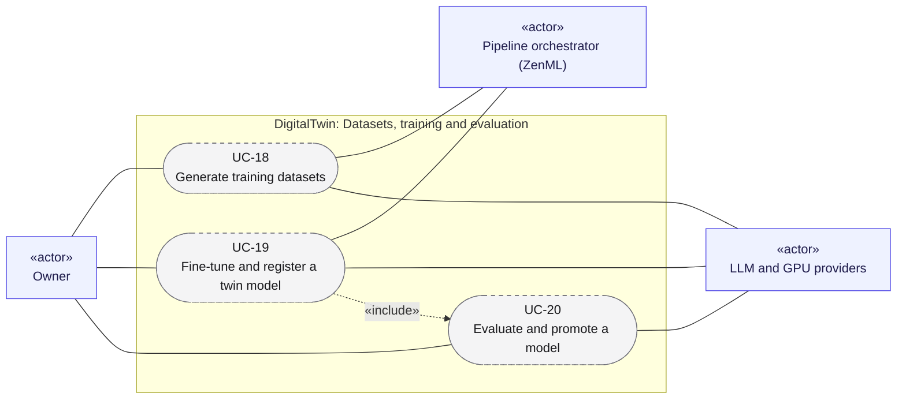

# Use cases 05: Datasets, training and evaluation

[← Use cases](README.md) · [Hub](../README.md) · Previous: [Use cases 04](04_rag_chat_and_features.md) · Next: [Use cases 06](06_admin_privacy_ops.md)

Making the twin sound like its owner: build datasets from writing that is really theirs ([UC-18](#uc-18-generate-training-datasets)), fine-tune and register a model ([UC-19](#uc-19-fine-tune-and-register-a-twin-model)), and promote it only if it beats production ([UC-20](#uc-20-evaluate-and-promote-a-model)).

Legend: green = implemented · yellow = partially implemented · grey dashed = planned. `«include»` = always part of the flow; `«extend»` = optional add-on to it.

---

## UC-18. Generate training datasets

| | |
|---|---|
| Primary actor | Owner |
| Secondary actors | Pipeline orchestrator (ZenML), LLM and GPU providers |
| Status | Planned · phase P3 · Must |
| User stories | US-073, US-074, US-075, US-076, US-094 ([backlog](../user_stories/user_stories.md)) |
| Requirements | [DS](../requirements/requirements.md#211-dataset-generation-ds) 001, 002, 003, 004, 005, 006, 007, 008, 010 · [PRV](../requirements/requirements.md#216-privacy-and-data-subject-operations-prv) 004 · [VER](../requirements/requirements.md#27-data-versioning-ver) 005 |
| Sequence diagrams | [SD-6](../sequence_diagrams/sd6_datasets_training_eval.md) |
| Class diagrams | [8a](../class_diagrams/08a_dataset_generation.md) |

**Goal.** Versioned instruction and preference datasets built from the owner's style-eligible writing, plus external content whose licence allows it, within a cost cap.

**Preconditions.** Cleaned documents exist ([UC-14](04_rag_chat_and_features.md#uc-14-build-and-update-the-search-index)).

**Main flow.**
1. The owner runs `generate_datasets(owner_id, cleaned_version)`.
2. `TrainingDataSelector` admits only style-eligible `self` documents and licensed external documents, and honours exclusions ([UC-15](04_rag_chat_and_features.md#uc-15-exclude-or-forget-content)).
3. `NerRedactor` replaces third-party PII with typed placeholders.
4. After a budget check, `SampleGenerator` creates instruction and preference samples with an LLM.
5. The filter chain removes duplicates, length outliers and unfaithful samples, and `DocumentSplitter` splits train and test by source document.
6. `DatasetStore` publishes an immutable `DatasetVersion` with a dataset card and `Lineage`.

**Alternative flows.**
- 4a. Over budget: generation stops before any paid call.

**Postconditions.** `dataset@vN` exists, and its card lists its sources, licences and filter report.

---

## UC-19. Fine-tune and register a twin model

| | |
|---|---|
| Primary actor | Owner |
| Secondary actors | Pipeline orchestrator (ZenML), LLM and GPU providers |
| Status | Planned · phase P3–P4 · Must |
| User stories | US-077, US-078, US-079 ([backlog](../user_stories/user_stories.md)) |
| Requirements | [FT](../requirements/requirements.md#212-fine-tuning-ft) 001, 002, 003, 004, 005, 006 · [VER](../requirements/requirements.md#27-data-versioning-ver) 004 |
| Sequence diagrams | [SD-6](../sequence_diagrams/sd6_datasets_training_eval.md) |
| Class diagrams | [8b](../class_diagrams/08b_training_model_registry_and_evaluation.md) |
| Includes | [UC-20](#uc-20-evaluate-and-promote-a-model) |

**Goal.** An open-weight model adapted to the owner (SFT, then DPO) on bounded compute, registered with full lineage.

**Preconditions.** A dataset version from [UC-18](#uc-18-generate-training-datasets).

**Main flow.**
1. The owner runs `training(owner_id, dataset@vN, TrainingConfig)`.
2. `DatasetQualityGate` checks the minimum size and removal rate. `OwnerScope.assert_all` checks that every sample belongs to the owner or is shared.
3. After a budget check, SFT runs on the `ComputeBackend`, which cancels at `max_hours` or `max_usd`. The result is registered as a `ModelVersion`.
4. DPO runs with the SFT model as its parent and is registered too.
5. The candidate is evaluated and promoted or not ([UC-20](#uc-20-evaluate-and-promote-a-model)).

**Alternative flows.**
- 2a. A gate or the isolation check fails: refused, and no GPU time is spent.

**Postconditions.** The model registry holds the candidates. Each can be rebuilt from its recorded inputs.

---

## UC-20. Evaluate and promote a model

| | |
|---|---|
| Primary actor | Owner |
| Secondary actors | LLM and GPU providers |
| Status | Planned · phase P2–P3 · Must |
| User stories | US-080, US-081, US-082, US-083 ([backlog](../user_stories/user_stories.md)) |
| Requirements | [DS](../requirements/requirements.md#211-dataset-generation-ds) 009 · [EVAL](../requirements/requirements.md#213-evaluation-eval) 001, 002, 003, 004, 005 |
| Sequence diagrams | [SD-6](../sequence_diagrams/sd6_datasets_training_eval.md) |
| Class diagrams | [8b](../class_diagrams/08b_training_model_registry_and_evaluation.md) |

**Goal.** Only models that beat production on quality and pass the safety checks reach the twin.

**Main flow.**
1. The evaluators run the candidate on the held-out split and on the owner-approved `EvalSet`, which is never used for training. They measure style, relevance and faithfulness, check for benchmark regressions and run safety red-team checks (privacy refusal, prompt injection, AI disclosure).
2. The `EvalReport` records each metric with a 95% confidence interval.
3. `PromotionGate` compares the candidate's report with production's.
4. The candidate passes every threshold and is tagged `production`.

**Alternative flows.**
- 4a. It fails any threshold: it is tagged `staging` only.
- 1a. RAG evaluation (P2): retrieval and generation are evaluated on a curated question set per topic, without a new model.

**Postconditions.** The production tag always points at the best evaluated model.
