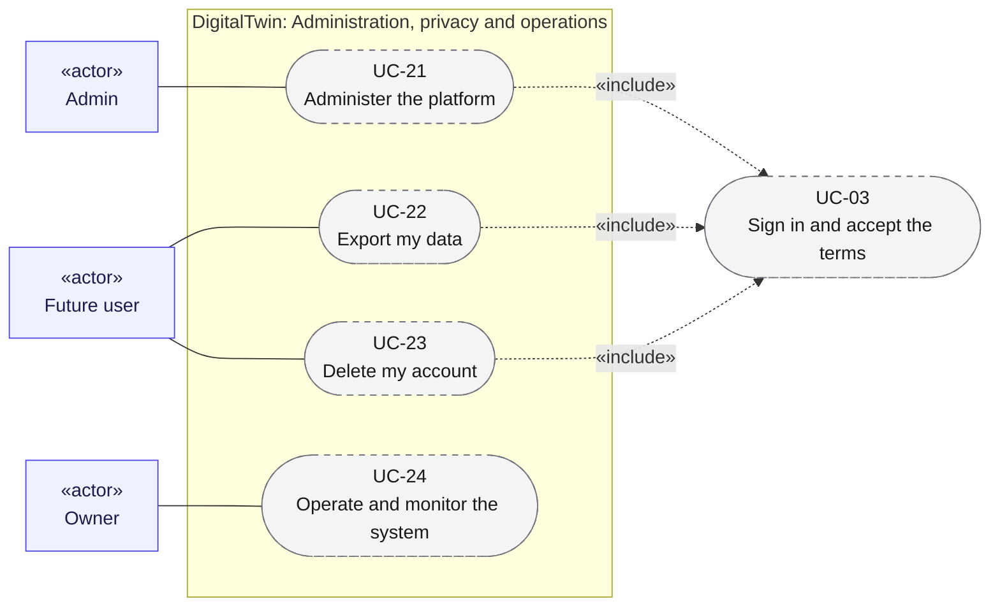

# Use cases 06: Administration, privacy and operations

[← Use cases](README.md) · [Hub](../README.md) · Previous: [Use cases 05](05_datasets_training_eval.md)

Keeping the platform healthy and fair ([UC-21](#uc-21-administer-the-platform)), honouring data-subject rights ([UC-22](#uc-22-export-my-data), [UC-23](#uc-23-delete-my-account)), and operating the system safely ([UC-24](#uc-24-operate-and-monitor-the-system)).

Legend: green = implemented · yellow = partially implemented · grey dashed = planned. `«include»` = always part of the flow; `«extend»` = optional add-on to it.

---

## UC-21. Administer the platform

| | |
|---|---|
| Primary actor | Admin |
| Secondary actors | none |
| Status | Planned · phase P4 · Should |
| User stories | US-057 ([backlog](../user_stories/user_stories.md)) |
| Requirements | [UI](../requirements/requirements.md#29-source-registration-ui-and-api-ui) 007, 012 |
| Sequence diagrams | none yet |
| Class diagrams | [10a](../class_diagrams/10a_ui_api_and_authentication.md) |
| Includes | [UC-03](01_configure_and_register_sources.md#uc-03-sign-in-and-accept-the-terms) |

**Goal.** The admin, initially the owner, keeps the platform healthy and fair as users join.

**Main flow.**
1. The admin signs in with the admin role ([UC-03](01_configure_and_register_sources.md#uc-03-sign-in-and-accept-the-terms)).
2. The admin manages users and invites, global topics, provider settings and per-user quotas.
3. The admin disables abusive or broken sources globally, and handles deletion requests ([UC-23](#uc-23-delete-my-account)).

**Postconditions.** Changes are audited, and disabled sources are never selected.

---

## UC-22. Export my data

| | |
|---|---|
| Primary actor | Future user |
| Secondary actors | none |
| Status | Planned · phase P4 · Should |
| User stories | US-092 ([backlog](../user_stories/user_stories.md)) |
| Requirements | [PRV](../requirements/requirements.md#216-privacy-and-data-subject-operations-prv) 001 |
| Sequence diagrams | none yet |
| Class diagrams | [10b](../class_diagrams/10b_governance_and_privacy_operations.md) |
| Includes | [UC-03](01_configure_and_register_sources.md#uc-03-sign-in-and-accept-the-terms) |

**Goal.** A user sees and takes everything the system holds about them.

**Main flow.**
1. The user requests an export.
2. The system collects every record scoped to the user (`OwnerScope`): their profile, subscriptions, own documents, datasets, model versions and traces.
3. The system delivers an archive.

**Postconditions.** The export covers every `Purgeable` store.

---

## UC-23. Delete my account

| | |
|---|---|
| Primary actor | Future user |
| Secondary actors | none |
| Status | Planned · phase P4 · Must |
| User stories | US-045, US-093, US-095 ([backlog](../user_stories/user_stories.md)) |
| Requirements | [PRV](../requirements/requirements.md#216-privacy-and-data-subject-operations-prv) 002, 005 · [VER](../requirements/requirements.md#27-data-versioning-ver) 008 |
| Sequence diagrams | [SD-8](../sequence_diagrams/sd8_account_deletion.md) |
| Class diagrams | [10b](../class_diagrams/10b_governance_and_privacy_operations.md), [4](../class_diagrams/04_raw_storage_and_versioning.md) |
| Includes | [UC-03](01_configure_and_register_sources.md#uc-03-sign-in-and-accept-the-terms) |

**Goal.** Leaving the platform removes every trace of the user's data, including what reached the models.

**Main flow.**
1. The user re-authenticates and sends `DELETE /api/v1/me`.
2. `AccountDeletionService` disables the user, so no new runs select their sources.
3. Every store is purged by `PurgeScope(owner_id=user)`: vectors, cleaned and raw documents, datasets, the user's adapters, traces and registry records.
4. The user's snapshot partition (`data/raw/users/<id>/`) is left out of the next snapshot.
5. `TaintTracker` tags shared models trained on the user's documents as tainted, to be retrained or retired within 30 days.
6. A `DeletionLog` records completion, and the API answers 202.

**Alternative flows.**
- 3a. A store fails: the log records an incomplete deletion and the failed stores, and the purge is retried within 7 days.

**Postconditions.** No store holds the user's data. Past snapshots follow the policy decided in OQ-06.

---

## UC-24. Operate and monitor the system

| | |
|---|---|
| Primary actor | Owner |
| Secondary actors | none |
| Status | Planned · phase P1–P4 · Must |
| User stories | US-084, US-085, US-086, US-087, US-088, US-089, US-090 ([backlog](../user_stories/user_stories.md)) |
| Requirements | [OPS](../requirements/requirements.md#215-llmops-monitoring-cicd-deployment-ops) 001, 002, 003, 004, 005, 006, 008, 009 |
| Sequence diagrams | none yet |
| Class diagrams | [9](../class_diagrams/09_llm_clients_inference_and_llmops.md), [5](../class_diagrams/05_orchestration.md) |

**Goal.** The owner releases safely, notices problems early and never overspends.

**Main flow.**
1. CI runs lint, type checks, tests, config validation and secret and dependency scans on every push.
2. The inference service is deployed as a container through staging and then production, with one-step rollback.
3. Scheduled backups of Mongo and the vector DB run, and restores are tested.
4. Every inference request is traced. All spend is metered against monthly budgets, with a hard stop.
5. Dashboards and alerts cover provider failures, sources failing several runs in a row, errors, latency, cost, empty retrievals and quality drift.

**Alternative flows.**
- 2a. A release degrades production: roll back in one step.
- 4a. The budget is exhausted: paid calls stop (see [UC-14](04_rag_chat_and_features.md#uc-14-build-and-update-the-search-index), [UC-16](04_rag_chat_and_features.md#uc-16-chat-with-the-twin), [UC-18](05_datasets_training_eval.md#uc-18-generate-training-datasets), [UC-19](05_datasets_training_eval.md#uc-19-fine-tune-and-register-a-twin-model)).

**Postconditions.** Every release, run and request leaves a trace.
